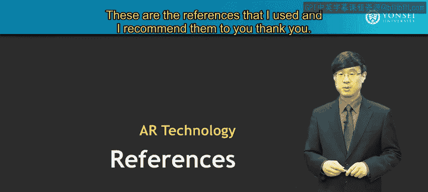

# 延世大学《新兴技术从智能手机到物联网再到大数据Emerging Technologies From Smartphone to IoT to Big Data》 - P133：10_2.4 AR特征提取.zh_en - GPT中英字幕课程资源 - BV18hpFewEcG

Auggamented reality feature extraction is the topic that we will study about。

Starting off with this example， among the sequence of operations that need to be done。

 feature extraction was this right here， which from the acquisition image that came in achieving it into a way such that our interest points are detected in a way that our feature is extracted and you can see that the red circles on top of this image。

Are around the specific domain of the object that we are interested about。

This process has many requirements， as well as is very complicated。

And that is why we will study about it over here in this domain。

Now let's look into the details of this right here based upon surf technology。

 and you can see now that there are six steps within feature extraction。

 starting off with gray scale image generation。Then there is integral image generation。

Followed by response map generation。Then we arrive at the interest point。

 the interest point detection。Arriving here is a big accomplishment itself。 However。

 it is not complete because。You need to do orientation assignment just because you've identified interest points is not sufficient。

The orientation assignment is followed by the descriptor extraction。

And these are the six steps that we will look into。Based upon that。

Grayscale image generation is the first step。 The original image captured by the air device is changed into grayscale values in order to make it robust to color modifications。

 because the color can change based upon what color the lightning is In other words。

 even in this room， if we were to make one of these light bulbs that are shining on me in blue。

 I would look blue， if these were changed to green， I would look green if these were changed to red。

 I would look reddish。😊，So therefore， light can be changed that will influence it。

 and in order to make it robust to color modifications。

 which are highly influential from the light sources， we choose grayscale technology。

The next step is the integral image generation， which is a process of building an integral image from the grayscale image。

 This procedure enables fast calculation of summations over image subregions。😊。

Which is followed by the response map generation step。In order to detect Is interest points。

 we are getting there， and this is a stage right before interest point detection in order to detect the interest points using the determinants of the image Hessian matrix。

The RMG process， response map generation process constructs the scale space of the image。

Then using this， we can go into interest point detection。Based on the generated scale response maps。

 the maximum and minimum。These are the extrems， these are detected and used as the interest points。

There is much more details to this in the following lecture where I will go over。

Images as well as show you what the actual process is in addition to concepts such as the Hessian and other scale space information。

 so hang in there， I'm going to do the overall view in this lecture and the details in the next lecture。

The fifth step is the orientation assignment， each detected interest point is assigned a reproducible orientation to provide rotation invariance。

Invariance to image rotation， Why is that necessary， Once again， this is not a still image。

 This is not a fixed video。 This is live vision view of a human being。And when I look at an object。

 I'm not going to stay the same。 I'm going to move around as I need to do whatever I want to do。

 So therefore， every moment， when I'm seeing an object in my view， that is going to change。

And you know that when I turn my head or bend my knees。

 the view that comes into my vision can be extremely changed。Therefore。

 looking at a certain object from a different point of view will change the orientation。

 and therefore I need to have this such that the rotation invariance is included into my detection mechanism。

Because what if I'm looking at it from a certain angle and the information shows。

 but then when I slightly move， it cannot detect it anymore。

 although the object is right in front of me。Therefore。

 I need rotation invariance and techniques that can support this。

Then there's the descriptor extraction。This is a process of uniquely identifying an interest point such that it distinguishes from other interest points once again。

 when we do interest point detection， a lot of interest points are going to show up and some of them may not be related to a certain object that comes in my view because my view may have several objects so therefore I need to focus on some interest points that form that belong to that are on the surrounding of a certain object and these interest points need to be linked together such that they are identifying a certain object and that objects feature is extracted。

😊，And that's the process of what we're doing。Finding the interest points of the image， the video。

 detecting the descriptors from interest points and comparing the descriptors with the data in the database。

😊，Is what we need to do， for example， the original image。A gray skill。Followed by interest points。

 and then the descriptors。Combining them together， we are identifying an object。

 This is a result of the descriptor process based upon feature extraction done in my lab off of a real object。

😊，Of one of the tables， we put a can there and we did the process and as you can see these image processing mechanisms that are being used by augmented reality go through this process to identify the descriptors that we result in。

 and this is what the feature extraction process is about。Feature extraction。

 qualification for descriptors。 Well， we need them to be able to do this。

Even with noise factors influencing them because there will be noise factors， scale。

 if we look at it close， magnified， or if we look at it from a far view angle。

 the scale will change the rotation of course， the angle of view will change and the object will be as if it's rotating so we need to have invariability disregarding these factors。

What type of descriptors can we use， There can be corner， blob or region。

 and we'll see some examples of where blob or corner or region are used in the details of the various。

Feature extraction techniques， which we will go in detail。Blob detection， well。

 we've already seen this image， and it is based on blob detection results in which this technique uses laplaian of Gaussian。

 LOG。And this is based on a Heian matrix process， which uses a second order derivative。

And this is the determinant of H， which is called a hessia。

 and then the trace of H is called the Laplaceia。Why are we using these terminologies What do they do I'll give you more details in the following lecture in the following module in which we will compare six of the most popular feature extraction and feature description techniques that exist and are used in all augmented reality devices so in the following lecture you'll see some details on this so for now I'll go and skip。

The blob detection is a process of detecting blobs in an image。 What's a blob。

 A blob is a region of an image that has constant image properties。Okay， in some cases。

 it may not be exactly constant， or maybe it'll just be approximately constant。

 so there will be a threshold on how constant it needs to be and if it comes within that range。

 then it will qualify as a blob and we can use it in augmented reality。Feature extraction。

All points in the blob are considered to be similar to each other and that's why we grouped them up and in the example where we saw the flowers we use circles to represent them。

 of course in some cases we will use a square to a rectangular or a square on top of it。

 but in the example that we saw in the former page。

 those were flowers and the circles were well fittingtting。😊。

These image properties related to brightness， color。

 and other properties are used in the comparison process to the surrounding regions to identify a certain property。

 which is a blob。Some typical feature extraction techniques include。Har feature。Sft。Hg， surf。

And orRB， and there's others as well， which I will go over in the following lecture modules。

These are the references that I use， and I recommend them to you。 Thank you。

