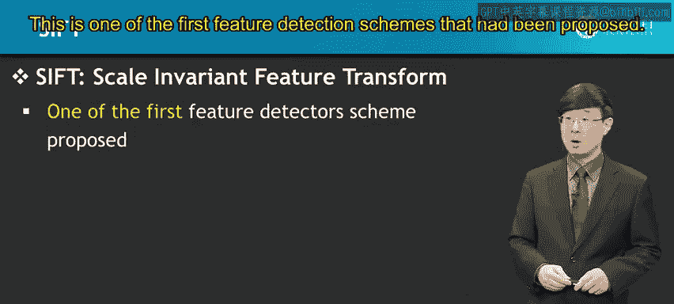
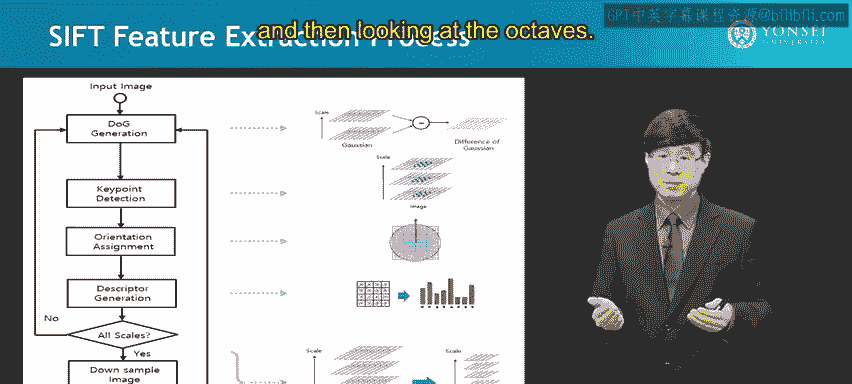
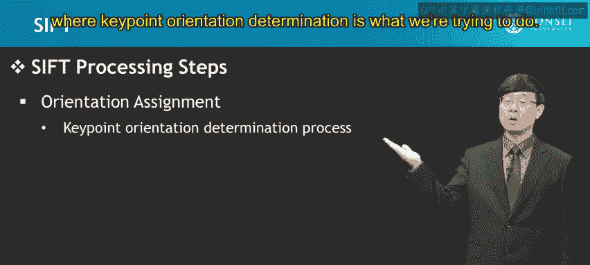
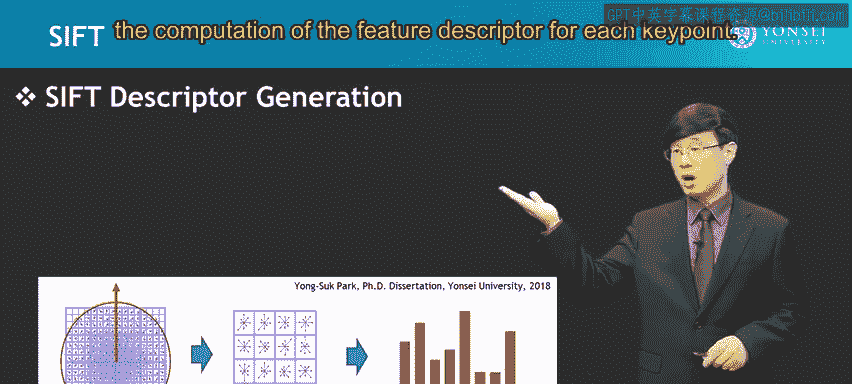
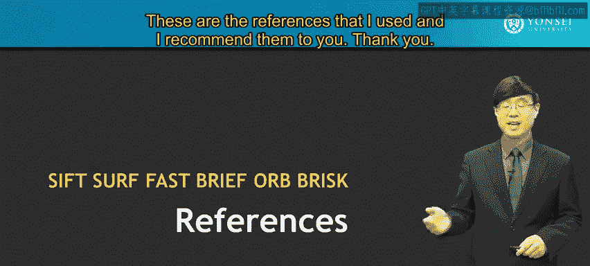

# 延世大学《新兴技术从智能手机到物联网再到大数据Emerging Technologies From Smartphone to IoT to Big Data》 - P135：12_3.2 SIFT算法.zh_en - GPT中英字幕课程资源 - BV18hpFewEcG

Yeah。We will start with Sift。And in SiF， this stands for scale Ivariant feature transformform。

This is one of the first feature detection schemes that had been proposed。

It uses image transformations in the feature detection matching process。

SF characteristics include that it's highly accurate， which is wonderful， however。

 the large computation complexity limits the use in real time applications， and this is an issue。

Looking at the process that you see right here。The table that you saw in the former lecture as well as the figures that I'm showing you right here are from the PhD dissertation at Ys University of Dr。

 Yongsk Park， who is my grad student， and we work together in this research for several years and I proudly am showing you some of the results that were accomplished and are shown in his PhD dissertation I'm very proud of my grad students that are doing research with me and had doing research with me together in the past to accomplish new technologies。

😊，So I'm using this proudly， and here we go。In the overall sift feature。

 you can see the dog generation on the top dog stands for this。Right here。

 and we will talk about this in the following page。It's based on Gaussian techniques。

 and we are extracting the differences of this。And after that process goes into key point detection mechanisms。

As you can see here， the key points are based upon these different levels of an image based on different scales that are produced and finding maximumimal or minimum points。

 the extrema points。This follows by orientation assignment techniques， which you see uses this。

 which I will show you soon in further details， and then there's descriptor generation techniques。

Then it goes down into down sample of the image and then looking at the octops。

And you will see about the details of this。In the following page。Difference of Gausian generation。

 dog generation。Build a scale space using an approximation based on dog techniques。

So if you look at Sift and the following surf， scale space is used as the core technology to start the augmented reality process。

Local extrema of the dog images at varying scales are selected as interest points these local extrema。

 what is a extrema， a local is within an image there are local ranges that you can divide it into based on characteristics of the image then in each image there are extreme points which are the extres as in terms of being either a maximum or a minimum point in that local range that's what we mean by local extrema and these will be the key points that we are looking for using the dog images at various scales。

And these will become our interest points。Dog images are produced by image convolving or blurring with Gaussians at each octop of the scale space in the Gausian pyramid。

So we are going to use the scale space and Gaussian pyramid in which in the scale space we have。

Abstract scale space and coming down to the full scale space， stacking them up。

 it will look like a pyramid of images。Based upon Gaussian processing。

And the processing is involving convolution or blurring techniques。And these Gausian images。

 based on the number of octops， is downsampled after each iteration。Why use DOG， What is this doing。

 Well， a DOG is a L G lap plaian of Gaussian approximation method。

So what we're really saying is that we would want to use a Laplaceian of Gaussian。

 but instead of that we're using a simpler， less computation burdening DOG technique。

A lap Plaian of Gaussian， Why do you want to use a lapplaceian， What is the benefit of it。

 Hang in there， I'll explain it Su。DG has low computation complexity compared to LOG。In addition。

 DOG does not need partial derivative computation like LOG does。So automatically from this statement。

 you see that。LOG is very computation burdening， and it is computation burdening because it uses partial derivatives。

😊，DG obtains local extrema of images with difference of Gausian techniques。Interest point detection。

 classical methods。Commonly used LO G technology， LO G is a very popular approach to use it because in interest point detection。

 LO G is scale imvariant when it is applied to multiple image scales。

The characteristics of a Gaussian， scale space pyramid and kernel techniques are frequently used。

 and this is just a conceptual example of a pyramid of images at different levels。😊。

This is not exactly what you will see as a result， however。

 it gives you an idea of what you mean by a pyramid of images at different scales。😊。

Approxiation of La Plaian of Gaussian， what is the lapplaceian process doing？

It is a differential operator of a function on Euclidean space once again remember that sift and surf are based upon the Euclidean space。

 the Euclidean distance， where the other algorithms that were faster and more appropriate for real time were based on the heming distance because they are based on binary operations。

Here this scheme has a second order Gaussian scale space derivative based process。

 and this here is sensitive to noise and requires a lot of computation。

This is one of the reasons that we want to avoid the Laplaceian process。

 and that is why we want to have approximation methods。

 and that is why DOG technology is used instead of LOG technology in Sift。

Sifft processing steps include the key point detection。

 where key point localization process is conducted。

Each pixel in the dog image is compared to its neighboring pixels。

So each pixel is compared with its neighboring pixel。

 so that's what it means by a localization process What are you trying to do。

 you're trying to do key point detection。Comparison is processed on the current scale and two scales above and two scales below。

 and that is where the comparison process is conducted why to find key points。

Candidate key points are pixels that are local maximums or minimums。

 the extrema points are the candidate key points。And a final set of key points will exclude low contrast points because if you're a low contrast point。

 you may have error inside， you may not be accurate。

 so even though the value is a maximum or minimum in its local range， if the contrast is low。

 you may not want to use it because it may be faulty。

Then we have the orientation assignment procedure。Where key point orientation determination is what we're trying to do Or of a key point is the local image gradient histogram in the neighborhood of the key point。

What is the gradient doing， the gradient is showing you the rate of change。

The histogram is a structure in which it's a graphical technique that shows you where the amount of change is largest and smallest。

So therefore， looking into this， we can find the orientation of a key point based upon gradient histogram techniques in which。

The peaks in the histogram， the grade and histogram， are selected as the dominant orientations。

 because that's where the most changes are detected。

 How are they detected using the gradient technique。

The Sift descriptor generation is based on the computation of the feature descriptor for each key point。

And the feature descriptor consists of 128 orientation histograms。In the figure below。

 you can see the image gradients， the key point descriptors。

 and the 128 features for one key point as a sequence of this operation that is used in Sift。

These are the references that I use， and I recommend them to you， Thank you。

