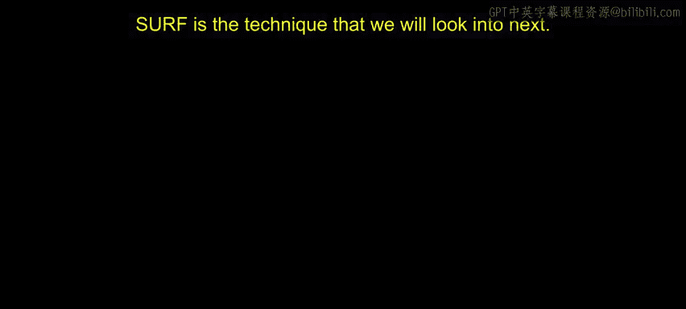
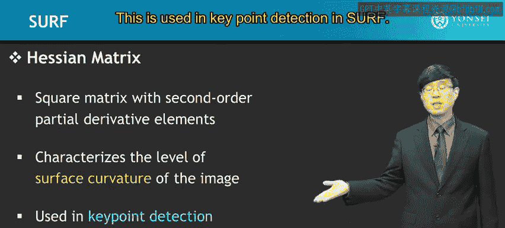
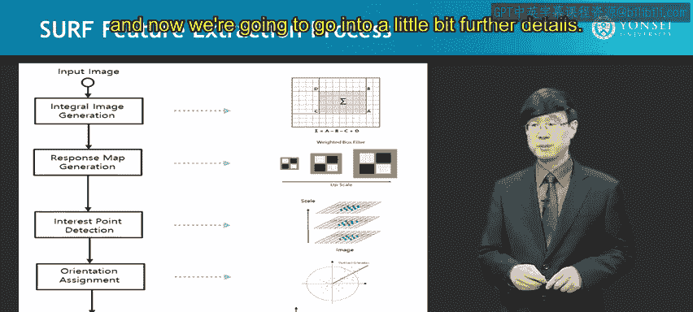
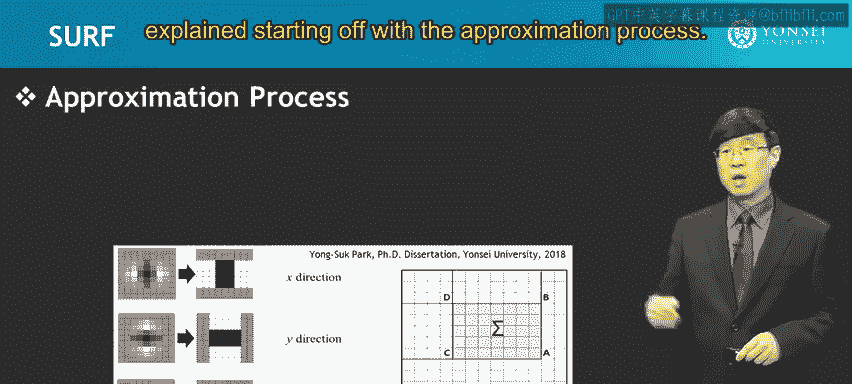
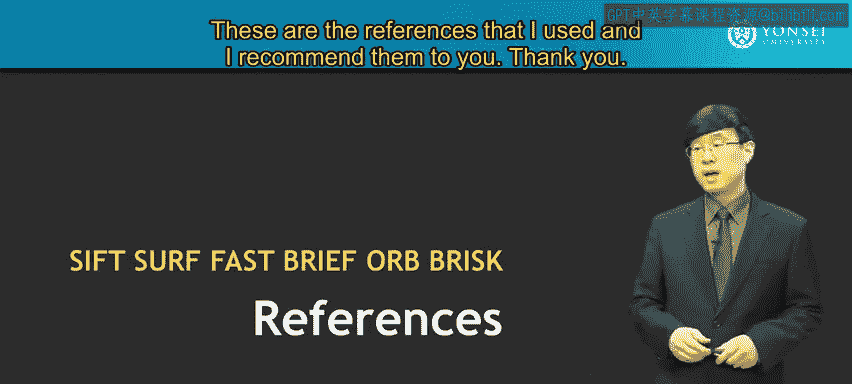

# 延世大学《新兴技术从智能手机到物联网再到大数据Emerging Technologies From Smartphone to IoT to Big Data》 - P136：13_3.3 SURF算法.zh_en - GPT中英字幕课程资源 - BV18hpFewEcG

Surf is the technique that we will look into next。Surf is speed Up robust feature。

And this is an approximation technique that is used to get faster and very similarly accurate levels of processing in interest point detection compared to Sift。

So Sift has good performance， yet it is slow because of the heavy computation。

And we want to get near sift performance， but at much faster rates。And that is why surf was made。

Sf will use the DOH， the determinant of Hessian matrix in its process。

 This is used in the interest point detection mechanism。

It will also use box filters in approximating the DOH process。In other words。

 the HessM matrix process will be approximated using box filtering。The Hessian matrix， what is this？

This is a square matrix with second order partial derivative elements。

 so there is the partial derivative processing that is needed in this matrix。😊。

This characterizes the level of surface curvature of an image， and therefore it is very important。

This is used in key point detection in Ser。

Looking at the surf operation， there is integral image generation， response map generation。

 interest point detection， orientation assignment and descriptor extraction in the former lecture we've already went through these processes because the overall feature extraction and feature detection mechanism I based it upon surf。

😊，And now we're going to go into a little bit further details。

As you can see， the details over here are explained。

Starting off with the approximation process。This approximates the S DOG with box filtering。

The square box filters are used for approximation instead of using the Gausian averaging of the image。

 and you can see the x direction Y direction， X Y direction mechanism here。😊，Where in this example。

 the box filters of an integral image used in surf are shown。 This here enables fast approximation。😊。

And box area calculation， as you can see right here， to generate what the integral image。

Inegral image generation。Integal images are used for fast convolation computation。

Multiple parallel processing box filtering techniques on different scale images are used to approximate the LG process。

Interest point detection will use Hessian matrix based on blob detection in the IPD process。

The feature descriptor scheme is based on interest points where the neighboring pixels of the interest points are divided into subregions。

Serf to Scor describes the pixelix intensity distribution based on a scale independent neighborhood。

Where each subreg's wavelelet response is then used。

These are the references that I use， and I recommend them to you。 Thank you。

