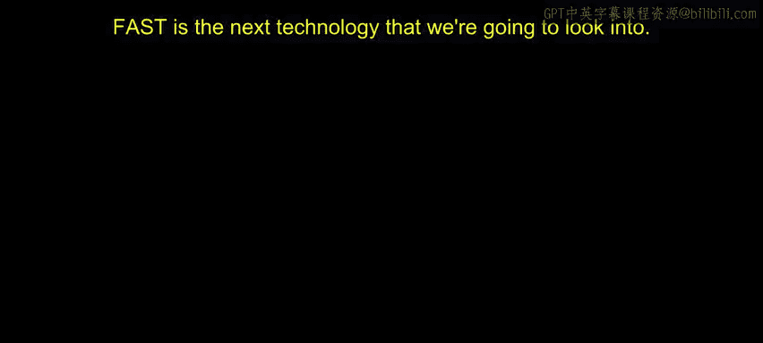
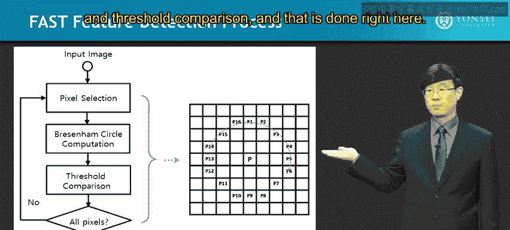
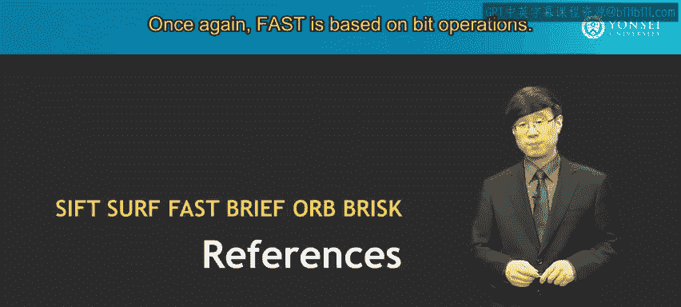

# 延世大学《新兴技术从智能手机到物联网再到大数据Emerging Technologies From Smartphone to IoT to Big Data》 - P137：14_3.4 FAST算法.zh_en - GPT中英字幕课程资源 - BV18hpFewEcG

Fast is the next technology that we're going to look into。

FasS stands for features from Ac Sement Test。

Fast matching and low computation。FasS can detect a greater number of interest points at the given scale compared to scale space detector techniques such as Sift and Ser。

This is a template based corner detector scheme， so therefore corner detector is used。

And what is a corner， a corner is a fixed scale interest point。

Fast feature detection process looks like this in which it has pixel selection。

 it has a Bs am circle and threshold comparison。And that is done right here。

The Bs and M's circle computation。Is based on where each corner has a point with two dominant and distinct gradient orientations。

The center pixel is compared with surrounding pixels in a circular pattern based on the BsynM circle。

Circular template to detect corners based on intensity comparison is conducted。

And the size of the connected pixel regions is commonly what we have as 9 or 10 based on the 16 possible pixels。

When 9 is used， fast 9， when 10 is used， fast 10 is normally what we call。

Threshold comparison is then conducted in fast。Each pixel is compared to a preset threshold value。

 why？We want to determine whether the pixel value is greater or lesser than the center pixel。

Decision tree is used to expedite the process such that the pixel comparison is done faster。

Fast descriptor output is an adjoining bit vector form。And once again， fast is based on B operations。

These are the references that I use， and I recommend them to you。 Thank you。

