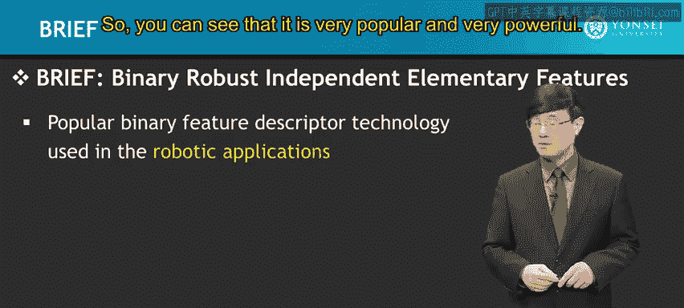
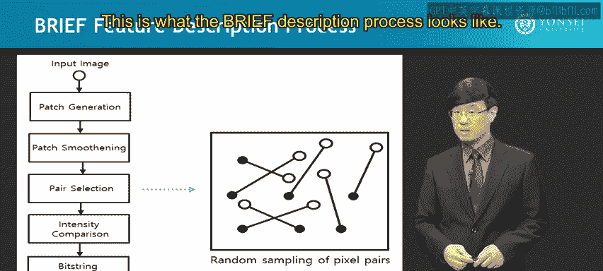

# 延世大学《新兴技术从智能手机到物联网再到大数据Emerging Technologies From Smartphone to IoT to Big Data》 - P138：15_3.5 BRIEF算法.zh_en - GPT中英字幕课程资源 - BV18hpFewEcG

Brief technology。Brief stands for binary robust independent elementary features and from the name you can see that it has the word binary inside in addition。

 robust independent elementary features， the robustness is another characteristic that we're going to look into。

This is a popular binary feature to scripture technology used in robotic applications。

 like for robot view， robot vision， so you can see that it is very popular and very powerful。

Randomly generated distribution patterns are used， this is much different。

Distribution patterns consist of 256 pixel point pairs。

And descriptors are generated from binary comparison of the point pairs。

The overall feature description process of brief looks like this， where there is a patch generation。

Patch smoothing。Pair generation。Which you see right here。

 and you can see that random sampling of pixel pairs are used。And then intensity comparison。

 followed by a bit string generation。This is what the brief description process looks like。

Looking into the details， binary Drscriptor parts。Sampling pattern is what is important。

The sampling pattern is used to sample points in the region around the descriptor。

Then there's orientation compensation key point orientation is determined by the size of the orientation compensation that is needed to compensate for rotational changes。

You need this because once again rotational changes will occur in the image once again this is not a still image。

 this is not a fixed recorded video， this is live images that are on your real worldor view of your augmented reality device that is why rotational change compensation is critical and that's what's being done right here。

Sampling pairs。The final descriptor is made by pairs based on comparing sampling pairs。

Brief does not have any intricate sampling pattern or mechanism for orientation compensation。

Brief compares random point pairs。 That's a critical thing。

 as I showed you on the processing diagram within the local region。Noise sensitivity。

Brief descriptors use information based on single pixel locations， which makes it sensitive to noise。

 therefore， Gaussian filters are used to relieve the noise sensitivity and make it more robust。😊。

These are the references that I use， and I recommend them to you， thank you。

