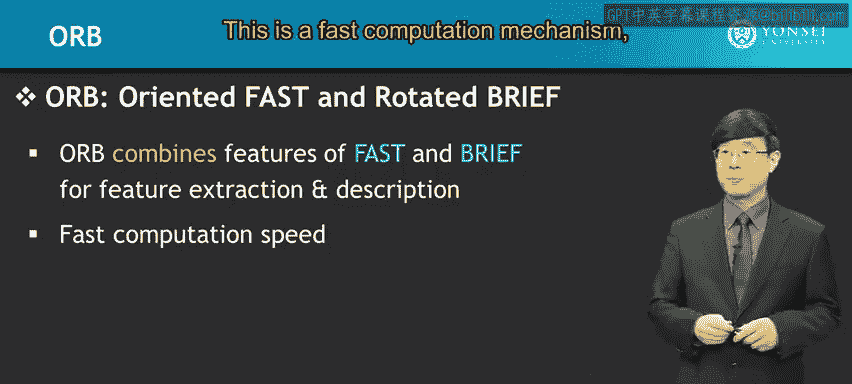
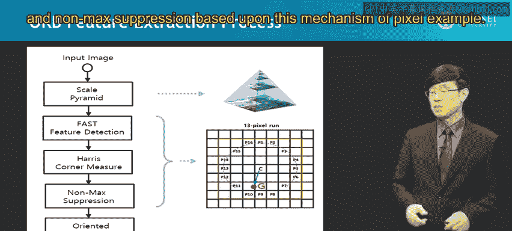

# 延世大学《新兴技术从智能手机到物联网再到大数据Emerging Technologies From Smartphone to IoT to Big Data》 - P139：16_3.6 ORB算法.zh_en - GPT中英字幕课程资源 - BV18hpFewEcG

ORB。ORB stands for Oriented Fast and Roated Brief。This is a combination of fast and brief technology for feature extraction and description technology。

This is a fast computation mechanism， that's why it's so attractive。

And it is very efficient in memory usage， that's why this combination was created。

Very high matching accuracy。 Of course， this is needed in augmented reality。

OrB can be used instead of sift and surfF for feature extraction In addition。

 this is based on binary operations because fast and brief are both based on he distance as well as binary operations。

😊，And being based on these features make it faster， less computation burdening。

 and more appropriate for real time applications， that's why instead of sift or surfF。

 you will see orRB as a popular applied mechanism。The process is like this where theres a scale pyramid。

 followed by fast feature detection， Harris corner measure non max suppression。

 then oriented brief techniques。Here shows the middle part of fast feature detection。

 Harris corner measurement， and non max suppression based upon this mechanism of pixel example。

Going into the details multi scale image Pyramid， multi scale featured based scale pyramid is used。

Fast and rotated brief。R applied to each scale of the image pyramid。

Fast feature detection uses fast corner detector in the detection of key points。

And the corner detection mechanism was used in fast because we are using fast。Automatically。

 the corner detection mechanism comes in。Automatically。

 you can see what I meant by mixing and matching of feature detection and descriptor techniques are possible orB itself is an optimized mix and match result。

 a fast and rotated brief。😊，So you can see how mix and matching can be done if you are developing a specific application where you see one of these techniques perform extremely well。

 then you can create your own mix and matching combined algorithm。Harris corner measure。

This is applied on the key points to select the top end。Points with the strongest fast responses。

Then we have the centroid， which is the center of gravity G of an image patch。

 this is computed with moments to improve the rotation invariance。

So we have the centroid G and the top endpoints， which are the candidate points coming out from the fast processing。

Which will be used to determine our key points。Oriented brief。

This orientation is computed based on the direction of the vector from the key point to the centroid G。

 so the key point and the centroid are used in determining the orientation。

Brief features use of orientation information to be rotation invariant。

 This is where the rotated version of brief kicks in to be very effective in OB。

Our brief is used as the binary descriptor。To be rotation invariant， once again。

 our brief in some literature， you'll see it with a capital R brief。

 and here some will use a little case， small case R in front of brief。

So please be aware that a capital R or a small case R may be in front of brief to represent the rotated version of brief。

Which is used in ORB， along with fastT。Search and matching process。Corsponding search uses MPLSH。

 which is multiprobe locally sensitive hashing techniques。When a match fail occurs。

 neighboring buckets are searched for matches。MPLSH uses fewer hash tables to save memory consumption。

And this uses more consistent hash bucket sizes compared to the original brief technology。

These are the references that I use and I recommend them to you， thank you。

