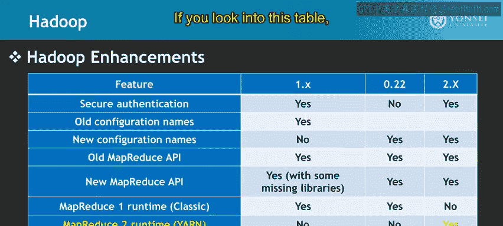

# 延世大学《新兴技术从智能手机到物联网再到大数据Emerging Technologies From Smartphone to IoT to Big Data》 - P13：12_2.9 HDFS增强.zh_en - GPT中英字幕课程资源 - BV18hpFewEcG

哦。In this lecture， we will now look into HDFS enhancements。

If you look into this table， I would like you to focus on the bottom three rows and the。

Write most column， which has2 dot x。 This means that the release version is 2。0 and higher。

You can see the bottom three rows， which say Mareduce2 runtime yarn below that is HDFS Federation。

 and below that is HDFS high availability。 These are the new addition features that were added on Mapreduce and HDFS Hadop。

 to provide improvements。 Let's look into these three details。

The first one that we will look into is Mareduce 2。Starting with Mareduce 2。

 the enhanced Mareduce runtime system is called yarn， this was what was added。In following examples。

 we will have more details and an example of yarn being used in HDFS。

HDFS Federation petitionitions the HDFS namespace across multiple name nodes。

It enables improved support for clusters with very large number of files。

The high availability feature uses standby name nodes for backup。

 and therefore the name node is no longer a potential single point of failure for the system。

Back up the name node files that form the persistent state of the file system's metadata is conducted in the failure backup nameme node system mechanism。

Configure the name node to write its persistent state to multiple file systems。

Synchronous and atomic backup。And then the common backup configuration is copyied to local disk and remote file system。

The secondary name node does not act the same way as the primary name node。

The secondary name node periodically merges the namespace image and the edit log to prevent the edit log from becoming too large。

The secondary name node usually runs on a separate computer to perform mergege process because this requires significant processing capability and memory。

The HDFS Federation allows a cluster to scale by adding name nodes。

And each name node manages a namespace volume and a block pool。

The namespace volume is made up of the metadata for the namespace。

And the block pool contains all the blocks for the file in the namespace。

And this is all to make the system more reliable and robust。😊。

The namespace volumes are all independent。Name notes do not communicate with each other。

Failure of a name node is also independent to other name nodes。

The name no failure does not influence the availability of other name nodes， namespace。

High availability makes the system much more robust and reliable， using a pair of name node。

 which are the primary and standby， and they are set to be in an active and standby configuration。😊。

The secondary name node stores the latest edit log entries and an up to date block mapping。

When the primary name node fails， the standby name node takes over serving the client requests。

Although the active standby name node can take over operation quickly within few tens of a second。

To avoid unnecessary name node switching， the standby name node activation will be executed after a sufficient observation period。

For example， approximately a minute or a few minutes。These are the references that I use。

 and I recommend them to you。

