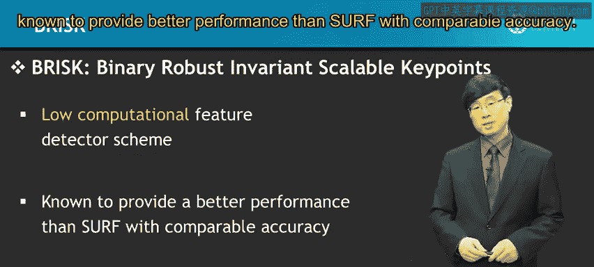
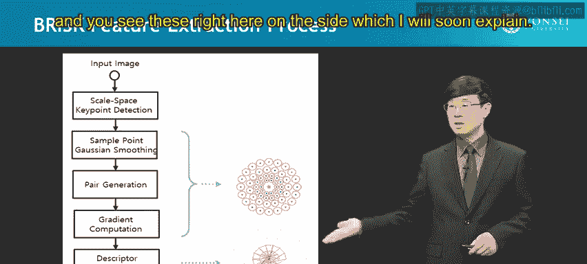
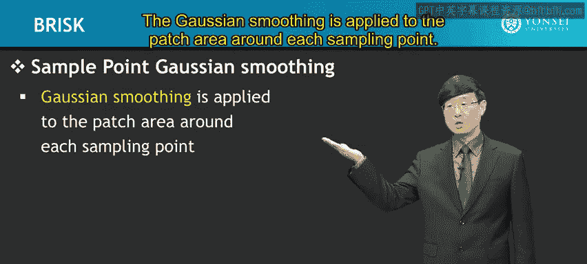
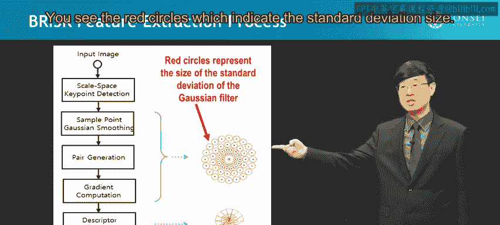

# 延世大学《新兴技术从智能手机到物联网再到大数据Emerging Technologies From Smartphone to IoT to Big Data》 - P140：17_3.7 BRISK算法.zh_en - GPT中英字幕课程资源 - BV18hpFewEcG

Brisk technology Briisk stands for Biary robust Ivariant Scalable key points。

This is a low computational feature detector scheme。

Known to provide better performance than surf with comparable accuracy。

Looking into the mechanism it starts off with the scale space key point detection mechanism。

 then you see sampling point， Gausian smoothing， followed by pair generation， gradient computation。

 then descriptor generation， and you see these right here on the side which I will soon explain。

Starting off with the candidate interest point detection mechanism。IPD uses a guest。

 which is adaptive and generic corner detection based on accelerated segment tests that's a long word short a guest。

This is a corner detector mechanism。A guest is an extension to fast。

 so it's an improved fast mechanism。A gas uses circular symmetric pattern region shapes with 60 point pairs。

A guest uses point pair line assignments arranged in four concentric rings。

Scacalle space key point detection。It's based on scale space using octaves and intra octaves。

These are created first。Then each octave is half sampled from the previous octave。

An intra octave is downsampled to be placed in between octaves。

Scale space key point detection will then use non maximal suppression on each octave and intra octave。

Subpixel maximum is computed across the patch。And continuous maximum is computed across scales。

This here is the scale space key point detection mechanism that is used in brisk。

Sample point Gausian smoothing is also applied。The Gaus smoothing is applied to the patch area around each sampling point。

The red circles represent the size of the standard deviation of the Gaussian filter。

 like in right here， you see the red circles which indicate the standard deviation size。

Pair generation is then conducted where point pairs of pixels are separated into two groups。

There are long segment pairs used in coarse resolution。

 there are short segment pairs used in fine resolution。

The short and long segment pair separation is used in scale invariance processing。

Graaddian computation well， a gradient is computed on the log segment pairs first。

Because they're trying to determine the feature orientation。

And then comes the turn for the short segment pairs。

 so the gradient is computed on these to determine the amount of rotation in reference to the orientation which was determined by the long segment pair gradient processing。

😊，Binary descriptors is made from the rotated short segment pairs。

These are the references that I use， and I highly recommend them to you。 Thank you。

