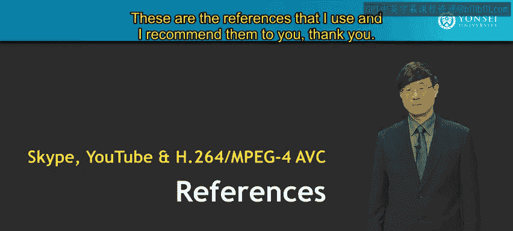

# 延世大学《新兴技术从智能手机到物联网再到大数据Emerging Technologies From Smartphone to IoT to Big Data》 - P141：18_4.1 Skype.zh_en - GPT中英字幕课程资源 - BV18hpFewEcG

In this module， we'll study about Skype， YouTube， and the technology that Skype and YouTube uses。

Further details will be also included in the following module as well。

We will start this with discussion on Skype。Skype is a service that supports video chat and voice call service applications with a well known logo that you see right here。

The terminology of Skype was derived from the word sky and peer to peer。

 and you can see that it resulted in a very cool name。Skype communicates voice using a microphone。

 speaker， video webcam over the internet， so therefore these modules come together over interaction with Skype。

Skype's architecture is based on a hybrid peer to peer mechanism， in addition。

 it is also using a client and server mechanism as well。

The audio codex supported include the G dot 729， SFO， PC， Silk and OpPus。

The video codeex supported include H。 264， which we will talk about in further details in this lecture。

And the supporting applications are voiceover IP， video conferencing。

 instant messaging and file transfer。 All of the important things are in here。

 That's why we need to study this in further detail。😊。

Skype video conference calls can be made from various platforms using smartphones， tablets， PCs。

 and various other devices。😊，The client operating system for a desktop。Is supported by these units。

 as you can see the series of evolution of Windows products are included。

The universal Windows platform client operating systems include Windows 10 and Windows 10 mobilebi。

 as well as HoloLs， which you see this device right here。This is an augmented reality device。

 which I also use in my research and development in my lab with my grad students。

One of the things about augmented reality is that it supports video and various other techniques。

 and it is a wonderful platform for Skype based video conferencing as well as other augmented reality applications。

😊，Other desktop operating systems include OSX， Linux。Including Uuntu， Linux， Alpha。

 and other versions as well。Skype for other mobile device operating systems include the iOS。

 for Apples， iPhone and iPad， Android， Blackberry 10， Fire OS， Nokia X。

 and previously available for selected Sbian and Blackberry operating system devices。

Skype calls to other Skype users within the Skype service are free， however。

 Skype can also be used in making traditional phone calls to landline telephones and mobile phones for a debit based user account charge using Skype credit or by subscription。

Similar technologies that support Voiceover IP and Vo conferencing include SIP and Hdo 323 based Services。

For example， used by companies like Linf and Google Hangouts。

Looking into the history of Skype in 2003， Skype was founded by experts and developers that contributed from Sweden。

 Denmark and Estonia。In 2003 August， the first public beta version of Skype was released。

Then in 2005。Sky made an agreement with the Polish web portal and enabled integration into the Polish market。

Then， one of the big turnaround points was in 2005 September。

 where eBay agreed to acquire Skype Technologies's essay for approximately $2。5 billion。

Then in 2009 September， based on Skype's value， which was evaluated at $2。75 billion。

 eBay announced that it was selling 65% of it， which is $1。9 billion worth of。In 2010。

 Skypad 663 million registered users， so you can see the tremendous growth in dependency on this cool app that was newly created。

Then a big turnaround point was in 2011， where Microsoft acquired Skype for $8。

5 billion and began to integrate Skype services into various Microsoft products。In 2013， February。

 Microsoft introduced Office 2013， which included 60 Skype world Min per month in the Office 365 consumer Plan。

Which was for home and personal and university usages of Skype。This made it extremely popular。

 and it helped promote both the product itself as well as Microsoft technology products。

In April of 2013， the Windows live Messenger instantsant messagingsaging service was phased out in favor of promoting Skype。

Then in November of 2014， Microsoft announced that Link would be replaced by Skype for business in 2015。

Later versions include combined features of Link and the consumer Skype software。

Eorgan were given the option to switch their users from the default Skype for business interface to the Skype for Business interface。

These are the references that I use， and I recommend them to you。 Thank you。

