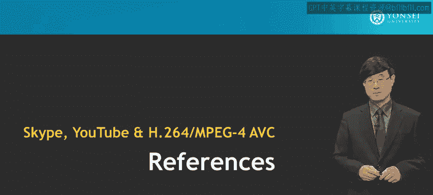

# 延世大学《新兴技术从智能手机到物联网再到大数据Emerging Technologies From Smartphone to IoT to Big Data》 - P142：19_4.2 Skype编解码器.zh_en - GPT中英字幕课程资源 - BV18hpFewEcG

Skype Codeoticx is what we'll study about。Starting from the audio codex that Skype uses， initially。

 Skype used G dot 729 and SVOPC for their Voover IP applications。Skype added is silk to Skype 4。

0 for Windows and other Skype clients。Silk is a lightweight and embeddable audio codeda created by Skype。

Skype Ous is an open source codec that can integrate the silk codec for voice transmission with Ct codex。

Sealt is short for， constrained energy lap transform。

Silk is an audio compression format and audio codedak。It was developed by Skype Limited。

 where the initial release was in March of 2009， and the latest release SDK was in 2012。

Silk operation specs。Audio sampling frequencies are at8， 12， 16 or 24 kilohertz。

And the bit rate range is from 6 to 40 kilobits per second。

The representation of bits per second have these other representations as well， and they're the same。

The low algorithmic delay was based on 25 milliseconds where the frame size was the 20 millisecond part。

 and there was a5 millisecond look ahead part that was included into low algorithmic delay。

The reference programming was based on C programming。And the codec is based on LPC。

 which is linear predictive coding。Silk binary SDK is available and the SDK stands for the softwareft development Kit。

 so you can see that development of various new technologies can be enabled through the SDK。

Skype Audio codeak Ous is what we'll look into now designed as a lossy audio coding format to efficiently encode speech and general audio into a single format OPus was designed to combine silk and self。

 switching between or combining silk and self as needed for maximum efficiency。

The opPus also maintains low latency， sufficient for real time interactive communications。

OPus was designed to have low complexity to run on low end RM3 processors so even if it's not the most advanced mobile devices that are running Skype。

 still because it is focused to run on even lower edge modules that various devices could easily support the OPus operation required to support Skype。

OPus was standardized in the IETF RF 6716 documents。Sealt。

Is short for constrained energy lab transform， and this is an open royalty free lossy audio compression technique。

It has very low algorithmic delay to support low latency audio communications。

It was designed using lower latency MD CT technology。

 which is short for modified discrete cosine transformation。Now looking into Skype Video Codex。

We start with VP7， which was used for Virgins prior to Skype 5。5 as the video code。After 2005。

 Skype used true motion VP7 code， which is an evolution from the original VP7。In early 2011， Skype 5。

5 moved to VPA8， the more evolved version。True motiontion。

 VP7 and VP8 were developed by on2 technologies for Google。Skype 5。

7 uses VP8 for both group and one2 one standard definition video chatting。

The big change came in 2011 when Skype was acquired by Microsoft。

Then the video codec was changed to the Hdot 264 and this is a very powerful protocol。

 which I will explain in detail in this lecture module。😊。

Going into the further details of this Skype video call quality。

 the standard mode has a video resolution of 320 by 240 pixels with 15 frames per second。

Then the upper and high quality mode has a resolution of 640 by 480 pixels with 30 frames per second。

Then going into high definition mode， this has the highest resolution at 1280 by 720 pixels with 30 frames per second。

Then other H。264 codex are also used in group and peer to peer， which is one to one， video chatting。

These are the references that I use， and I recommend them to you， Thank you。

