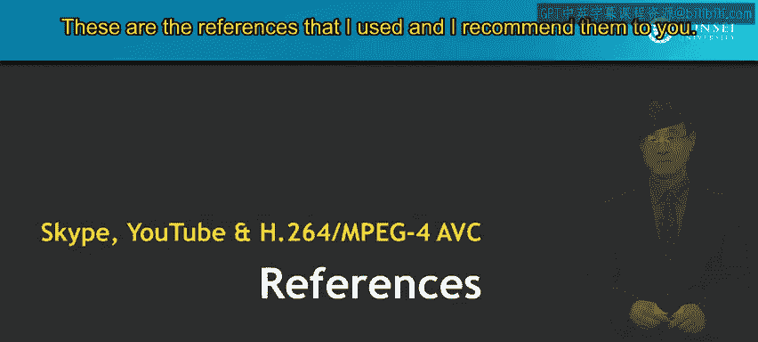

# 延世大学《新兴技术从智能手机到物联网再到大数据Emerging Technologies From Smartphone to IoT to Big Data》 - P143：20_4.3 YouTube.zh_en - GPT中英字幕课程资源 - BV18hpFewEcG

We will now study about YouTube。YouTube is a global video sharing website that uses Hdot 264， MEC4。

 AVC and WebM and Adobe Flash Vo technology。Looking into the history of YouTube， in 2005， February。

 three former PayPal employees created YouTube。The founder Kim said that the inspiration for YouTube first came from the difficult experience looking for the Justin Timberlake and Janet Jackson's 2004 Super Bowl halftime performance。

 where there was an exposure incident， and also the 2004 Indian Ocean tsunami。And therefore。

 there was a need to have a video sharing site， and that was the motivation for career。In addition。

 for the cofounders Hurley and Chen， they found their motivation where YouTube was designed to serve one of the features of an online dating service using videos。

Combining this all together。In 2005， February， on Valentine's Day， the domain name www。youtube。

com was activated。Then， in 2005 April， the first YouTube video titled Me at the Zoo at the San Diego Zoo was uploaded。

 which shown the co founder Careim。As you can see right here。In 2005， September。

A Nike advertisement reaches 1 million views for the very first time。

And now you can see exponential growth in the number of users in YouTube where in 2005 November。

To April 2006。YouTube received a 11。5 million venture investment。

Then the official website of YouTube。com was officially launched in December of 2005。In 2006 July。

 YouTube announced that every day there were more than 65，000 new videos that were uploaded。

Then Google in November of 2006 bought YouTube。In 2010， the headquarters was moved to San Brurunno。

 California。And in April of 2011， it was revealed that 30% of the videos accounted for 99% of YouTube views。

 so it's showing that there was a smaller portion that dominated the number of views among the videos that were uploaded。

In 2014， YouTube announced that every minute， 300 hours of new video was being uploaded。Then in 2015。

 YouTube was ranked as the third most visited website in the world。

And YouTube was attracting more than 15 billion visitors per month。

 making it the world's top TV and video website。In 2016 January。

 the San Brurunno headquarters was expanded to an office park where the 2。

800 employees could be hosted and overall $215 million were invested。The Internet video technology。

Is based on the service categories in which first we'll talk about over the top OTT technology。

User generated content is what we're focusing on in YouTube， mostly amateurs。

 and the content is user created， user generated。Compared to that。

 the original video content that we're normally used to seeing and viewing are professionally generated contents made in studios or broadcasting companies to promote commercial products and services。

 which also would include like advertisements。These are the contents of ABc。com， Hulu。

 and other things that you're normally aware of。Then there's the direct movie sales。

 the EST electronics sell through to consumers over the internet。

 which popular ones are like Netflix， Apple TV， Ultraviolet and other company services as well。

Over the top OTT in media broadcasting， OTT refers to media content delivered to the end user with the ISP。

 the Internet service provider， simply serving as the transporting IP packet role。

 like providing the network connectivity。This is different because normally the media content was purchased through the ISP。

 however， over in OTT， the ISP is just the network and service provider where the contents are purchased in a different way。

Consumers can access OTT media content through an internet connected device。

Where cable or satellite TV set top box？Smart TV， smartphone， PC， laptop， tablet， computer。

Gae console B and others。Based upon the word of a TV set top box is really where the terminology over the top over a set top box。

 the original word terminology came from that， and that's where OTT emerged from however。

 the concept of OTT has expanded。YouTube V technology previously was based on Adobe Flash Player plugins。

And therefore， these needed to be installed in the internet browser on your PC to view YouTube videos。

In 2010 January， YouTube Expi site used the built in multimedia capability of HTML5。

Web browsers to enable YouTube videos to be viewed without requiring Adobe Flash Player to be installed。

Then。Due to the success and the features of HTML5 in 2015 January。

 HTML5 was announced as a default playback method。I want you to note that HTMLmL5 video streaming uses MEC dash dash is dynamic adaptive streaming over HTTP。

 This is the most dominating video streaming technology not only used by YouTube but almost by every video system in the world。

 That is why the following lecture will be focused on MPEC dash separately。

MmpEC Dash supports adaptive bit rate HTTP based streaming by controlling the video and audio quality based on the network condition。

These are the references that I used and I recommend them to you。

