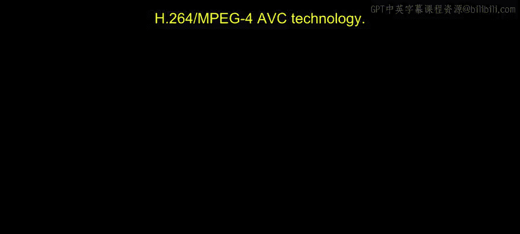
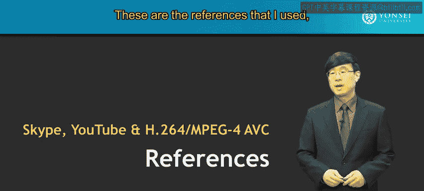

# 延世大学《新兴技术从智能手机到物联网再到大数据Emerging Technologies From Smartphone to IoT to Big Data》 - P144：21_4.4 H.264-MPEG-4 AVC.zh_en - GPT中英字幕课程资源 - BV18hpFewEcG

HD264 M4 AVC technology This is so important that is why this lecture will focus on this。😊。

The Hdo 264 is the MEC4 part 10 AVC protocol。 When we say AVC。

 we're talking about events video coding technology。

It is the most popular standard for video recording， compression and distribution。

 and that is why it is used in Skype and also YouTube。 So therefore you need to know this。

Overall in the specifications， this was developed by the project partnership of the JVT。

 the joint video team of the ITUT， V CEG and the ISO IEC， JTC1 MEC Group。Looking into the details。

 there's many acronyms and very powerful international standardization groups。With the ITUT。

 the ISO IEC， JTC1， their descriptions are listed down here。

This was designed for a high quality video with lowest bit rates。

The video standards that uses block oriented motion compensation compression。

So it is the compression technique that is based on motion compensation based on block oriented units。

 selected block units。And this compression technique is so good because you look at a video with sufficient resolution and quality。

 however， the compression technique makes the file size very small in which it is easy to store and also very convenient to transfer over a network。

 so these two characteristics make it so popular such of that。

 Skype and YouTube and almost all video streaming and applications use it。😊。

So we need to go into further details。H do264 was designed to have half or a lesser bit rate compared to the impactEC 2。

 the H。263， or the impactEC 4 part 2。And it was to achieve this half or lesser bit rate。

 resulting in much easier to transfer over the network or much smaller file sizes when saved in the memory。

And this was accomplished without increasing the complexity too much。However。

 there was an increase in the complexity， not too much， but there was。

 and the slight increase in computation complexity consider that modern devices have better GPs and CPUs。

Such that they can take it and complete it within the same limited amount of time。H。

 264 is a family of standards， so it's not just one type。

 it has a group inside that composes several different video encoding profiles。

The H 264 decoder may not be able to decode all profiles。

 so the decodable profiles need to be informed。Then， H。

264 compression results in low bid rates and lower resolutions。

The Hdo 264 loss less encoding is possible， but is rarely used because it will result in a larger file size。

H dot 265 is the MG H part 2 and the H E VC， and this is a successor of the H dot264， MG4 A VC。

The applications include blue Ray discs， internet streaming sources， and that is why YouTube， Skype。

 iTunes Store and Vimail are all included。Web software。For Adobe Flash Player， as well as Microsoft。

 Silver Light and others are included。HDTV broadcasting companies use it as well。 In addition。

 cable services also use it。As well as satellite services based on DVBS and DVBS2。

The H 264 patents are owned by various parties who licensing is administistered by the patent firm。

 the MEC LA， which is in Denver， Colorado， in the United States。

The profiles include a non scalable 2D video application profiles， which are the CBP。

 which is constrained baseline profile for low cost applications used in video conferencing and mobile applications。

Then there is the baseline profile BP for low cost applications that require additional data loss robustness。

 and this is used in video conferencing and mobile applications as well。

Then there's the extended profile for streaming video。

 where relatively high compression capability with enhanced robustness to support data losses and server stream switching。

The MP， the main profile， is for a standard definition digital TV broadcast using MPEC4 DVDB standards。

MP is used for HDTV， but rarely is used after H the high profile was developed in 2004。

Then there is the high profile， which we were talking about for DB。

 HDT broadcast and disk storage applications。This is used as the Blue Rais storage format and the DB HDTTV broadcast services。

Then there's the progressive high profile， which is similar to HP without the field coding features。

Then we also have the constrained high profile， which is similar to the PHIP without BB slices included。

There is also the high 10 P profile， which builds on the HP with added support for up to 10 bits per sample of decod picture precision。

Then there's the high 422 p。And this is for professional applications that use Interlace V。

This builds on the high 10 p with added support for the4 to2 to2 chromma subsampling format while using up to 10 bits per sample of decod picture precision。

Then the other mode is the high 444 PP profile this builds on top of the high 422p。

 supporting up to4 to4 to4 chroma sampling with up to 14 bits per sample。

The HdoT 264 profiles also include cam codederrs， editing and professional application profiles。

Where four additional interframe only profiles used mostly for professional applications。

 involving camera and editing systems。These profiles are listed down here。There is also the SVC。

 the scalable video coding profiles， where scalable constrained baseline profile is one of them。

 primarily for real time communication applications。There is also the scalable high profile。

 primarily for broadcast and streaming applications。In addition。

 there is the scalable constraint high profile， which is primarily for real time communication applications。

The scalable high intra profile is for production applications constrained to all intra use。

There is also the MVC， the multi view video coding profiles stereo high profile is one of them。

 This is a profile for two view stereoscopic 3D video。

The multi View high profile is for two or more views using both Inter picture。

 which is temporal time based domain and NBC Inter prediction。

There is also the multiview depth high profile as well。

These are the references that I used， and I recommend them to you。 Thank you。😊。

