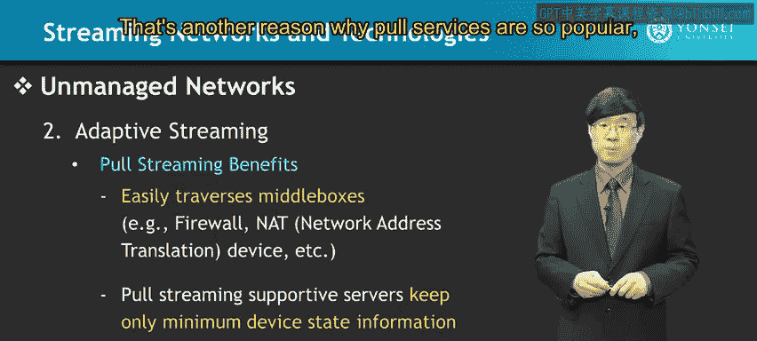
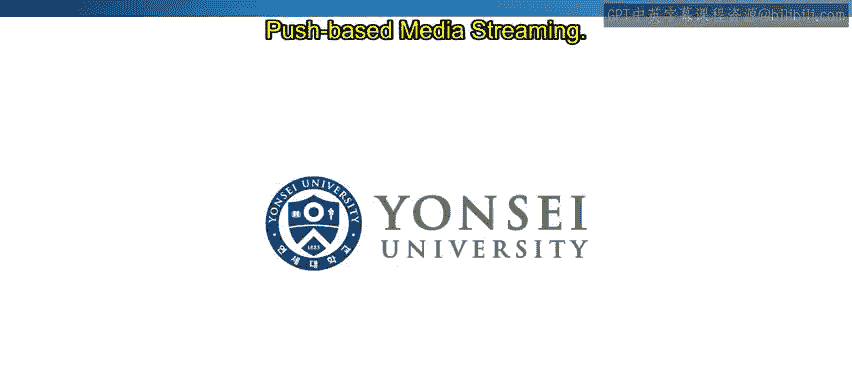

# 延世大学《新兴技术从智能手机到物联网再到大数据Emerging Technologies From Smartphone to IoT to Big Data》 - P145：22_5.1 流媒体网络和技术（第1部分）.zh_en - GPT中英字幕课程资源 - BV18hpFewEcG

哦。🎼Yeah。Video streaming and impact D。In this module。

 we'll start with streaming networks and technologies。We'll first start with Man networks。

In the managed networks category， cable TV and IPTV services are the most popular。

One of the things that you can see in these type of services is that they're well planned。

 their schedule is preannounced in addition， in between the movies。

 the dramas and the TV shows and the news broadcasts that they have。

 they have just the right amount of advertisements inside there as well。

This all comes because they are well managed， prescheduled。

 and the delivery mechanism to your house is well planned as well。

They use multicast transport technology， and also they have controlled quality of service QOS functions such that the service that is provided to you is very reliable。

Then we have， on the other hand， unmanaged networks。

 in which content delivery to the viewer is using a Unicast connection。

The delivery from a server or CDN is the common way it's done。

A server is a broadcast server which could be something like the YouTube server In addition when we say CDN。

 this is content delivery network in which this is a network that is used for video streaming and content delivery over various wide range networks。

 including the internet that may cross intercontinental areas。Therefore。

 we will need to study about CDN technology， and that is the topic in the next module in this course。

Then looking at streaming methods， there are proprietary streaming protocols which run on TCP or UDP。

There is HTTP over TCP， and this is used popular in progressive download techniques and we will see some of these。

In addition， there is conventional streaming versus adaptive streaming technology。

 and this is something that we need to look into， especially because adaptive streaming technology is what's going on right now and also future networks will rely on it so the technical aspect of this。

 how does this work， we will need to study about that and we will in this course。

Conventional streaming services。These are the ones that you'll see as in terms of Microsoft。

 Windows Media， Apple， Quickt， Adobe Flash， very popular media service technologies that you've already used。

Progressive download is HTTP over TCP， where video playout can start as soon as the necessary amount of data。

 which may be a little bit worth of about two to 10 seconds worth of video information is download it and then buffered in your memory and then you can immediately turn it on Of course。

 because it is buffered， it is stored within your memory， you can decide when to turn it on。

 when to turn it off， deposit or you can go and go backwards or forwards to see the parts of the video Of course you cannot go forward beyond what has been received。

 but you can go maybe a little bit into the forward fast forwarding of the video to see if it is already downloaded and received in your device。

Progressive download， there are advantages and disadvantages， the pros and the cons。

The pros are easily supports freeze and rebuffing In addition， easily supports trick mode。

 which enables you to do fast forward seek play or rewind and other functions。

Then there's the disadvantages， the cons， which the server must have multiple resolution versions of the same video。

 so it's going to take up more space on the server。What about T mode。

 a little bit more on the details？This is an example of T mode in which when you're watching a video。

 for example， like YouTube。And you view it to a certain point。

 you want to look into the further down or you want to rewind back to a certain position to look at and view a different point within the video then what you do is you put your finger down on the red dot and you move it around then those small windows that you see over there will show an image of where the video will restart if you turn it back on at that position This is what we call trick mode and it helps to make video viewing very very convenient。

Then there's adaptive streaming， which is a level up in technology。

 where a viewer device monitors its replay buffer and network condition。

 which is related to the bandwidth， the error rate， the throughput， various delay components。

And it will choose the most appropriate version of the video。

 the video resolution that is and uses progressive downloading it will decide what level to show as in terms of level meaning resolution of the video the resolution。

 for example， there could be an ordinary mode， but if the network condition is good and there's a little buffer。

 then well， you can maybe go up to a high definition mode。

 where the number of frames per second goes up in addition。

 the number of resolution in your each image goes up as well that will increase the data rate that is being received and you can only do that when your network condition and your replay buffer has sufficient space。

😊，Some of the adaptive streaming service examples include MPEC Dash。

 which is dashash stands for dynamicynamic Adapive streaming over HTTP。

 which is the most popular networking technology that is used throughout the world。In addition。

 Microsoft smooth streaming， as well as Apple H TTP live streaming and Adobe HTTP dynamicynamic streaming。

 These are all very popular， but this one is the most popular。

The advantage of using adaptive streaming with HTTP are based upon the fact that HTTP has ubiquitous connectivity。

Meaning that almost all devices support HTTB connections。HCTP is a pull protocol。

 The pull protocol is opposite to a push protocol。And this is an advantage of adaptive streaming using HTTP because pull streaming has the following benefits。

😊，Based on the fact that it easily traverses middle boxes， the middle boxes are the firewall。

 the gateway， the network address， translation devices and other things as well。

This is based on the fact that it is a pull service in which the device will send out requests。

To have a certain amount of video information to be sent to it。

Such that these middle boxes will see how much was requested by the device。

 and then it will see that the server is sending that much amount。Because of that。

 it can trust that the amount that is being sent into the network to the user is the right amount。

The opposite case， which is the push protocol in which the server is in control of the video streaming flow。

 it will send packets down to the mobile device， then these middle boxes do not know if this video files that are being sent to the mobile user are based on the mobile user's request or if it is just sending it down in a way such that it is due to a certain virus attack。

 it is based upon a certain denial of service attack that is being conducted。

These middle boxes are not sure， so the firewall may activate a blocking mechanism。

 and the video flow will be blocked。Pull services enable the opposite operation such that just the right amount that has been requested by the mobile device is sent to the mobile device from the server。

 and that can be relied upon such that the middle boxes let that pass through very easily。

In addition， P streaming support servers keep only minimum device state information。

This means that if we were doing a push base service， which is the opposite of a pull service。

If we're doing a push base service， then the server needs to keep track of how much it's sent to that mobile device。

In addition， it needs to keep track of the network condition。

 it needs to keep track of if there were any errors and if there were， should I retransmit or not。

That's a lot of information to be sent and keep track of if you are in control of a lot of mobile users at the same time。

Therefore， it really complicates the structure， the control mechanism that the server needs to keep track of。

On the other hand， in poll services， your smartphone is going to request how much it needs based upon the network condition that it sees based upon the amount of memory that it has。

Based upon the current V status in which it is displaying。

 so it knows exactly what's going on and it's only controlling the services that are coming to itself。

 so it's not that much of a burden for the smartphone because basically the smartphone knows what it's doing and it's going to keep track of itself anyway。

So therefore， the amount of work that the server needs to keep track of is minimal when you use pull services。

 and that's another reason why pull services are so popular。

And that is the reason why much more scalable compared to push streaming servers， meaning that。

On one server that is supporting multiple users， when you're using push。😡。

If there is a limited amount， then when you're using pool， you can support much more。

And the scalability benefit comes from that。

