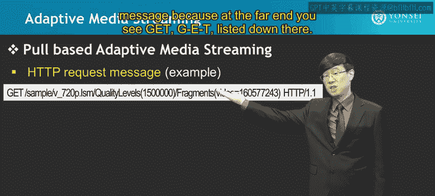
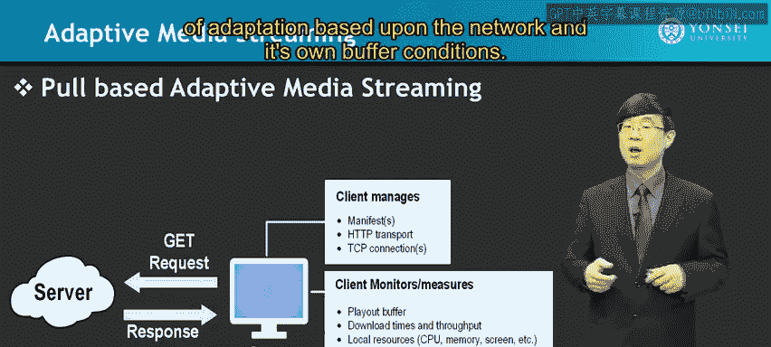

# 延世大学《新兴技术从智能手机到物联网再到大数据Emerging Technologies From Smartphone to IoT to Big Data》 - P146：23_5.1 流媒体网络和技术（第2部分）.zh_en - GPT中英字幕课程资源 - BV18hpFewEcG

哦。🎼Yeah。Push based media streaming， let's take a closer look into what push is。

The server streams packets to the client until the client stops or interrupts the session。

 so it is in a form that the server is going to send and send and send until the receiving device says。

 whoa， stop， I can't take anymore。The server maintains a session state。

With the client and listens for commands from the client regarding session state changes。

Some of the popular push based media streaming services that have been used are RTSP。

 which stands for Realtime streaming Proto and RTP， Real time Trans Pro。

RRTSP is an IETF standard based upon RFC 2326， and typically the SCP session control protocol is commonly used。

On the other hand， RTP is an IETF standard based upon RFC 3550， in which UDP is commonly used。

RTP on UnDP lets the server push packets to the client。

The server bit rate is determined by the application quality of service requirements and the client and server characteristics here when we say bit rate。

 we're talking about data traffic that is measured in units of bits per second。

 either represented like this， bits slash second or BPS bits per second for short。

Pushbased media streaming， the disadvantages， the cons server has too much to do。 it's too burdening。

 In addition， playing devices status is hard to track because the server and the mobile device are far away。

 the server is trying to keep track of the mobile device or your PC or laptop computer status and it's far away。

 and by the time that a certain status is experienced and reported back to the server there is a time gap。

 So therefore the server is always trying to do catchup of the current status that is going on at your PC laptop computer or smartphone。

Many firewalls will block RTP packets because they don't know if the packets that are being sent to the mobile device are based on a mobile device's request or if this is some type of security attack。

Many Internet service networks that have been replaced with CDN do not support RTP。

 this is because RTP is possibly dangerous and it could be used in network attacks。

We need to study about CDN as you've seen that content delivery networks are one of the core technologies that are used in video streaming services。

 so we will in the next module。Pullbased adaptive streaming technology， the media client。

 which is like your smartphone or your personal computer。

 sends HTTP request to the server to quickly retrieve this is you're pulling in your packets。

 content packets in burst mode， meaning that when you request for something you want it to be sent very quickly such that you receive packets in a sequence and then you save it in your memory and you can replay it back on your mobile device。

After the minimum required buffer level is filled up， the media client is able to play it。

 display it on the media player， for example， once you download the minimum amount that is required。

 then on your smartphone， you can start viewing the video。

The server transmits at the media encoding bit rate that matches the media consumption rate。

Meaning that there is a certain rate that the video is being displayed。

 such that video packets that are in the memory are consumed。Then。

The way that the media encoding bit rate is set will be matched to that rate。In addition。

 if the client buffer level remains stable at a certain fixed level approximately。

 the network resources will be efficiently used， this is what we're talking about as in terms of quality network resources on how efficient we're using them。

In addition to how the mobile device or your PC or laptop computer is viewing the video rate。

 for instance， in order to have the buffer level remain stable at the client device。

 which is your PC laptop or smartphone， that means that the speed of how the video packets are consumed and displayed on your display。

And the speed of how the packets are arriving into your buffer， your memory。

 these are approximately the same rate。Such that the overall buffer level remains stable。

Meaning that it's coming in and going out at the same rate。Then in these cases。

 the network resources are very efficiently used， and that's good。

Then if the network packets are lost or transmission delays our experience， then buffer underflow。

 the buffers will become empty because packets will not be coming in properly。

 they may be coming in but if they have errorss， they will be dropped， they will be terminated。

 they will be erased。Therefore， the playback may be interrupted in which the video stops in the middle。

The server will dynamically switch to a lower bit rate stream to prevent buffer underflow that means that the video packets that come in。

 they will be made in a way such that when you support a lower resolution video。

 then the amount of data packets that are sent in and the packet sizes can be reduced in these cases。

Therefore， the overall streaming speed can be maintained because you're sending a little matching the lesser size of the network throughput。

And therefore， what is being received can be displayed on your monitor very comfortably。 Of course。

 what you lose here is the resolution of the video。😊，To avoid noticeable video quality degradation。

 gradual bit rate stream reductions are used， meaning that if you see the network conditions are degrading。

 they're getting poorer， then you gradually reduce the video quality， such that lesser packets。

 a lesser throughput is needed。😊，If network conditions improve。

 then the server switches to a higher bit rate until the media encoding bit rate is recovered。

And that's talking about if the error conditions improve。

 then you want to go back to the high quality that you were using before。

And this is supportive if the network throughput and the other conditions in the network are able to support this higher resolution and higher throughput。

The pullb adaptive streaming of the media works like this in which you see over there。

 there are various movie bit rates and also fragments。

The details of this will be explained in the following slides， but first。

 let me go over this example， which starts off with a request manifest of movie A。

That is replied back from the server with this， a manifest comes back to the device that is going to play the video。

With this manifest coming back， this means that I will support your request of Movie A。Then。

The pull process starts。And it is going to request for 200 kilobits per second of a data rate。

 which is the data rate for the video streaming to be sent to itself， and the reference time is zero。

Then as the video packets come in， it will see that the network condition is pretty good。

 so it will request for a higher resolution， it will request for more。

 and the data rate goes up to 400 kilos per second at two seconds。

Then it asks for even higher quality upgrade。Then 800 kiloBs per second at four seconds is what is requested。

 and then a higher data rate is received。But then。As we're receiving at this higher rate of 800 kilobits per second。

 some packet losses and some delay are experienced， so it says， whoa， this is too fast， let's reduce。

 and therefore it requests for at six seconds for a 400 kilobs per second rate， it is reducing。

Then the network conditions improve and it goes back to the higher rate again and request for this services at eight seconds into the video service。

This is how we get at this range and this is how the adaptive media streaming is done。

 and as you can see it is based on the pull mechanism， what is requested is what is gotten。

Looking into the structure of the media streaming。File format， which is based on MP4。

 MP 4 technology。 you will first see。At the beginning， there is the file type。

 which is the F type listed up there。 Then we have the movie metadata， which is the M， O， O， V part。

Then we go into the fragment part and in the fragment part。

 you can see that the audio video data are in the MAT boxes。 The MDAT stands for media data。

And you will see that the MAT boxes and the metadata form a fragment。In addition。

 fragments are retrieved in an HTTP get request message。Looking inside the fragment。

 we have the overall MOOF， the movie fragment part， and then we have the media data， the MDDAT part。

 which we explained down here。This is what is in a fragment。

Then we have the movie fragment random access part， the MFRA part。

 and this is what we are going to be using。Looking into the HTTP request message， for an example。

 you see that this is a get message because at the far end you see gett GET listed down there。

Each fragment is downloaded based on a unique HTTP request response pair。In addition。

 the HTTP request message header contains two pieces of important information， one is the bid rate。

 and the other is the time offset of the requested fragment。

Looking up here in this HTTP get request message， where is that， well。

 you can estimate this information from these parts right here。

Looking into the details of the pullbase adaptive media streaming structure。

 being interactive with the server， look over there on the top there is a get request and at the bottom there is the response supporting the client manages these components。

 the client monitors and measures these factors， and then the client will perform the certain level of adaptation based upon the network and its own buffer conditions。

Looking into the details， generic client side， pool based adaptive streaming implementation example is now what we're going to see。

And here we go。A client acquires media from fragments of a file over one or more connection according to the playout buffer state and other conditions。

 which include the network status as well。Over there。

 which is the get request and the response part that is a key component At minimum。

 the server provides standard responses to the HTTP gett request。

 meaning that it can provide at least the standard responses or it can provide more information。

The client gets a manifest best file that identifies the overall media presentation and alternative bit rates。

😊，These alternative bit rates are for higher resolution or lower resolution video and audio。

Then comes the client managing components。The client needs a client side manifest or playlist file to map fragment requests to specific files or to map byte ranges or time offsets to files。

In addition， some adaptive streaming techniques， a similar file on the server translates client requests。

Then we have the clientient Monits and Mesure component in which the playout buffer management selects fragments from a file at a particular bit rate in response to buffer state and other variables。

This here you can see the components of what is actually measured and what is monitored。 In addition。

 client performs adaptation based on these monitored values。

Then the adaptive streaming client keeps a playout buffer of several seconds saved。

 and it wants to maintain this level in a stable way， because if this is maintained stable。

 then the network is going to be used very efficiently。 How much does it try to keep。

 about 5 to 30 seconds of video playing time。

