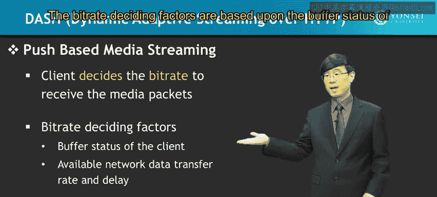
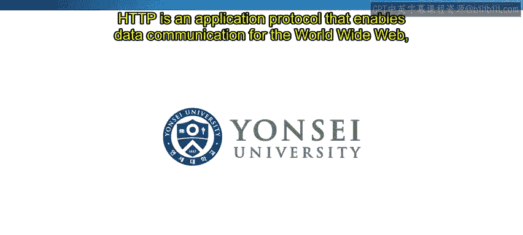

# 延世大学《新兴技术从智能手机到物联网再到大数据Emerging Technologies From Smartphone to IoT to Big Data》 - P147：24_5.2 视频帧和HTTP（第1部分）.zh_en - GPT中英字幕课程资源 - BV18hpFewEcG

哦。🎼Yeah。Now looking into the video frames that are in the fragments。

We have iframe for intracoded frame， we have P frame for predicted frame。

 then we have B frame for by predictive frame。An eyeframe is an independently encoded picture。

 so if you get an eyeframe and you try to present it on the monitor。

 it works well because it has all information for the image fully contained。Then。

 in order to increase the compression rate， we use P frames and B frames。

A P frame depends on one previously decoded I or P frame。

And this is to increase the compression rate， such that these Pframes are smaller compared to iframes。

 because compared to the former iframe， only the parts that are different that have changed in this new frame following frame will be encoded inside。

 and that increases the compression rate significantly。Then we have Bframes。

 which depend on multiple previous decod pictures。 What does this mean。

 Why would you need to rely on multiple decod pictures， Think of it this way。

 If you had two images and the overall background depended on one image and a certain object that newly shows up depends on another image。

 then what if you just took those two to combine to create another image。

Then you would be using multiple former images to construct your new image。And if it works that way。

 with a little bit of image information， you can create the new image at a very low data rate。😊。

So therefore， the compression becomes very powerful and the resulting file becomes very small。

 which is exactly what we want that is one example。

 a relative example compared to what the B frame is actually doing。

P and B frames have higher compression rates， which make the video streaming file very small。

 and that is wonderful。This encodes the motion compensated differences。

 which is the relative information only of other frames。

 and that is how it gets to make these frames so small such that the compression rate is very high。

This provides advantages in。When you save a video file on your device。

 it takes just very little space。 In addition， when you request for it to be sent to you。

 just a little of data flow will enable a large amount of video playback to become possible。

 So it is a win win， as in terms of networking and also story。😊。

The video frames are based on video fragments， and these are made up of one or multiple gopes。 G。

 OPS。 This stands for groups of pictures。😊，And there is， each group of picture begins with an iframe。

 and then it is followed by P or B frames。This results in a much smaller video file size。

Compared to using all iframes， because the eyeframe is large because it contains full information of an overall image。

Very high data compression rate is achieved due to the P& B frames used in IGOP。

There are two types of GOP， one is a close type in which the P and B decoding depends only on frames within that GOP。

However， an open GOP is when a P or B frames will depend on frames that are beyond the GOP range of where they are contained within。

So when you're using an open GOP， you need to have some other GOPpss opened up and kept in the memory because an open GOP will have some P and B frames that will need to take information from those earlier GOPPs that were already opened and played on the video。

 however， when you have closed GOP then the overall buffer size you need to dedicate in terms of memory allocation for the video streaming playing can be just smaller because everything is self-contain。

 you open up a GOP and all of the relations are within that GOP so based upon closed and open。

 there are ways that you can achieve different levels of buffers and also how do you play the video back will be dependent on which type of GOP you're using。

HTTP Progressive download。One of the most widely used poolbased media streaming methods。

 And that is because it has ubiquitous connectivity。 Almost all mobile devices， Pcs， laptops。

 tablets and pads all use this technology。 So this is why it's so popular。

 And why you need to learn about it。 So here we go。😊。

It is used in almost all applications and web services over the Internet。

 YouTube uses H T TP over TCP。And various other video streaming technologies use it as well。

TCP supports recovery of errors， reordering of data segments。

And erroneous and lost packets are recovered by the TCP。

YouTube needs to provide adaptive transmission control to avoid video stalling。

 and that is exactly what MPEC Dash does。Poull based media streaming based upon HTTP。

This is the most common protocol that is used for video service delivery and various media streaming delivery。

The media client is the active entity that requests content from the media server。

And the server response depends on the request from the client。

 so you can see that there is a direct pull mechanism and unless it is requested。

 the server will not send it to your smartphone。In addition。

 the client decides the bit rate to receive the media packets。

The bit rate deciding factors are based upon the buffer status of the client and available network data transfer。

 rate and delay。

