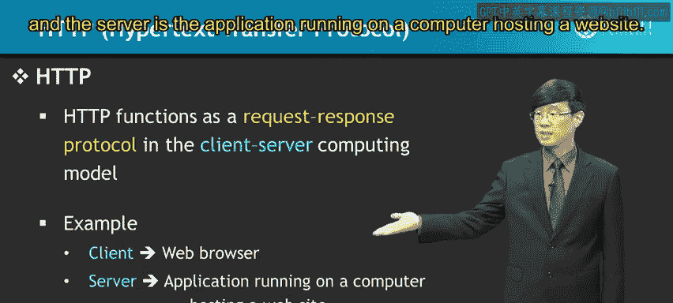
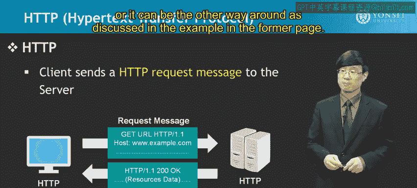
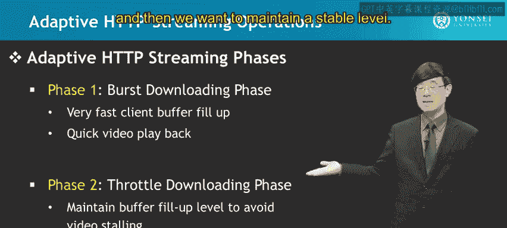

# 延世大学《新兴技术从智能手机到物联网再到大数据Emerging Technologies From Smartphone to IoT to Big Data》 - P148：25_5.2 视频帧和HTTP（第2部分）.zh_en - GPT中英字幕课程资源 - BV18hpFewEcG

哦。🎼Yeah。HCTP is an application protocol that enables data communication for the World Wide Web。

And it is very popular。HTTP supports， distributed， collaborative。Hypermedia information systems。

In addition， HCTTP is the protocol used to exchange or transfer hypertext。

Hypertext is structured text that is used in hyperlinks between PC smartphones and servers。

 This is what the website addresses are used and requested through text with special formats that are enabling website and various hypertext support services so you can see that HTTP is needed and naturally it is very popular based on the fact that HTTP is based on a pull mechanism makes it even better and these combinations come together in and dashash。

😊，Here， HTTP has a history that is quite interesting， it was created in 1989 by CER。

 which is the European Organization for nuclearcle Research。It was standardized by the IETF。

 the Internet Engineering Task Force， and the Worldide Web consortium。

 so from the beginning you can see that it was made to be used as a web internet support mechanism。

 and it is definitely serving its original purpose。HTTP versions include 1。0。

 which is the original HTTP。This makes a separate connection to the same server for every resource request that is received。

An upgraded version is in RF。2068， and that is version 1。1。 This was released in 1997。

And in this mechanism， it can reuse a connection multiple times for downloading video。

 audio and data， so definitely as you can see that there is a significant boost in its efficiency on how it can be used to support multiple connections。

😊，HTTP 1。1 was revised and RF 2616 was released in 1999 replacing its former version RFC 2068。

This commonly is what is used in the internet nowadays。

HTTP2 was standardized in 2015 and is now supported by major web servers。

The HTTP functions as a request response protocol based upon a client server computing model。

 so it is a request that is made and a response is sent to it。

 the typical pull based mechanism in which who is making the pull request the client is and who is responding the servers。

An example will be like the client is a web browser and the server is the application running on a computer hosting a website。

Here is an example where a client sends a HTTP request message to the server。

 you can see the request message that is based upon a get URL and HTTP version 1。1 is being used。

 and you will see that there is a OK message that is sent back where the resources data is returned back。

From the server to the client， or it can be the other way around。

 as discussed in the example in the former page。

Server provides resources such as HTML files and video content or functions to the client。

The server sends back a response message to the client。

 and the service response includes status information of the request process。

HTTP permits intermediate network elements to improve or enable communications between the client and server。

HTTP is an application layer protocol that needs a reliable transport layer protocol。

 and this is why HTTP works well with TCP because TCP the session control。

 and it has a windowbased control in addition to it that works with the session control and therefore it is made very reliable So HTTP with TCP good combination。

 and that is why YouTube video uses it。😊，HTTP can also use unreliable protocols， for example。

 like it does in HTTPU and SSDP， Simple Service Discovery Proto。

HTTP resources are identified in the internet using an URL。

 and that is where HTTP works so well with because it considers its original URL based connectivity support。

URLs use the URLI。Of H T TP and H， T TPS S。The URs are hyperlinks in HTML。

 which is hyperpertexts Markov language。And these documents form interlinked hypertext documents。

HTTP is commonly supported by firewalls， so connection blocking due to security issues rarely occur once again。

 because it is based on pull based mechanism。Client device controls the streaming。

 it is based on a pull mechanism。The server does not need to maintain session state information of the client device once again。

 because it is based on a pull based mechanism。HTTP 1。1 can reuse a connection multiple times。

 and that was one of the benefits of 1。1。And it can use it for downloading video audio data。

Popular websites can benefit from webc servers。And they can send previously stored contents on behalf of an upstream server to reduce the response time。

Such that this is one way to save， of course， the response time to make the response time faster。

 in addition， it prevents unnecessary traffic being exchanged over the internet。

 therefore helping to improve the internet quality。

HTTP proxy servers at private network boundaries can facilitate communication for clients without a globally routed address。

This is enabled by relaying messages with external servers。

A combination of adaptive video rate control and progressive downloading。

Typical techniques that use adaptive HTTP streaming。

In proprietary services include Microsoft smoothth streaming， Adobe HTTP Dynamic streaming。

 and Apple HTTP live streaming。It is a combination of adaptive video array control and progressive downloading。

Where several representations with different quality of the same video are stored in the server and downloaded。

 you will see this included into the impact dash package。

Videos are commonly divided into fragments of two to 10 seconds of length。

Client device periodically checks the network condition every two to 10 seconds based upon the fragment length and may make changes。

Such that these changes are based upon fragment units。 So within a fragment。

 you view what is going on。 the next fragment， I may want a different type of data rate or I want a different type of video quality。

Then therefore， the controlling units are based upon segments of the fragments。

 and that's why every two to10 seconds that is based upon the fragment size is also the reference in which the periodic checks are conducted。

The client device tries to avoid video stalling because we want our video to be streaming。

 and therefore we want to avoid having our buffer emptied。Bffer starvation。

 We don't want it to occur。 Once again， we want the buffer to maintain a stable。

 good level in which the video play， as well as the video packets arriving。

 are at the same rate or nearly the same rate， such that how much do I have in my buffer that buffer level is maintained in a stable fashion。

😊，One selection option that is commonly used is that we want to select the video player quality level to be at a slightly lower level than what the bit rate the network can support。

 because if you are using the full capacity of the network。

 then small changes to the network throughput will have a fluctuating effect on the video stream that is being received。

😊，And we don't want that。 We want it to be as stable as possible。

 So that is why instead of using the full structure of what the throughput can support。

 we want to lower it down a little bit and use that level in a steady， stable fashion。😊。

This has the effect of saving network bandwidth also。

 so it's saving network bandwidth and also making the video play very stable。

 such that buffer being empty， buffer starvation does not occur。Phase one of the process。

 burst downloading phase， very fast client buffer fill up is achieved and quick video playback is attempted。

Then in step two， throttle download phase where you maintain buffer fill up level to avoid video stalling。

So at the first， we want to hurry up to start the video so we go into burst mode， download a lot。

 and then quickly start to play， and then we want to maintain a stable level。

