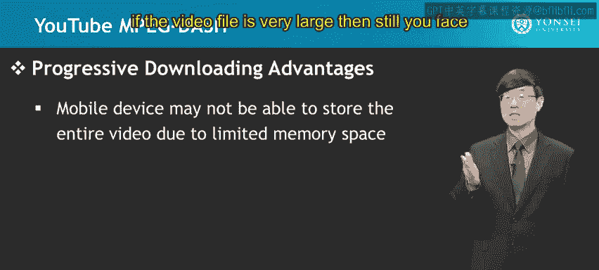
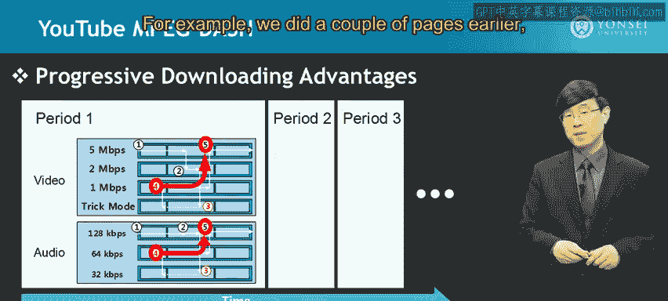
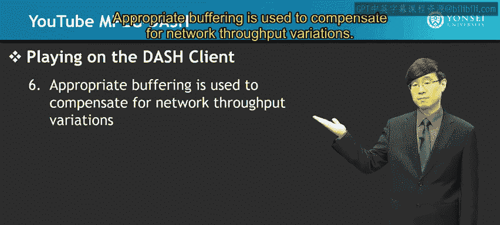

# 延世大学《新兴技术从智能手机到物联网再到大数据Emerging Technologies From Smartphone to IoT to Big Data》 - P149：26_5.3 YouTube的MPEG-DASH（第1部分）.zh_en - GPT中英字幕课程资源 - BV18hpFewEcG

哦。🎼Yeah。Now is an example of YouTube using MEC D and the adaptive HTTP streaming technology In this example。

 you can see that there are eight video resolutions that YouTube uses。😊，Here we have the 144 p。

 the 240 p， the 360 p， the 480 p， the 720 p， the 1080 p， the 1440 p and the highest resolution。

 which is the 2160 p。 What is this P This is showing the number of pixels， as you can see right here。

 the pixel structure of an image has a width。For the 144 case， the 144 p case。

 you can see that it is a 256 by 144 pixelixel image。

And the 144 is what becomes a reference for the run44 P resolution。

 so as you can see the height number。Having a P next to it is what defines the image resolution。

That is why these numbers are listed， such that the number following the multiplying sign with a P is what is the resolution way over there。

What are the differences of these rates in reference to this rate。

 which is the lowest rate of the video resolution， then the other ones go up like this in which the 240 p is 1。

6 times of a higher level than the 640。By 360 image is about 2。

5 times of a higher resolution mechanism， and you can see the numbers go down here。

 become larger and larger as the resolution is at a higher level compared to the 144P video that is here。

The internet uses HTTP streaming over TCP most commonly for video streaming。

 as we already talked about， and that is used in YouTube， however。

 other very popular techniques such as Netflix and Hulu also use it as well。

Types of HTTP video streaming。There is the regular HTTP streaming。

 which completely downloads the video to the client device。Then there is progressive。

 which is progressively going to download the video at a fixed quality。Then there's the adaptive one。

This is the adaptive streaming over HTTP， where it is a combination of adaptive video quality。

 adaptive video rates， control and progressive downloading techniques are all used together。

 Typical techniques that will support this are the impact dash in which YouTube is using So you can think of this right here as what is being used by YouTube。

😊，Progressive downloading advantages。A mobile device may not be able to store the entire video due to limited memory space in this case。

 progressively downloading is nice because if you do not have enough space this will prevent you from actually viewing the video if it is required to have it fully download it however。

 progressive download is a technique in which you can download and the downloading amount maybe up to about two seconds。

 10 seconds， maybe even 30 seconds worth of it， and that will be in the buffer and displayed so therefore the parts that have already been viewed can be erased。

So therefore you do not need to save the entire file。

 and that is a real advantage for devices that have limited memory， even if you have a lot of memory。

 if the video file is very large， then still you face the same problem and this works as a wonderful solution。

In addition。Many users do not watch an entire video， for example， in YouTube and other services。

 a common factor that is analyzed and discovered is that many people only watch about 20% of the entire video so if you download the entire video and view it。

 then 80% that you're not going to view was a total waste in your personal data usage and also the internet bandwidth consumption。

So therefore， progressive download is going to provide you with this benefit。

 You're going to save your personal data and you're going to save usage of the Internet bandwidth。

 These techniques make impact D so attractive， and that is why YouTube is using it。😊。

Here is one example of a YouTube based impactEC dash video service。

 and please note that there are periods in which changes are made， in addition。

 please note that in the video and audio there are multiple quality levels。Of course。

 the ones that have the higher data rate are the higher resolutions， as in terms of video and audio。

Looking into the details， we start at point1。 This is the same reference point of video and audio。

 as you see right here， then as you go and progress， you will see that in this example。

 due to conditions that are changing in the network and the network conditions are getting worse。

The throughput is being reduced。 More delay is being experienced。

 packet errors are being experienced。 Then we drop to a lower data rate。

 We don't drop all the way to one， but we stay at that level， which is next to the 5 Mbit per second。

 which is the 2 mebit per second。 And here you can see that we only drop the video quality。😊。

Where the audio quality is maintained。This is because the video quality drop results in a larger savings。

 so we're going to gradually degrade the overall resolution and performance of this service。

Then we stay at this level and you'll see that the next step due to degrading quality conditions that as we draw from two megabits per second down to trick mode。

You'll see the same thing in which we have 128 kilolibpers per second。

 drop down to the lower audio mode。Then you see that at trick mode that we go back to a certain position。

 this is where you put your finger on the video scroll bar and move it back to a certain position。

What happens over here is that that effect will be shown in both the video and the audio。

 because if you pull back your video to a certain position， if you do a rewind to a certain position。

Where you're going to do a review back at a former video segment that you've already viewed。

 well when you do that， of course， the video and the audio needs to be matched at that current point。

 and that is what you're seeing right here。It is based upon the trick mode。Then starting back at04。

 this is where we're going to start， and then as the network condition improves。

 we go to a higher audio quality and a video quality together。

 and that is the way that YouTube and Dash is controlling it。

Over here you see that what is being provided is only with three video resolutions and a trick mode。

But。YouTe videos can be with more resolutions included inside。 For example。

 we did a couple of pages earlier。 it had more levels， up to eight levels that were used。😊。

And that is where our video is at stage5 and it continues on into period two。

EmpPEC dash specifications based upon ISO， IEC 2309-1。

The impact dash standard only define the MPD and the segment formats。

 the MPD is the media presentation description。The MPD delivery format of media encoding that will include the video segments。

 adaptive downloading， video plane control are determined by the application on the client device。

The HTTP server here， the MPD and the video and audio data segments are stored in the server and maintained and controlled there。

Playing on a dash client is based on step one， where the dash client requests formpD from the server to be sent。

Once again， this is a pull mechanism， so the client needs to request for it for it to be delivered from the server。

 the typical pull mechanism。The MPD is delivered to the client using HTTP， email， thumbh driveri。

 broadcast， or some other mechanism。The client parses thempD。

And then the client MEC dashash application reads its information。The program timing。

 media content availability， media types， resolution， minimum and maximum bandwidth。

 available multimedia resolution types， and so much more information can be read。

The client selects the appropriate encoded alternative and starts streaming the content by fetching segments using HTTP get requests This is exactly what the pull mechanism and it's going into action。

Appropriate buffering is used to compensate four network throughput variations。

The client continues to fetch subsequent segments and also monitors the network bandwidth fluctuations。

The client adapts to the available bandwidth by fetching segments with lower or higher bit rates to maintain an adequate buffer。

On the H TTP server side， there are segments and fragments。 In addition， there's the MPD。

 the media presentation description。And through MPD delivery on the dash client side you can see that there is a parser for the MPD。

 there is a segment parser for the segment video streaming data。

 there is a media player unit also down here there is an HTTP client here in this example it is based on HTTP 1。

1 it could be based on 2。0 and then there is a controlled heuristics engine。

This is all in the dash client and working together such that the M Dash video can be played on your device with help from the server。

 This is exactly what YouTube M Dash uses。😊。