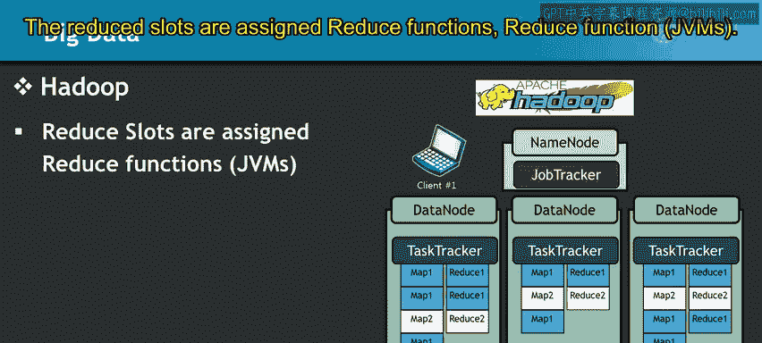
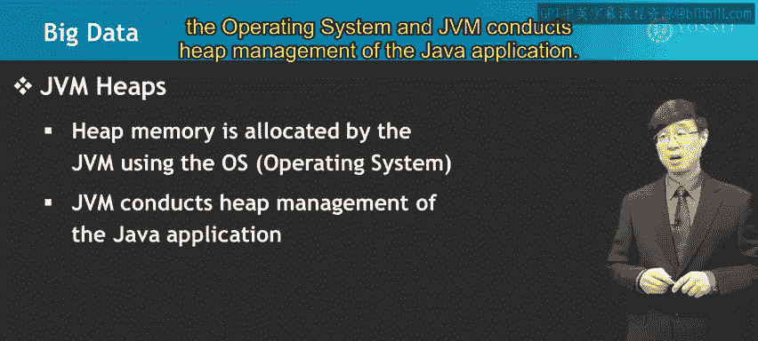
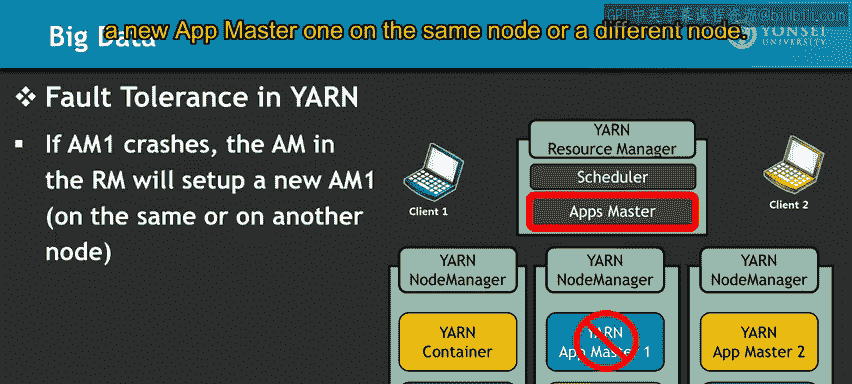
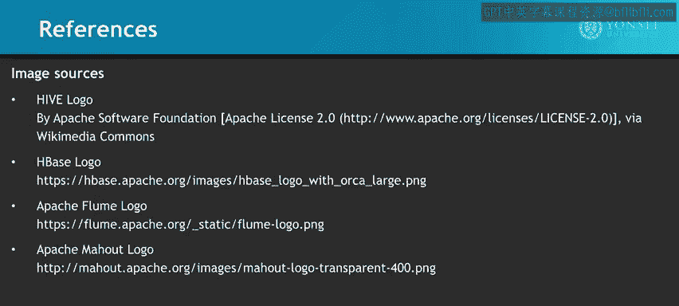

# 延世大学《新兴技术从智能手机到物联网再到大数据Emerging Technologies From Smartphone to IoT to Big Data》 - P14：13_2.10 Hadoop与Hadoop YARN的比较.zh_en - GPT中英字幕课程资源 - BV18hpFewEcG

哦。In this lecture， we will now look into Hadoop and compare the operation to a Hadoop yarn system。

In this example， client1 sends app 1， application 1 to execute mapre operations in the HDFS。

In this example， a job tracker is made on the name node。

The job tracker could be located on a different node。In this example， it's located on the name node。

Then a job tracker is formed。To execute the job。The name node selects data nodes。

Then the data nodes will start to send heartbeat signals to the name node every three seconds。

The job tracker， which serves as the brain， the master， sets up multiple task trackers。

 which will be the workhorse， the slave notes。Each task tracker assigns slots to be either a map slot or a reduced slot。

Map slots are assigned map functions。 These are JVMs。What is a JVM， I will soon explain that to you。

The reduced slots are assigned。 reduce functions， Red function， JVMs。

Parallel processing is operated based on simultaneous controlling multiple process Is。

In order to explain what HVM is， let's look into Java。 This is a trademark owned by Oracle。

HAVM is a Java virtual machine。 It is a virtual abstract computing system on a computer used to execute Java programs。

It runs on a JRV Java runtime environment。 This is a software package that contains a JVM called a hotspot and JCL。

 which is a Java class library。JVM memory usage types include heaps。Threadat stacks， native handles。

 internal data structures， and others。JVM heaps are Java objects that are kept in the heat memory。😡。

They make the process much faster。 When a JVM starts， the heat memory space is allocated。

Heap size can be increased or decreased during the execution of the application。

Heat management is allocated by the JVM using the operating system。

 and JVM conducts heat management of the Java application。

Haadop， with yarn example。The resource manager has a scheduler and App master inside。

The resource manager prepares node managers on the multiple nodes in the cluster。

The node managers send heartbeats to the resource manager to show that they're alive and also support updated connectivity information。

A zookeeper can be applied to the resource manager for high availability protection。

Client1 submits app1， applicationpplication1 to the resource Manager。

The scheduler selects a node with sufficient resources to set up app Master1 on the node manager。

I do need to mention that this is app master 1 on the node manager， and on the resource manager。

 it is App master， it's plural。The App master， which is on the resource manager。

 starts to monitor the app master one to check if failure occurs。Now。

 this monitoring process continues on for the entire duration of this application。

The app Master1 communicates with a scheduler in the resource manager requesting for containers to be set on the node。

The scheduler sends keys and container information to at Master1 for the containers to be set up。

Based on the keys and container information received from the Schr。

 App Master1 contacts the known masters and sends keys and container information and requests for containers to be set up。

Then， each。Notode manager， contacted by app Masterster 1 will set up a container to run app 1 on their node。

 and that's in the yellow app ones assigned。Let's look at what would happen if another client were requesting for their application to run。

Then app 2 will be submitted to the resource manager。

The scheduler will select a no to set up app Master 2。

The App master will start to monitor at Master2 to check if failure occurs。

 and this process will continue as long as the clientient2 app is in process。

App Master 2 requests for container setup， and the scheduler sends key and container information to App Master2。

A Masterster2 contacts the node managers and sends keys and container information to request for containers to be set up on their nodes。

Each node manager contacted by app Masterster 2 will set up a container to run app 2 on their node。

App 2 will run on the new containers。For fault tolerance in yarn， if a container crashes。

 at Master 1 will communicate with the resource manager and will set up a new container to replace the crash container。

If App Master 1 crashes， the App master in the resource manager will set up a new app master1 on the same node or a different node。

These are the references that I used， and I recommend them to you。 Thank you。

