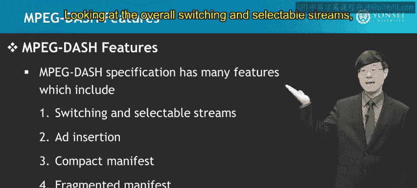
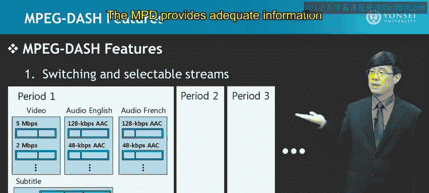
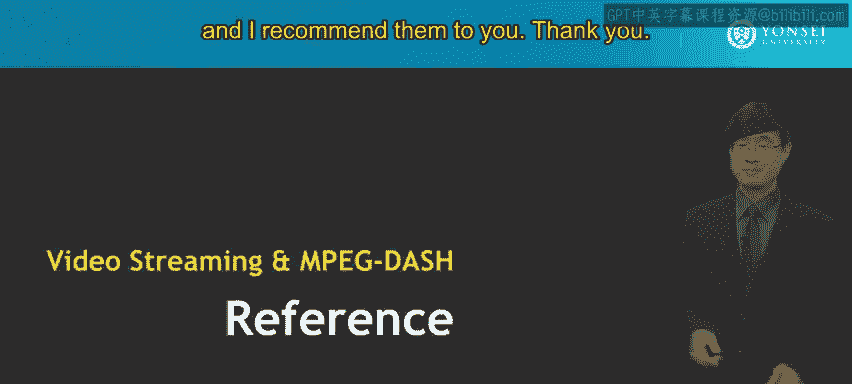

# 延世大学《新兴技术从智能手机到物联网再到大数据Emerging Technologies From Smartphone to IoT to Big Data》 - P150：27_5.3 YouTube的MPEG-DASH（第2部分）.zh_en - GPT中英字幕课程资源 - BV18hpFewEcG

哦。🎼Yeah。Let's look into the overall MPD， what is in here and what is the structure？

As you see way over there in the MPD which is the media presentation description。

 look there are periods， period ID， start units and multiple of those are included inside if you look at one of the blocks and expand it out。

 let's say we're looking at period ID number two and open it up then you'll see this over here in which it has a start of 60 seconds In addition there's adaptation set zero。

 set one and set two inside。What is in this adaptation set Well。

 let's open up adaptation set one inside you see the representation one at five megabits per second。

 representation2 at  two megabits per second， you see the representation3 at 500 kilobits per second and you see representation4。

 which supports trick mode， T mode is very convenient having it in there is good。

Looking into what's in this representation， let's open up representation two。And it has， of course。

 the two megabits per second。 This is where the segment information is included。

 What's in the segment information。 This is in the segment information where you see it has its duration listed and there are initialization segment。

 media segment1， segment 2 media segment 3 media segment 4， and this information is included inside。

 So overall now you know what is inside the MPD， and why the MPD is so important to support and help the dash client。

 which is using MP dash which is used in video services like YouTube。😊。

The MPD contains multiple periods。The periods contain multiple adaptation sets。

 The period is a program time interval， which includes information on the starting time and its duration。

The adaptation set contains multiple representations。A representation。

 this will have different bit rate encodings of video or audio of the same multimedia content The bit rate is based on resolution。

 number of channels and other information。The representation for T mode can be included。

 and for YouTube， having that in there is a necessity。Once again。

 the T mode is this application where you can go fast forward or review and look at a certain place。

We already studied some frame information like the iframe， the Pframe and the Bframe。

 typicallyy the iframe is used when you're doing trick mode。

 so when you put your finger down and you move it around to look at a certain point in the video then both the video reference point and the audio reference point will be moved around together but instead of hearing something typically you'll see an image of when when you turn on your video at this point then this will be the starting image you will see and typically it is useful to use iframes when you're representing this part because iframes are complete information they have independent information of the complete image inside So therefore if you're developing a video service streaming mechanism like this。

 then in trick mode， those small windows could be low resolution iframes that are shown。😊。

Then step number four， representations consist of multiple media segments information。

Segments are chunks out of the media stream in a time order sequence。Each segment has a URI。

 a uniform resource identifier， and this is critical to be used in web based applications。

The UI is used as the service address location from where the multimedia content can be downloaded from once again。

 webbased application support of where the information is and the UI will provide its web based location identifying information。

Download uses HtTP gett， which may include the byte ranges。Step5。

 segment information includes its initialization segment and information of multiple media segments。

EmpPEC dash specifications have many features which include。Switching and selectable streams。

Add insertion。This may seem trivial， but if you're the company that is supporting the server and video streaming。

 actually a insertion may be your most important thing。😡，Compact manifest。And fragment manifest。

 In addition， it has segments with variable durations。

 All of this is used in adaptive video streaming techniques。😊。

Looking at the overall switching and selectable streams， in period one。

 you see video at5 megabits per second，2 megabits per second， and lower rates， audio in English。

At the 128 kilos per second，48 kilolib per second level。

 then audio in French at the 128 kilos per second and 48 kilo per second。 In addition。

 you will see subtitles in English and French。😊，This is what we have in the switching and selectable streams based upon units that are segmented in periods。

Switching and selectable streams， the MPD provides adequate information to the client for selecting and switching between streams。

Selecting one audio stream from different languages is possible。

Selecting video between different camera angles is also possible。

Selecting the subtitle from provided languages is possible。

Dynaically switching between different bit rates of the same video camera is also possible。

 so you can see the diverse based switching selectable items that are supported in impact D and this is what makes it so great and so effective。

At insertion， advertisements can be inserted as a period between periods or segment between segments in both on demand and live cases。

On both on demand and live cases， meaning that you can include ads in support of prescheduled ones。

 as well as on demand and live。 that provides wonderful flexibility to the service provider and once again。

😊，Including an ad may be the most important resource of revenue for the company that is in charge of the video streaming or the server。

So therefore， it is so important。In addition， compact Man， fragmented Man。

 the compact one is the segment address URLs can be signaled using a template scheme results in a compact MPD。

Then the MPD can be divided into multiple parts where some of its elements can be externally referenced。

 enables downloading MPD in multiple steps， there are benefits and advantages。

 pros and cons of each one of these。Segments with variable durations。

 as you can see in this example down here， duration of segments can be varied。😊。

Duration information in live streaming， the duration of the next segment can be provided in events along with delivery of the current segment。

Especially when you're doing live streaming， having this flexibility in variable durations of your segment is very beneficial。

😊，Here is an example of impact dash features where you can see the content and different servers or CDN is listed here where multiple base URLs can be used the same content can be available at multiple URLs client can stream from any URL that is provided。

And you can see the dash encoder over here， the dash client over here。

 and in the middle different servers or CDN network connected。

 where content segments are listed here。The option of CDN， as it's showing up。

 up and again and again and again， in this is why we will study about CDN in the next module of this course。

😡，Clock drift control for live sessions。Here， the UTC time can be included with each segment UCT time enables the client to control its clock drift and reynchronize such that the video streaming process that is being conducted over the Internet and other wide area network and small area。

 local area network technologies， these are all coordinated perfectly based upon the UTC coordinated universal time that is included in the segments as you can see here where the UTC time reference is inside。

Then in step number8， we have SVC and MVC is supported。 Both of these are important。

 SVC is scalable video coding， and MVC is multi view video coding。

Both of these are important the MPD provides adequate information regarding the decoding dependencies between these representations This information can be used for streaming any SVC or MVC multilayer coded streams。

A flexible set of descriptors is also one of the features。

The descriptors describe the content rating， components role， accessibility features， camera views。

 frame packing， audio channels， configuration， all of this is so important。

 gives you the capability to control and switch and select what you're going to be using in your display。

Number 10， subsetting adaptation sets into groups where grouping occurs according to the content author's guidance。

 so you can see that the author of the content can have some type of selection mode in which it is presented in a way that it is desired by the original creator。

Quality metrics for reporting the session experience。

Empact Dash standardss has a set of quality metrics。

 these metrics are used by the client to measure and report back to a server。

So the server can get feedback on the quality of the session experience。

So this information can be collected and used to improve the way that the network is managed and controlled and various other characteristics can be prepared。

 scheduled， and deployed based upon this very important information。😊。

Most of these features are provided in flexible and extensible ways， they're not required。

 you get to select what you want to use and among the options that are provided。

 you can decide how you're going to use them this enables impact Dash to be used in flexible ways in various future applications This is why I am teaching this in such detail because impact Dash is not going anywhere it is the technology of today and it's going to be the technology of the future so if you understand what I've just explained you will be able to use it in various ways for your applications in the future。

These are the references that I used， and I recommend them to you。 Thank you。

