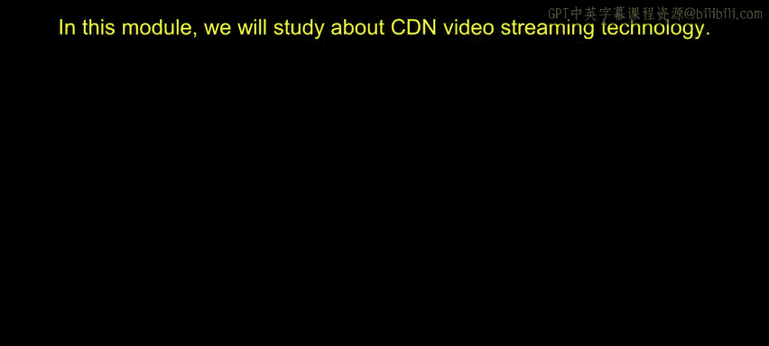

# 延世大学《新兴技术从智能手机到物联网再到大数据Emerging Technologies From Smartphone to IoT to Big Data》 - P151：28_6.1 CDN介绍.zh_en - GPT中英字幕课程资源 - BV18hpFewEcG

응。🎼Oh。In this module， we will study about CN video streaming technology。

 We will start with the CDN introduction。The lecture sequence is based on the motivation and structure。

 procedures， hierarchical content delivery model， market and major service providers。

 and advanced technologies in CDN。😊，Starting off with the motivation of CDN。

 CDN is a network constructed from a group of strategically placed and geographically distributed caching servers。

When we say geographically distributed， this could be worldwide， Intercontinental connected。

The CDN is one of the most efficient solutions for the content provider in serving a large number of user devices for reduction in content download time and network traffic content download time reducing this is very critical if you have a slow content downloading time。

 people will not use your service。In addition， reducing network traffic。Think of YouTube。

 YouTube has millions up to billions of users that are using it。

If everybody has their request individually connecting to the main server。

 then the main server is not going to be able to support all of it。

 so therefore what CDN technology will do is that it will predict what is needed or what is going to be used most popular。

 place it in a local server such that when requests are coming in。

That will be the place that will provide the video streaming to the user。

So therefore CDN technology is critical and it is used in video streaming。

 especially the powerful internet based Intercontinental connecting。

 major popular video service streaming techniques all need CDN technology support and that is why this module of lecture is so important so hang in there。

😊，The network traffic that is accessed by mobile users， smart devices is rapidly increasing。

Mobile network performance is highly dependent on the content download of the multimedia data and applications。

In addition， several mobile network operators have suffered from service outage or performance deterioration due to significant increases in use of mobile devices。

 so they are growing the network more and more but not at the rate that the number of users are growing so at a certain point when there's more users then the network can support you will see that services will be downgraded。

 it will stop， it will be halted。😊，Or it will become extremely slow to a level that it is useless。

There are mobile operators that are experiencing this。 How do you reduce this effect。

 CN technology is critical。For this example。The content provider may be way over there in the United States where the users are in all these different countries。

 for example， maybe YouTube downloading video， if everybody is connecting to the United States to download something from Google or YouTube。

 then naturally the overall international connection that connects these contents is going to be overcapacitated。

 overloaded and overall a lot of different services are going to be heavily influenced。

To prevent that， we are going to use C DN technology using C DN， Both content。

 download time and network traffic are reduced。 Win， win。 So therefore， it is very important。😊。

CDN and mobile networks， especially on your smartphone。

Mobile communication networks have a stronger need for both reduced traffic load and content delivery time compared to broadband backbone networks within an untonommous system。

What is this talking about well， mobile communication network service providers。

 they need to provide services to users these users are not like they are connected to a gigabit ethernet wired connection sitting in front of a notebook computer or a personal computer No。

 these are users that are moving around。They're moving around to different cells such that handover needs to be supported。

They're moving to cell edges， which is the place where handover is going to be executed。

 and at the cell edge， you have a very poor link。 that is why handover is needed。

Then how to provide services at these conditions。In addition。

 you need to support services through wireless connectivity。

 where the bandwidth and the throughput is limited， and also your prone to errors。

In these situations， you need to reduce how much is being sent and provided in a way such that the users get what they want。

 however， the network resources are not overused。In these very limited resources of mobile communication cellular networks that are providing all the switching and roaming services。

 which are very complex to support。These networks are very sensitive。

 so CDN technology supporting them is even more critical。

International and Intercontinental backbone networks have critical need for CDN support。

 they want the amount of traffic that is sent across intercontinent connections to be minimum because those links are expensive and they have uses where multiple users that have critical high priority service needs will need to be using it first。

So therefore， CDN makes everything much more efficient。

You will see that BGP4 borderor Gateway Protocol 4 is used beyond on autonomous system networks。

 and this protocol may have different policies in charging traffic usage costs。

 so therefore using CDN for a certain content that is delivered to a certain region in which it is reused for all multiple users that request for it will save one single transmission such that it is used multiple times。

 saving network traffic over that long haul backbone connection。CdN structure。

CDN usually consists of a content provider and caching servers。

The content provider possesses all content to serve。 In addition， for the example of YouTube。

 there may be multiple videos at different qualities of the same video movie。 In addition。

 the audio may be at certain levels in which there is high quality and low quality audio of the same movie。

😊，So therefore， the CP， the content provider， needs to possess all。

The caching servers are distributed in the network。

 containing selected copies of identical contents that the CP stores。

Then you will see the content provider and the caching servers over there。

 which are closer to the user。When a user requests a content to its nearest caching server。

 the server can deliver。😊，The content， if the requested content， is in its cash。Otherwise。

 the caching server redirects the user's request to the remotely located CP。

When a user requests a content to its nearest caching server。

 the server can deliver the content if the requested content is in its cache。

 as shown in the former example， here in this case you'll see very quick delivery where the user sends a session request。

And the local caching server has it， it will check if it has the content in its cache。

 and then it will send back a session response saying that yes， I have it。

Then the user will do resource allocation， as in terms that on its device。

 it will do memory allocation。 It will create a space， and then it will request for the content。

 and then it will have it delivered in that。Location that has the resources to be saved。

 that's where it will store the packets of the video。This is a procedure。

 in case the local caching server doesn't have it， then what will happen in a time flow diagram？

If the requested content is not in the local cache server。

 the content request is redirected to the remotely located CP。And the procedures are like this。

 number one。The overall session is requested。Here， the local caching server will check if it has the content。

Then resource allocation for the requested content is made because it does not have it。

This resource allocation is to prepare its download from the C。

 so it requests the C to send it through a content request。

 and then the content is delivered and the content is saved in the resource allocated area。

Then it will send a session response back to the user in step six。

And then the user will do a resource allocation， it will open up memory。

 and then it will send a content request to the local caching server and the local caching server will then send the content delivery。

The content delivered packets will be of course， saved in the users。Allocated resource area。

Content aging is focused on delivering the most popular contents to the user in the most effective way。

 In other words， we want to send things that will be requested。

 that will be reused and reused and reused locally so content aging is one thing where older contents are discarded to make space for newer contents that are more popular to come in。

Depending factors include location of caching servers， number of caching servers。

 limited memory size of the caching servers。In other words， if you have a little memory size。

 a small memory size， then you will need to do the。Throwing away process。

 the discarding process of older contents much more frequently。Content aging。

 delete expired contents from the caching server。Download update contents from the C。

 and that is what you need to do。 you need to have a good balance of throwing old things away and then downloading new stuff that is much more popular。

Each content has a content update period， which is a time to live based operation。

Few seconds for online trading， few seconds for auction information。And 24 hours or more for movies。

These are the references that I used， and I recommend them to you， Thank you。

