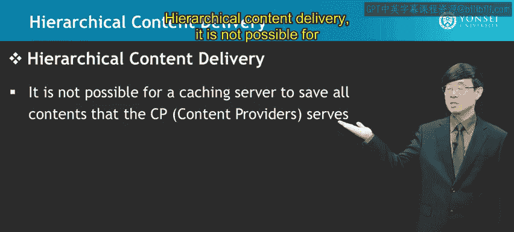
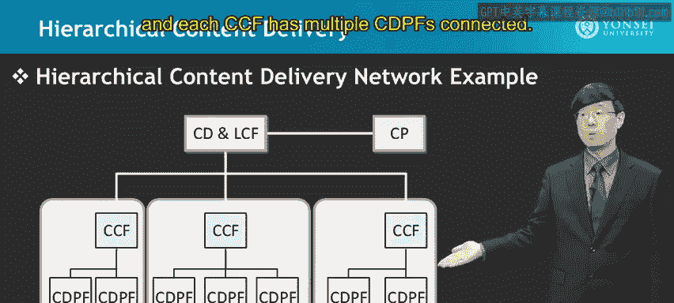
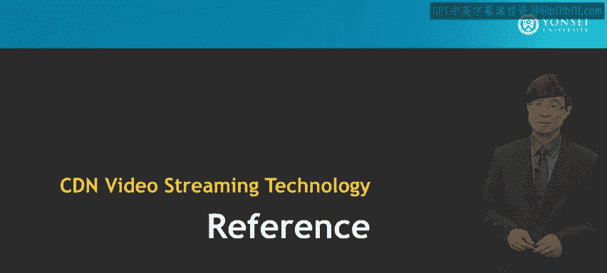

# 延世大学《新兴技术从智能手机到物联网再到大数据Emerging Technologies From Smartphone to IoT to Big Data》 - P152：29_6.2 CDN分层内容分发.zh_en - GPT中英字幕课程资源 - BV18hpFewEcG

응。🎼Oh。CDN， Hierarchical content delivery。Hierarchical content delivery。

It is not possible for a caching server to save all contents that the content provider serves。

Retrevieving contents from the remotely located CP can cause a long content download time。

Because the CP has many users that are connecting to it and downloading。In addition。

 the CP is most likely far away， such that there is a long network between the caching servers and the CP。

 so therefore when you request for something that request has a long way to go and the delivered video packets have a long way to come and when the link is long errors can occur more frequently which need to be recovered through the TCP process。

Typical examples， a large amount of traffic will be generated by each server in support of the content's packet routing。

For the given cache size of each server， it is important to maximize the hit rate。

Of the local caching server， such that the requested contents do not have to be retrieved from the CP。

Meaning that you want to bring the most popular contents that are going to be requested and requested frequently。

 having a high hit rate， and you want to save that information in the local caching servers in the areas where it will most likely be requested。

So therefore， some content may be more popular in some locations and other content will be more popular in other locations。

And that is going to be all related to the hit rate。 and therefore。

 not all caching servers that are locally placed will be saving the same information。

 They will have all different requests based upon what type of local server users are requesting for services。

😊，Hierarchical CDdN accomplishes this objective in the internet in a very scalable way。

 meaning that you increase the number of users still it maintains a very good performance Hierarchical cooperative content delivery techniques are used in providing content delivery to local caching servers。

😊，And we'll study more on that。What is the main functional blocks that are used in hierarchical content delivery。

 We'll start with the CN LCCF。 This controls the overall content delivery process and has all content Is of the CN。

The CCF is the cluster control function， and this controls multiple CDPFs。

 which are the content delivery processing functions。And saves content ID of the cluster。

The CDPF stores and delivers the content to the users， so we have CD and LCCF， we have the CCF。

 the CDPF， and we have the users。Connected in a structure like this。

Here at the bottom of these clusters， you can think of there are multiple users down here。

 but we're not drawing them in this figure。 You can see the C is connected to the C and LCCF。

 which is connected to the CCFs here in each cluster each cluster has a CCF。And the CCF。

These are connected to the CDPF in the cluster， and each CCF has multiple CDPFs connected。

Looking into case one of the content delivery procedures， request content is in the local cluster。

Content request message is delivered to the CCF。CCCF sends a session request message to the CDPF to deliver the content to the user。

 and then the CDPF delivers the content to the user。Very easy。The easiest case。

 which works like this。 The user has a session request made。 Step 1。

 This is received by the CCF in the local cluster。It's going to check if the requested content is in the local cluster then here session setup is conducted where the target CDPF is linked together and then session response is sent back to the user the user now is going to prepare to download by doing resource allocation maillock memory allocation to open up some space for the packets of the video stream to be saved。

Then content request is made in step 6， content request is made in step7 in which6 is from the user to the CCF Step 7 is in the local cluster from the CCF to the target CDPF。

Then the CDPF delivers the content to the user。Case 2。

The requested content is not in the local cluster， but another local cluster。

 a target cluster has a content， what are the procedures？The procedures are。

 the content request message is redirected from the local cluster to the CD and LCF。

That needs to be used in this stage， then the CDN LCCF checks if the requested content is in the other cluster。

Then the requested content can be delivered from the target cluster to the user directly。

 or it can be passing through the local cluster and the local cluster can deliver it to the user。

The local cluster can store the requested content and deliver to the user。

The procedures are like this。Much more complex and this is because。The local cluster doesn't have it。

 so here we go in step one， the user has a session request made to its local CCF。Here。

 it checks the content capability inside the local cluster。

 The CCF is going to check among its multiple CDPFs。Then if I at oops， I do not have it。

 then a redirect request message is going to be sent to the CD and LCF。

That unit has information of other local clusters， so it's going to start to look and search around the other clusters。

 and it will allocate the cluster that does have that information。

It will send back a response telling the CCF。Where to make connection to and the CCF will make connection by sending a session request to the target clusters CCF。

Then session setup will be done within the target cluster。

 this will connect the CCF with the appropriate CDPF within that target cluster。

Then the CCF will send back a session response， it will go back to the local clusters CCF。

And the local cluster CCF will send back a session response Now the user will then prepare the resource allocation part to download and save the received packet。

Then it will send a content request directly to the targetrget cluster CCF。

And the content request will be made directly to the CDPF within that target cluster。

 and the CDPF will send the content directly to the user in this example。Case three。

 when the requested content is not in the CDN。The content request message is sent from the CD and LCF to the CP。

And in this case， the CP needs to be contacted because it's nowhere in that range。

The CP delivers the content to the user through the local cluster。

And the requested content can be stored in the local cluster。

The mechanism is like this in which in a abbreviated mechanism explanation。

The user connects to the local cluster， the local cluster connects to the CDN LCCF。

As it is not identified anywhere in this range that it has it。

 well the CDN LCCF will make a request to the CP， the CP will send back information to the CDN LCCF and the CDN LCCF will contact the local cluster。

AndAfter exchange of these procedures， you will see that the CP will send the information to the CDPF in the local cluster that will be sent to the CCF in the local cluster。

 which will contact the user， the user will open up its memory to do resource receiving of future packets。

 that is the resource allocation mechanism， you see in step over there step 15。

 then it will make a content request to the CDPF that is local and the content delivery will be sent to the user in step 17。

These are the references that I used and I recommend them to you， Thank you。

