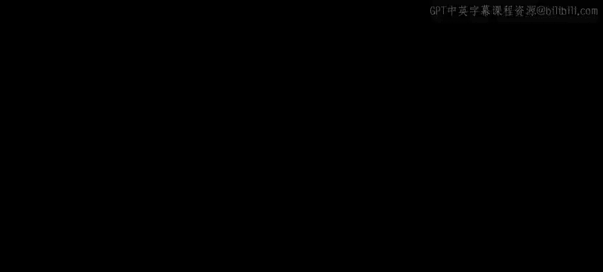
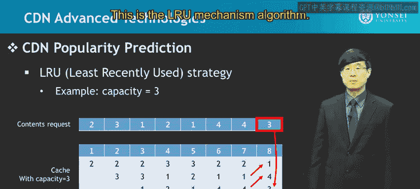

# 延世大学《新兴技术从智能手机到物联网再到大数据Emerging Technologies From Smartphone to IoT to Big Data》 - P154：31_6.4 CDN先进技术（第1部分）.zh_en - GPT中英字幕课程资源 - BV18hpFewEcG

哦。🎼Yeah。CDN advanced technologiesologies， as we've just seen。

 CN technologies and service shares and overall growth。😊，Its expected。 So therefore。

 we want to look into what advanced technologies are going to be more important for the future。

Focusing on some of the topics in research and development。

We are going to start with content aspects， content type based differentiated support based on data。

 multimedia， mobile apps and other things。Content aging control。Content selection and deletion。

 content replication detection We want to be able to see what is getting older and if it's not popular。

 terminated， remove it from the CDN and look at various contents because based upon the content type。

 where it's going to be called more frequently can be predicted。Dynamic page publishing。

Digital rights management。As well as live event management。

 all in the domain of research and development for CDN technologies。

System aspects in measuring the CDN market value。Surrogate server location， this is dynamic。

Storage memory size， also a dynamic feature， content delivery method。

Mobile device characteristics and their location。Network latency。

Security and information assurance based on anomaly detection， user authentication。

 content authentication， all of these are system aspects。Cooperative Caching and content routing S。

You see that there is a query based scheme in which a CDN server broadcasts a query for the requested content to other CDN servers inside the same cluster if it does not have the content。

Digest based scheme， where each CN server maintains a content digest。

 which includes the information of other CN servers of the same cluster。

Cooperative Caching and content routing S。Diirectctory base key。

 a directory server maintains the content information of the CdN servers。All of the same cluster。

Then there's hashing based schemes the CDN server maintains the same hashing function。

 the contents are allocated by contentents URL， unique IDs of the CDN servers and the hashing functions are all considered in this mechanism。

Seme a hashing B scheme， a CDN server allocates a certain portion of its storage to cache the most popular contents。

 and the rest is used to share with other servers using hashing functions。

The CDN popularity prediction is commonly based on a zip distribution。

This distribution is used and it is verified through statistical models that are based on content distribution in the real world。

The popularity of the eighth popular content is described with the zip distribution。

 As you can see down there。 The equation has P with a subscript of I， where this equals omega over。

I to the Alpa power。The omega is based on this representation where n is the total number of contents。

 alpha is the zipF parameter， and this overall determines the skewness of a content popularity。

Because it represents the skewness of content popularity。

 it is used in predicting what content to save and what content to erase。Overall。

 the distribution example is based on I and it shows the P value in reference to omega as you can see when I equals one pi equals omega and when I equals 2 it is omega over 2 when I equals 3 it is omega over 3 likewise going down that table。

In addition， the value， which represents the popularity， the values are shown over here。Overall。

 based on the nth content。As in terms of a representation of alpha equals 1 n equals 10。

 you can see the values that are in the table represented in a graph based structure over here。

Where the1th content is shown over here at this edge。

Using the zip distribution and other modeling techniques。

 various models based on CN popularity prediction can be conducted。

 One of the algorithms that is frequently used is the LRU， which is the least recently used strategy。

This is used in a form where it predicts the popularity of the content according to observation to the requests based on time duration。

Commonly considers t minus1 when we are at T。It replaces the least recently used content in the CDN cache。

Recently used contents are more likely to be requested in the near future。

 The LR U model is based on this assumption。 That is why the least recently used ones will be the ones that are selected and erased。

Give higher priority to the contents that have been recently used。

 and this is the basis of the LRU scheme。In the LRU example。

This is based on a capacity of three in the cache。 And so you see 1，2，3 slots available。

 and then you see the numbers from one to8。 These are the step by step procedures。

Then over here on the top you'll see the contents that are requested。 It is like asking for content2。

 content 3， content 1， content 2， content 1， content 4， content 4， content 3。

 this is the sequence that the requests are made。And you will see that this has a priority in the cache based upon which one was most recently used。

Now， content two is requested in step one， so we record that content3 is used next。

 so therefore it is recorded as well。Content1 has been requested。

 so content1 was delivered so far there's no conflict because we have a buffer size。

 a cash capacity of three， and three types of services have only been used。

Then we have service2 being requested as contentt2 is requested。

 content2 is one of the most recently used， so therefore it goes into the high position and content one and three shift up。

네。Content1 is requested。 so content one moves into the highest position， and content2 is moved up。

 Content 3 is maintains its position。Now Con4 is requested。As you can see over here。

 Con4 is a most recently requested one， so it goes into the most recent position and then one and two shift up。

And。😊，The third content is discarded。Then contentt4 is requested。

 it moves into the same position because it was formerly the most recently requested and it is still the most recently requested。

 and then content one and Con2 maintain their position because they are the recently requested ones as well following four。

And then you'll see this over here S3 is requested。This is the most recent one。

 the other recent ones are four and1 and the older one is two。

 so since it is the least recently used one， it is moving out of the CDdN storage。

 this is the LRU mechanism algorithm。

