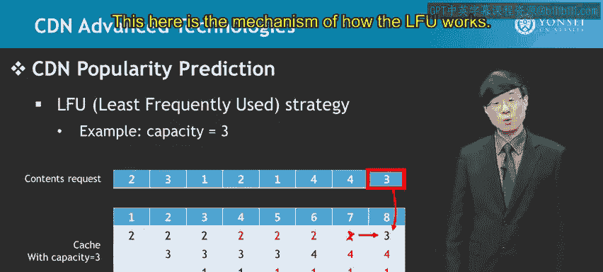
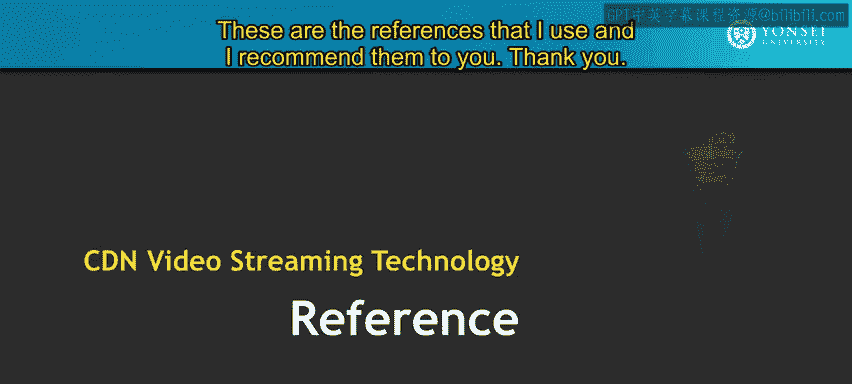

# 延世大学《新兴技术从智能手机到物联网再到大数据Emerging Technologies From Smartphone to IoT to Big Data》 - P155：32_6.4 CDN先进技术（第2部分）.zh_en - GPT中英字幕课程资源 - BV18hpFewEcG

哦。🎼Yeah。Instead of looking at what was most recently requested in the LFU。

 we're going to look at which one was more frequently requested。

And we're going to delete the least frequently used one。

 So this is based on how much you're using it in a given window period of time。 It looks like this。

 We're going to predict the popularity of contents according to observation of the request based on a time duration。

Commonly we're going to consider until t minus1， so t minus1 and a window given amount of period of time。

 and we're going to see how many times which content was requested and the least popular one。

 the least one that has the least number of requests is going to get kicked out of the group of the CDN。

 that's what we're doing。It puts in the CDN cache， the contents having the highest request frequency within a specific duration。

Keep track of the frequency of the content request to evaluate its popularity and whoever was least popular will be removed。

Here you can see that frequently used contents will be more likely to be requested soon again。

 this is the basis of this algorithm。If multiple contents have the same frequency。

 choose one of them according to the LRU strategy， so in other words。

 if they have the same frequency of requests within a given amount of recent time period。

 then which one was requested。More recently， you find that out and the other one is discarded。

 So the more recent gives higher priority to keep it saved if you have the same number of frequency that it has been requested。

Let's take an example based on capacity of three， as you see three right here in the cache。

And once again， this is the timets for the first period， the second third。

 this is the time sequence of the experiment where the contents that have been requested in the CDN are listed here。

 which is content 2，3，1，2，1，4，4，3。And we're going to look at here where the cache is in this example。

 This is not which one was more recently used。 This is not about that。

 So the positions listed here do not really show some type of priority。Content2 was requested。

 so in step one， it is recorded in the cache that it was requested In step 2， content3 was requested。

 so content 3 record is left。Here in step three， content one has been requested。

 so a record is left in the cache。Now content2 is requested， Con2 has been requested recently again。

 and this is its second call so it stays in the cache because in the cache we have two， three。

 and one， and nothing needs to be removed because we only have three types and the cache size is three so we don't have any lack of cache size。

Then content one comes in。Content one was requested， so it is recorded here。

 but it was already inside， but now it is recorded that the frequency has been one increased because it's been requested and this is its second call。

 so it's more popular。Currently， the least popular is content number three because content number two was requested twice。

 content number one was requested twice， but content three was requested only once。

Now comes in content4 content4， this is its first call。

Content3 was only called once also so since a new content was requested and their number of calls are both once each for Con3 and Con4。

 Cont4 is a newer one， a more recently requested one so it pushes three out and it stays in the memory。

 there's a record that is kept。Now you see that content4 is requested again。

 it maintains its position。 You can see that recently in the last seven steps， content2。

 Con4 Con one have each been requested twice so their frequency of request within the last seven steps are each two then we come back and content3 is requested as content3 comes in you'll see that all of two。

 four and one have been requested twice but two was requested the earlier so therefore now content3 has two requested as well。

 and it is a newer content so the oldest content is content2 although it has requested。

It has two requests， it is still the oldest one， so the newer content moves in and content2 is erased This here is a mechanism of how the LFU works。

Mobile wireless networks have additional challenges in supporting CDN services。

And the examples of the system are based on GPS。Navigation information， mobile TV， ITS。

 intelligent transportation systems， location based services。

 all of these techniques are effective on mobile wireless networks， typically smart cars。

 as well as smartphones and other smart devices。So therefore。

 considering the effect of this into content delivery technology is another challenge where CDN technology has to be evolving。

Efficient content provisioning is required to provide scalable control over wide coverage areas while providing high levels of quality service with limited resources This is a challenge of the current internet and CDN services in addition this is even a larger challenge for mobile CDN services。

Mobile CDdN challenges include mobile node constraints due to the portable size of the mobile devices。

 some of these constraints are the limited storage size。

 the processing power and input capability and various other factors。

Frequent network disconnections due to mobile users experiencing handover。

 in addition location oriented services regarding user mobility need to be considered。

Real time monitoring to obtain the real time status of mobile users is another challenge。

Looking at some of the major features of content type， comparing CDN and mobile CDN。

 which is static and which is dynamic， and streaming characteristics you can see over here where the dynamic characteristics of mobile CDN will be much more significant。

User location。CDN will be fixed based upon a PC or some type of fixed device， but mobile CDN。

 these devices will be fixed or they can be mobile。Surrogate location。

 this has to follow the overall service that's being provided。

 so what content is going to be needed and requested in a CDN is fixed。

 however in mobile CDN services you're going to have some mobile factors。Srogate topology。

 the Internet service provider。Also center of service area you can find that and that will be your center point however in mobile C and technology。

 you're going to be looking at mobile communication networks， their base stations。

 the radio access network and other technologies。Maintenance complexity here in CDN。

 it is low to medium， however， in mobile CdM is medium to high， and so therefore。

 you need to consider how you're going to maintain and control the mobile CDN network。

Services include for CDN， its multimedia and data services， and various others。In mobile CDN。

 you're going to see a lot of mobile apps in the future that are going to be using CDN services effectively。

 LBS locationbased services because the users are moving around and smartphones have GPS location services。

 and also various cloud accesses will be conducted。These are the references that I use。

 and I recommend them to you。 Thank you。

