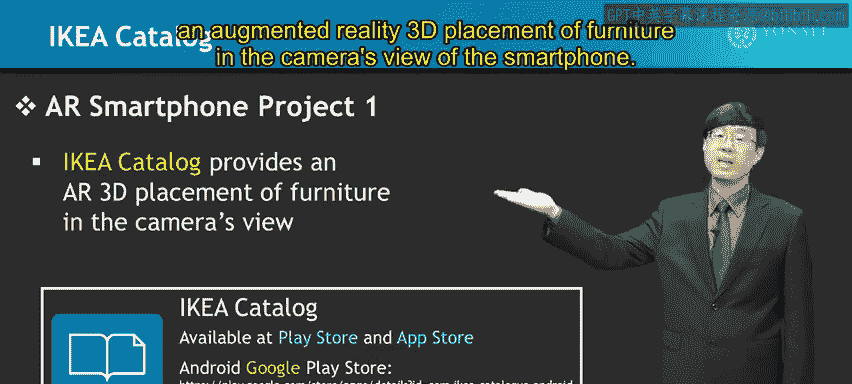

# 延世大学《新兴技术从智能手机到物联网再到大数据Emerging Technologies From Smartphone to IoT to Big Data》 - P156：33_7.1 宜家目录.zh_en - GPT中英字幕课程资源 - BV18hpFewEcG

Yeah。🎼Yeah。In this module of the augmentgamented Real smartphone project。

 there are two parts where I will start with the IKA catalogta project。This is project number one。

 and I want you to go and download this app if you're using a Android smartphone。

 you can use the Google Play Store， or if you're using an iPhone， you can use the Apple App Store。

The Ikea catalog provides an augmented reality 3D placement of furniture in the camera's view of the smartphone。

Looking into its mode， you can see it right here。

Then placing it on an example， this is a desk in my laboratory which we cleaned up for this project to show you an example。

You can change the height to see how the 3D AR image can be changed。

And based on the height option right here， then you can replay the tutorial to see further details。

 which I recommend。Looking into the tutorial， you can review all options in the tutorial to see how the 3D augmented reality furniture image can be changed。

Please take a close look because we are going to go through these experiments。

Now try the 3D augmented reality furniture image placement in your own office， home or other areas。

For each of the categories， try as many options as possible and see if there is an option that you cannot apply。

In terms of the space or some type of other restriction。For example， on the desk below。

 a 3D augmented reality black lamp was added。Using the options below。

 see where the loaded information of the selected furniture is added， in addition。

 also replace selected furniture with other larger furniture and then see if the augmented reality system acknowledges the limitation based on the size of the furniture as well as the actual space of where it can be placed。

Look through these options right here and use them。

Check out the functions of these options over there。Then， for example， try and use theI button。

To load information of furniture。In addition， you can use the camera like button to do the screenshot。

And then these are the experiments that I want you to conduct， using the various options。

 find when the performance is poor in terms of cannotnot place a furniture item even when the space is sufficient。

The application places a furniture item in a space that is unrealistically too small for it to be placed。

Also， look for the cases where placement of information of an item is incorrect or inappropriate。

I want you to go through the options and then see where it may not operate properly。

 and then under what circumstances did that happen， that is what I want you to look into。Also。

 I want you to help your peers。Give helpful tips。Also。

 inform others of exciting discoveries that you experience when you're using the IKA catalog augmented reality application。

In addition， inform your peers about other great AR applications that you will find and that are fun and also helpful。

Help others so that they can understand more on augmented reality systems。 Thank you。

These are the references that I use， and I recommend them to you。 there's another project。

 so hang in there。

