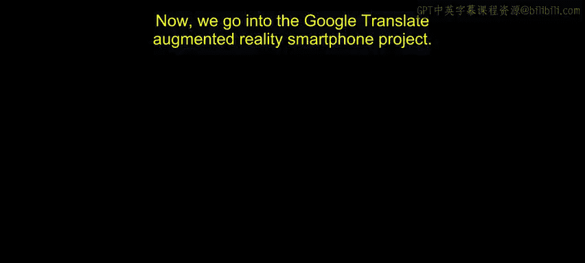
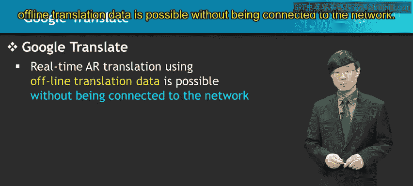
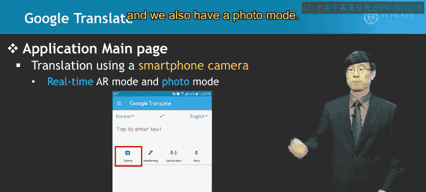
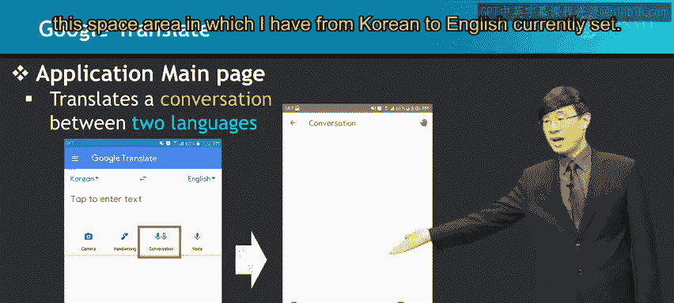
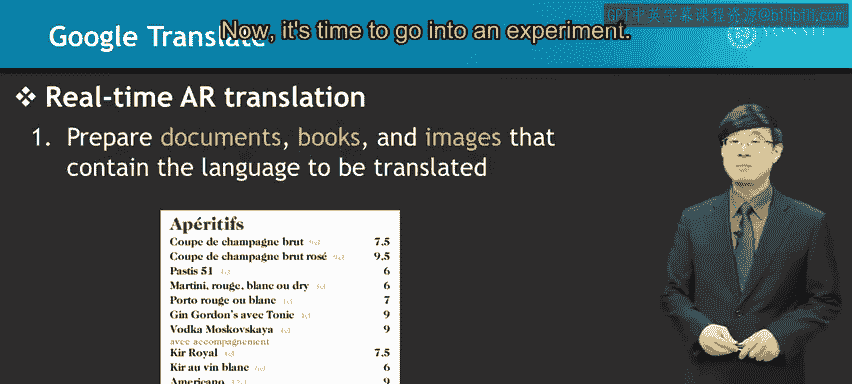
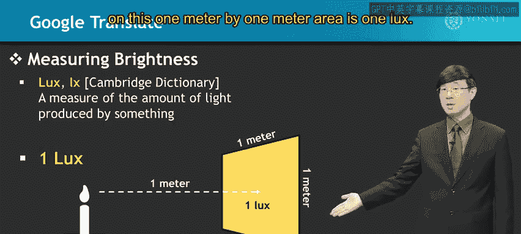
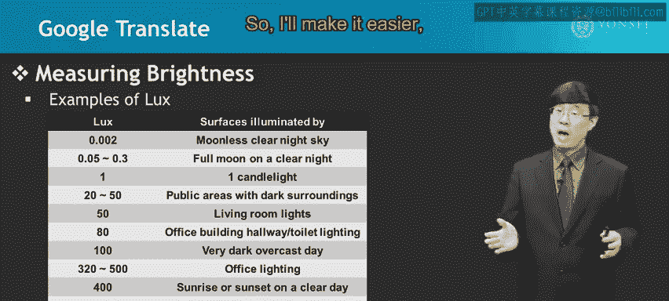
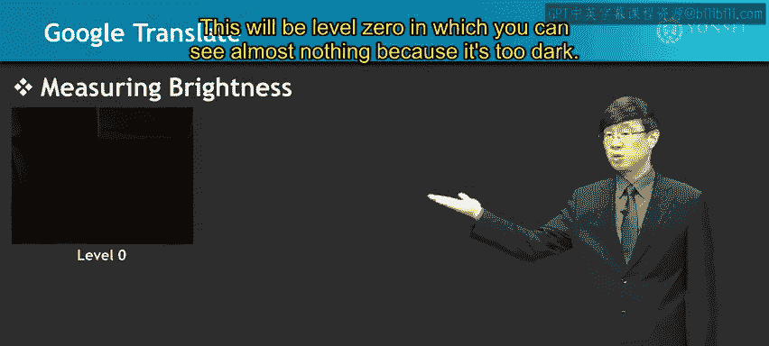
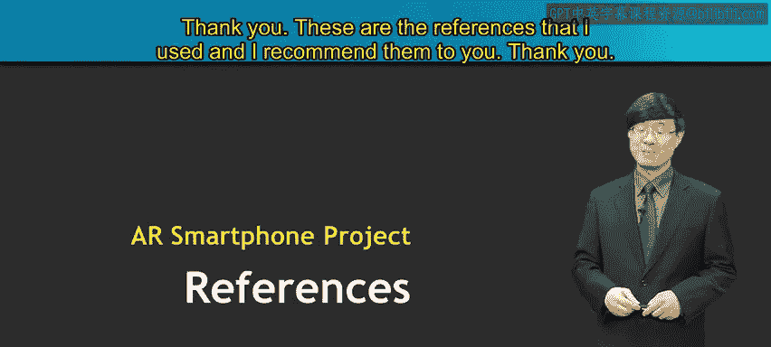

# 延世大学《新兴技术从智能手机到物联网再到大数据Emerging Technologies From Smartphone to IoT to Big Data》 - P157：34_7.2 谷歌翻译.zh_en - GPT中英字幕课程资源 - BV18hpFewEcG

Yeah。🎼Yeah。Now we go into the Google Translate augmented reality smartphone project。

 This is project number two。Looking in here， go and download the Google Translate。

 either you can do it from the Play store or the app store for either Android or Apple based devices。

Google Translate provides translation in real time， using the smartphones。

 camera and augmented reality display。A real time augmented reality translation using offline translation data is possible without being connected to the network。

The supported languages are listed here， and you can see that they are truly diverse。

Looking into the application main page， there are these buttons in the middle。

 which we will look into the options。First， you need to select the translation language as in terms of translate from。

To translate to。In addition， there's the option of detect language。

 which does not support real time AR translation， it only is used to detect the language。

We also have translation using a smartphone camera using that option down there。

 which is a real time augmented reality mode， and we also have a photo mode。

We can also translate handwriting using this and the overall translation below。

Then using that mode over there， you can translate a conversation between two languages。

 which will be listed here。The option over there will translate a conversation between two languages in this space area in which I have from Korean to English currently set。

Then the option over there will translate voice。Now it's time to go into the real time AR translation mode。

 which。You can switch languages using the button up there。 In addition， using this option right here。

 you can turn on the real time AR translation mode on or off。😊，Then using this mode right here。

 you can turn the flash of the smartphone camera on or off。In addition， using that button。

 you can translate in photo mode。You can highlight text using your finger as well。In addition。

 you can load an image to translate using the button over there。

You can pause the real time AR translation using this button right here。

Now it's time to go into an experiment。

Preparre documents， books， an image that contain the language that you want to be translated。

Then try translation using the real time AR translation mode in the Google Translate application。

 like you see in process right here。Then try translation while changing the environment as in terms of brightness。

 distance， smartphone， camera resolution， and other options。

The one experiment that I definitely want you to go through is using the darkness levels。

 where making it darker and even darker in this example。

The measurement of brightness is not a simple thing。The basic unit is based on lockx。

 which is a measure of the amount of light produced by something。

A representative lux unit is based on this right here。

 where one lux is based on one candle from a surface that you see is one meter by one meter。

In a distance one meter from the candle， then the amount of light that is presented on this one meter by one meter area is one lockx。

Based on that unit， you can see examples of lux in which moonless， clear night sky ranges from 0。

002 all the way to direct sunlight， which goes all the way up to 100，000 lux。

I know these levels of brightness are difficult to use， so I'll make it easier。

Which is measuring brightness based on our standards。

 this will be level zero in which you can see almost nothing because it's too dark。

Then level two， which looks like this a little bit brighter We will also use the intermediate stages。

 which is level one， which is right between these two。

 and I think that you can imagine what a level one would be like。😊，Then going into level4。

 which looks like this much brighter but not totally bright then a level up will be level 6。 Now。

 of course it's getting brighter and brighter， but I also want you to consider the intermediate levels of level3 as well as level 5 which are between these although I'm just showing you the major levels here。

 then going into the highest level of level 8 which is totally bright so we have nine levels from level 0 all the way to level8。

😊，And using these。We will test the real time augmented reality translation based on brightness performance based on the levels of zero-1。

2，3，4，5，678。Make the room darker and then look at the dark level based on comparing it to the pictures I just shown you。

I want you to consider the performance in different brightness levels。Consider the text size。

 the distance， as well as the font types， because based on font， some detections are much different。

Consider the language translation types as well。 Then consider performance based on light coming from a different angle with different brightness levels。

😊，Overall， finding several options that the Google Trans application may not operate properly。

In addition， to what I just explained for this project， I also want you to help your peers。

Give helpful tips。Inform others of exciting discoveries that you found from using the Google Translate augmented reality application。

In addition， inform your peers about other great AR applications。And help others。

Help them to be more fluent in augmented reality systems。 Thank you。

These are the references that I use， and I recommend them to you， Thank you。

