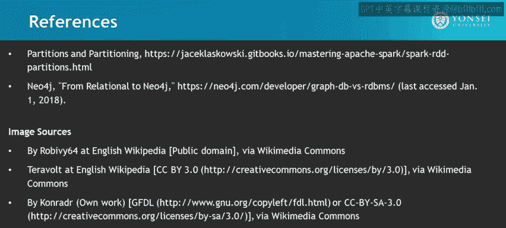

# 延世大学《新兴技术从智能手机到物联网再到大数据Emerging Technologies From Smartphone to IoT to Big Data》 - P15：14_3.1 Apache Spark.zh_en - GPT中英字幕课程资源 - BV18hpFewEcG

Yeah。🎼Yeah。This lecture is about Apache Spark。Apache Spark is a big data general processing technology。

It is currently the most popular and most active big data open source project in the world。

 and therefore you need to know the details about it。Before Spark。

 Hadop was the most widely used open source big data technology。

And we're going to see how Hadoop is being used by Spark。Spark conducts its own cluster management。

It supports batch applications， iterative algorithms， and interactive queries。

Spark is independent of Hadu。But Spark can use Hadoop for storage or for processing。

Spark has a built in machine learning library， which makes it so powerful。

Spark supports stream processing functionality。It has a streaming mode for real time applications。

 which uses Mibatch technology。Spark has been reported to be tenses to hundreds of times faster than Hadop。

 and we will soon see why。Spark is very fast and uses improved data processing techniques。

Which include in memoryory RAM processing。A resilient distributed data sets， RDD。

Dad directed acyclic crafts。Advanced scheduling， persisting techniques， real time streaming。

 and others。Spark does not have its own unique distributed storage system。

But it is built to use various third party distributed file organizing systems。

Many Sp systems are connected to Hadoop systems because already a lot of data is already in the Hadoop distributed file systems。

 the HDFS。Haadyop's mapRduce is replaced with Sparks RDD and DG and transformations and actions。

Spark uses the HDFS through the yarn Re Manager， and we will look at details about this。

Spark's advanced analytics， applications， and built in machine learning library functions enabled remarkable information extraction from data stored in HDFS and various other data sets。

For Hadop， Hadop does not have a built in machine learning library。

 so it uses a third party machine learning library， Mahat。

Haadduop was slow because MaRduce saves all of its process data in a physical storage medium after each operation to be fault tolerant。

 and normally the storage medium is a hard disk drive and we will soon see the speed limits of hard disk drives。

Haadyub repeats this process multiple times in a job， which makes it even slower。

Spark applications include retailer recommendation engines。Industry。

 machinery and manufacturing monitoring and automation prediction systems that estimate when parts will malfunction。

 when best to replace， and when to order replacement components。

Controllers for Internet of Things and cyber physical systems。

Spark and Masos were developed by the Amp Lab at UC Berkeley。In 2010。

 Spark became an open source software based on a BD， a Berkeley softwareft distribution license。

In 2013， Spark was donated to the Apache Software Foundation。In 2014。

 Apache Spark became a top level Apache project。In 2014 May， Apache Spark was initially released。

Looking into Spks characteristics， first， Spk scales very， very well。

 Spark can be executed on clusters consisting of thousands of nodes processing petabytes sized databases。

Looking into Sp and Hado their relationship。Haop and Spark are both big data technologies。

 Both provide some of the most popular big data tools。And both are Apache Software Foundation tools。

Haypan Spk systems can work together， and we will look at examples of this。

Many spark systems are connected to a Hadop HDFS through yarn。

Both are scalable and more data drives can be added to the network as the data set grows。

 so therefore it's wonderful to expand and include more information， more data。

Task management and data processing schemes are different。These are the references that I used。

 and I recommend them to you。 Thank you。

