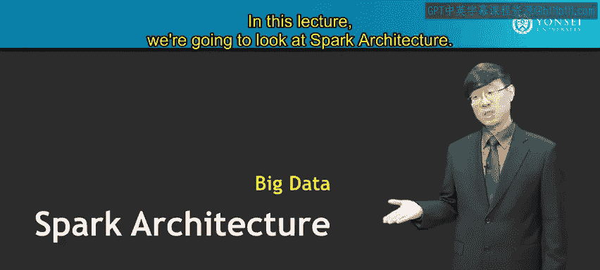
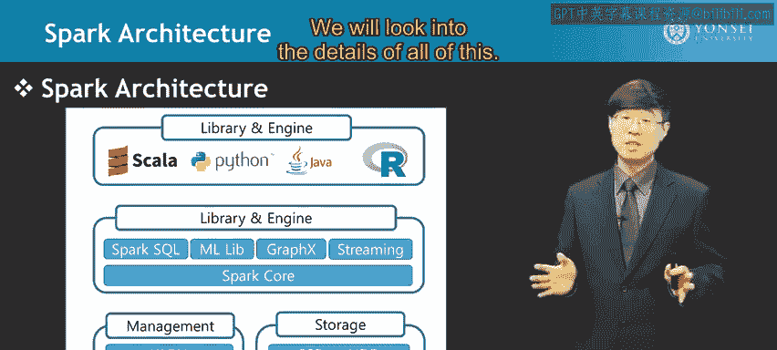
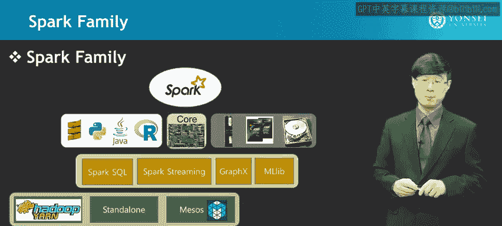
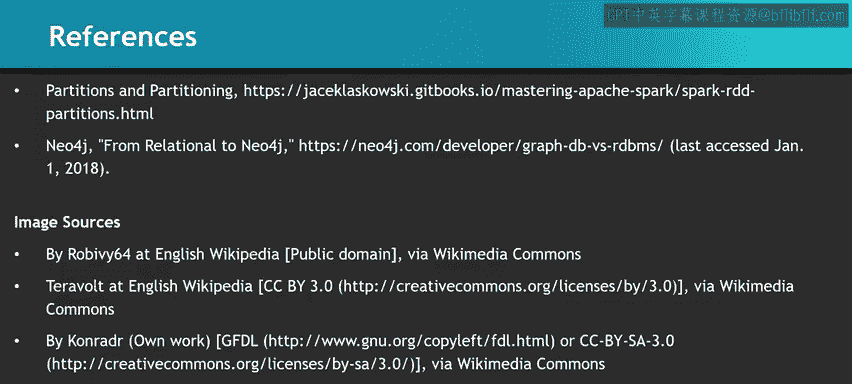

# 延世大学《新兴技术从智能手机到物联网再到大数据Emerging Technologies From Smartphone to IoT to Big Data》 - P16：15_3.2 Spark架构 3.3 Spark家族.zh_en - GPT中英字幕课程资源 - BV18hpFewEcG

Yeah。🎼In this lecture， we're going to look at Spark architecture。

The Spark architecture can be focused on the library and engine part， which includes the Spark SQL。

 machine learning library， Gs， and the streaming process。In addition。

 this all runs on top of the sparkark core。Then what makes all of this work together is the library and engines。

 the APIs， which include programming based on Scala， Python， Java， and R。In addition。

 there is the storage engines which are required。It's either on solid state disk or a hard disk drive。

 also HDFS， S3 from Amazon， RDBMS and No SQL。These are the storage mechanisms。In addition。

 management， based upon yarn， meus and spark scheduler can be used to control and manage the cluster。

 we will look into the details of all of this。

Spark's architecture is based on the RDD， the resilient distributed data set。

It is Spark's data structure。Instead of being a complete dataset collection itself。

 RDD is more like a formula sequence of transformations and actions to process the data。

Spark corere is an underlying general execution engine for the Spark platform。

 All functions are built upon Spar core。And it provides fast RA based in memoryory computing。

It provides referencing data sets so external storage systems can be used。Spark SequL。

This is a schema RDD based data abstraction。It provides support for structure and semistructure data。

Then we have Spark streaming， this performs analysis on streaming data using the fast scheduling capability of the Spark core。

Input data is formed into mini batches。And the RDD transformation is performed on these mini batches。

Then we have the machine learning library。This is a built in library of machine learning functions。

 which make Spark so powerful and extremely fast。The machine learning library can be easily applied to the distributed memory based Spark architecture。

Spark also has graph X。GraphicX is a distributed graph processing framework。

Spark uses the graph computation API of Gra X。 It provides optimized runtime processing of user defined graphs。

There is also the Spark cluster management methods， which include standalone， yarn and maos。

 and we'll look into the details of these soon。Let's look into the details of the Spark family。

In the Spark family， we can include yarn。Yarn is short for yet another resource negotiator。

It is Apache Hadjuop's cluster based resource management and job scheduling platform。

It is a Apache Hadoop next generation map Red source。

Yarn divides resource management and job scheduling into separate das。

There is Global Resource Manager and a per application。Application master。

Applications can be a single job or a DAG， a directed acyclic graph of jobs。

 So you'll see that a DAG is a combination， a serialized and paralyzed format of multiple transformation structure together that will be processed by an action together we'll soon look into the details of that。

Mzoos is a distributed cluster resource management and scheduling platform。

Mzous in ancient Greek means middle or mediator。MOS provides resource management and scheduling APIs for the entire data center and cloud environments。

Linear scalability for large clusters with tens of thousands of nodes is possible through Meos easily。

MsOS provides high availability， fault tolerance through zookeeper replicated master and agents。

 and non disruptive upgrades。It supports scheduling for legacy cloud applications and added pluggable scheduling policies。

It includes HTTP APIs to help develop cluster based distributed applications。

 it also has built in web UIs that enable cluster state monitoring and management。

It operates well on various operating systems and cloud platforms， which makes it so powerful。😊。

Who else are in the Spark family？Of course we had the core， which is the center of the processing。

In addition， we have the memory units， the RA， SSD and HD。Then we have the software。

 which enables the programming and the APIs， which is Scala， Python， Java， and R。In addition。

 we have the functional sets， which are the SparkSQL， Spark streaming， machine learning library。

 and Crra X。We also talked about the cluster management techniques。

 which we have Hadoop Yrn and Mzoos， in addition， I will soon talk about standalone and the details of all three of them。

Then in this family we also have Ton zookeeper。And also， Had youop HDFS。Kafka。We have S3， MongolDb。

 Cassandra， Neo4j。And our DBMS and others。Looking into Tton。

 this is an open source distributed fault tolerant and fast in memory RAM based file system。

It has very fast high performance data sharing features。

This is based on in memoryory RAM based file system， which enables very fast data sharing。

And lineage， which is a log of transformation sequences。

 this is used to build and recover data sets in case of a failure。

It stores binary programs used to generate data sets as well as the input data sets。

Each right is saved to the memory of a single node。And very fast， read。

r and data sharing across frameworks is possible。The name Ton is actually quite interesting。

 It is any hypothetical particle that can travel faster than the speed of light。

It was derived from the wordtion， which means particles slower than the speed of light。

 and the Greek word for fast， which is pronounced as Tais。

We also look into zookeeper Apache Zookeeper provides highly reliable distributed coordination for clusters。

 and that's why you will see that it's used quite widely。And as mentioned。

 high availability fault tolerance is provided through replicated mastering agents on non disruptive upgrades。

Zookeeper provides cluster based centralized control and easy management functions。

It maintains configuration information。Naming， distributed synchronization， group services。

Apache Cassandra is a distributed NoSQL database management system。

It supports large data sets and data exchange across various commodity servers。

It provides robustness through high availability with no SPOF， no single point of failure。

 making it even more robust。It provides reliable management capability for multiple data center based clusters。

Cassandra provides low latency， asynchronous， masterless replication operations for all clients。

 which makes it more reliable and fall tolerant。Kafka is a distributed data streaming platform。

It provides stream data， read and write management system capabilities。

It enables easy programming of scalable stream processes of real time applications。

It safely stores data streams in a distributed replicated fault tolerant cluster。

And streaming features of Kafka are used in Spk streaming， which we will talk about soon。

These are the references that I use， and I recommend them to you。

