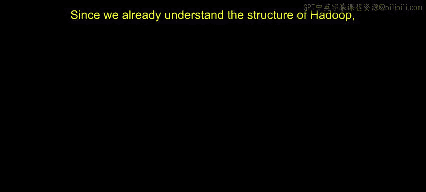
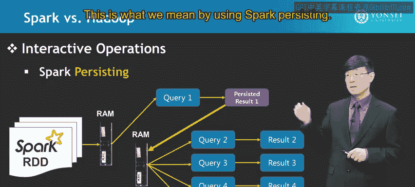
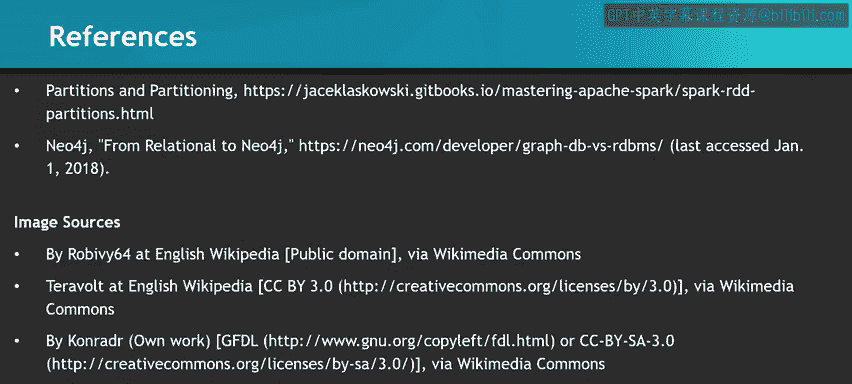

# 延世大学《新兴技术从智能手机到物联网再到大数据Emerging Technologies From Smartphone to IoT to Big Data》 - P17：16_3.4 Spark与Hadoop的比较.zh_en - GPT中英字幕课程资源 - BV18hpFewEcG

Yeah。Yeah。Since we already understand the structure of Hadoop。

 let's use Hadoop and compare it to Spark to understand how the Spk system works。

 in addition the advantages of Spark。The advantages of Spark compared to Hadop include faster analysis capability。

Due to these reasons。Spark also has Spark streaming。

 where real time data streaming analysis is capable through this technology。

 Spark streaming uses micro batchch technology。Machine learning functionality is another major advantage of Spark。

The machine learning library。Has programmable algorithms that can think and automatically update to changing conditions。

Machine learning requires the capability to learn through statistical modeling and simulation。

Based on changing conditions， an ideal solution is derived and adapted。

Another reason Spark is faster is because it uses random access memory。

You can see that Hadop is slower because it uses HD drives。

 where RAM based operations are much faster。If the data batch size is larger than the Sp in memory RA size。

 then overflow cache data sets can be transferred to local memory。

Option one would be a solid state drive， and option two would be a hard disk drive。Of course。

 the SSD is preferred as option one because it's much， much faster。

 which we will soon look into the speed options。Overflow cash data sets are recomputed on demand when needed。

Approximate speeds will be compared based on the unit of bits per second。

 which uses this notation right here。From a CPU to a hard disk drive。

 the access time will be about 2 to 12 milliseconds。

 where the transfer speed of the data itself will be about 800 megabits per second。

Looking into CPU to SSD， it has a much shorter access time and the speed of data transfer will be about 4。

8 gigabits per second。This is six times faster。Then from CPU to RA， the access time will be。

0001 to 0。05 milliseconds， which is much smaller， and the data transfer rate will be 80 gigabits per second。

This is 16。7 times faster than SSD and 100 times faster than HD。Also， the network speeds。

We have gigabit ethernet at 1 gigab per second or higher we have fast ethernet at 100 megabits per second speeds。

And we have Ethernet at 10 megabits per second speeds。

The specifics for the protocol would be listed like here for gigabbit ethernet， for fast ethernet。

 these are the standards and for ethernet， these are the standards。

Looking into the speeds altogether， you can see that RA to CPU is fastest， then SSD to CPU is next。

 and then HDDD to CPU is the slowest among the three。In addition。

 what you can also see is that the networking speeds of gigabit or 100 megabits per second related based on the network。

The Sp system was designed considering these speed differences。

 and it was overall optimized to provide maximum performance on a cluster in a distributed processing fashion。

Map reduceuce features。MaapRduce enables processing and generating large dataset sets with a parallel distributed algorithm on a cluster。

It enables users to easily analyze data with high level operators。

It is easy to execute parallel computations on a cluster of databases。

It takes care of work distribution。And it is highly reliable and fault tolerant。

What are the issues with MaRduce？Well， data sharing and multiple stage Mareduce job processing is commonly done by reading data from HDFS。

 executing MaRduce， have the output wrote to the HDFS。

 and then repeat this procedure again and again and again。

Studies show that many Hadb applications spend more than 90% of their time doing the read and write process to and from the HDFS。

And this is the time consuming process that was reduced by taking advantage of inmemory RAM in Spark。

Haadop will be slow for iterative and interactive applications requiring distributed data。

 parallel job processing and sharing。MaabRuces slow in data sharing due to slow replication。

 serialization， and disk input output time consumption we'll of course talk more about these factors I already talked about replication factors in my Hadoop lecture will also include further details on serialization。

Itterative operation is a multi sage process that reusees intermediate results for multiple computations in a series for the application。

Compared to Spark RDD， HadU is slower because of the multiple read rights to the HD HDFS。

And Spar is faster because it uses and takes advantage of in memory RAM。

Looking into a mapreuce portion of Hadop。You will see that from the HDFS。

It is read and the map process is done， then it's saved back into HDFS。

 and then it's read out again to do the reduced process， and then it's saved back again。

Itterative operations looked at a macroscopic point of view。

 you can see from HDFS to MARduce to HDFS to BRuce， and this process may be repeated multiple times。

And then eventually back to Hadop HDFS。Where in Sp。

 the process of RAM will be intercepted instead of the going back to HDFS process。

 and this will speed up the process tremendously， especially for the internal part which needs to be repeated multiple times。

 the speed advantage of RAM will be tremendous， and the final result could be saved in Cassandra。

Interactive operations are operations that run multiple queries on the same data。

 and Spark has tremendous advantages in here。Commonly requires queries that are executed in parallel on the same data set。

For HadU， MaRduce will conduct multiple write and reads on the same data set in the HD to run these multiple queries。

Each query will write and read to the HDD individually through the input and output ports to the HD。

 and this can dominate the overall time it is consuming。For example， looking at Hadoop。

 HDFS with all these five queries that we need to process， well。

 taking turns in the readout could be very， very tedious， for example one， two， three， four。

 five to satisfy these five queries and to obtain these five results。In Spark。

 we have a default RDD processing capability， which uses a Spark DAG。

 and this is a series of transformations that are set up。

 and then they're executed together in an optimal way。

These are recomputing each time an action is executed。Due to much faster RA input output speeds。

 Spar is much faster than Hadoop in interactive operations。

One of the key factors that makes it so fast， in addition to using RAM is the persisting RDD processing。

Now， within the DAG， a specific RDD processed output can be saved on RAM。

And it can be used for additional query based processing。

Since the RDD intermediate process results is persisted。

 it can be immediately reused by interactive queries without additional processing。

The spark is significantly faster than Hadji。For example。From the Spark RDD。

 I process it and I save it on the Ram， and then I can share it with these queries that I have。

In addition， I can persist it， in other words， if an intermediate result is needed。

 then I will go ahead and do query1 and then persist the result1， I will use result1。

 send it to back to a RA and then use it to satisfy these queries。So therefore。

 these queries do not need to repeat。Qury1， that was a part of them that needed to be processed。

And then I can obtain these results much quicker。 This is what we mean by using spark persisting。

Flexibility and switching tasks is another thing we need to look into when we compare Hadop and Sp in their processing speeds。

In Hadu， the job tracker sets up task trackers where each task tracker assigns slots to be either a map slot or a reduced slot。

Slat assignments cannot be dynamically changed during the application process。

Slot function reassignment by the test trackers need permission from the job tracker。

 which consumes time。In Spark， exchange of an assigned transformation or task to a core is flexible and fast because it is based on thready。

Compared to Hadop， Spk is much faster and can easily change processing threads of a transformation or task assigned to a core。

In addition， parallel processing speeds。Spark executes parallel processing based on multiple threads being operated on multiple cores simultaneously。

How you executes parallel processing based on simultaneously controlling multiple process IDs based upon the map and reduced slots that were predefined？

And this is why Spark has a much higher utilization， of course compared to Haddu。

These are the references that I used， and I recommend them to you。 Thank you。

