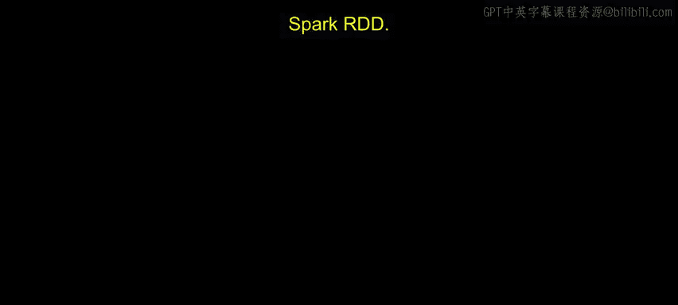
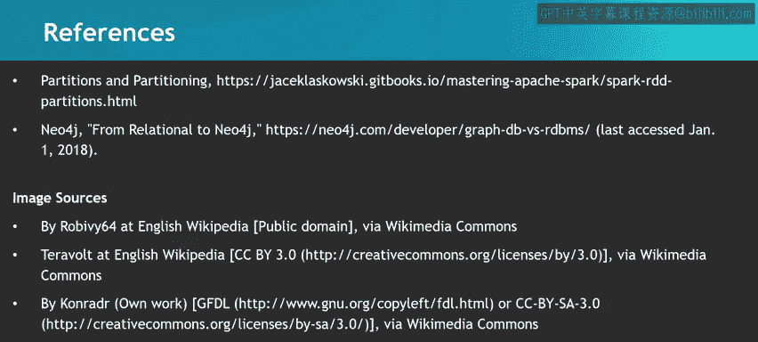

# 延世大学《新兴技术从智能手机到物联网再到大数据Emerging Technologies From Smartphone to IoT to Big Data》 - P18：17_3.5 Spark RDD.zh_en - GPT中英字幕课程资源 - BV18hpFewEcG

嗯。

Yeah。Spark RDD。RGD stands for Resilient distributed data sets， It has the general characteristics。

Where sequence of deterministic transformations and actions are conducted on a。Store data。

 another RDD。Or group of RDDs。RDD， the word comes from a combination of resilient。

Distributed and data sets。 And we'll look into all three of these terms。First， resilient。

Resilient comes from the meaning that it is a fault tolerant collection of data。

RDDs can recover from node failures automatically， which is why we say that it is fault tolerant。

It is also characterized as immutable distributed collection of objects or data。

The term distributed comes from the concept of parallel processing of distributed dataset sets。

Where each logical partition of the dataset can be computed on different nodes of the cluster。

Transformations are lazy during D setup。The functions for persisting and caching are listed in the parentheses here。

Then the term data set。RDD divides each data into logical partitions。

Where a read only database partitioned collection of data is what RDD uses。All types of Python， Java。

 Scala objects can be processed in RDDs。The term immutable data means this。

It means that it can be recreated again， if it's needed。

It comes from a set of deterministic transformations applied to an input data set。Therefore。

 immutability makes saving， copying， and sharing very easy and effective。

Imutability helps solve simultaneous multi threadread update problems。In addition。

 it can be safely shared and distributed across processes and nodes。

Then we look into persisting persistence。Persisting a data set in memory enhances the data processing speed across multiple operations。

Persisted RDD makes a node store its transformed data in its partitioned memory to quickly reuse it for other actions processed on the data。

 and we've already looked into this in an example before。

RDD persististence uses a DAG and lazy transformations to help schedule optimized RDD persisting for multiple actions to be executed。

Then the partitions of RDD。It is a logically divided chunk of the RDD or a larger data set。

All RDDs are divided into partitions。RDD's main unit of data processing is the partition。

RDD automatically partitions data sets。The programmer can control the partition number and size to more efficiently support the application in Spark。

Spark RDD default partition size for HDFS is 64 megabytes， which is the standard block size for HDFS。

Spark RDD maximum partition size for HDFS is 2 gigaby。 based on this。

 you can see the size of a partition and how it may operate within a system。

Metaadata and data types are considered in the RDD components。

Data and object type considered in the RDD partitioning and data placement includes structure data。

 semistructure data， and unstructured data。Then the task in transformations。

Where functions apply to process the data partition？

Where we will see that the parent RDD goes through a function， a transformation。

 and will result in a child RDD。The parent to child ratio could be one to one， n to1，1 to M。

 or n to M， which mean many to many， and for these many numbers that are not predefined I'm using N and M as variables RDD types include Hadop RDD。

Filtered RDD joint RDD mapped RDD paired RDD shuffled RDD union RDD， Python RDD double RDD。

JDBC RDD Jasonson RDD schema RDD。Vertex RDD， edge RDD。Cassandra RDD， GeORDD。Yes， Spark and others。

Among them， schema RDD will be looked into further。

Schema RDD is an RDD that has an associated schema。

It has all standard RDD functions and also can be used in relational queries。

Schema RDD creation methods include loading data in from external sources to schema RDD form。

Applying methods of converting a standard RDD into a schema RDD or importing a SQL context。

Or applying the Cate schema RDD function on SQL context。

Schema RDD can be registered as a table in the SQL context it was imported from。

 and also schema RDD registered as a table can be used in SQL statements。

These are the references that I used， and I recommend them to you。 Thank you。

