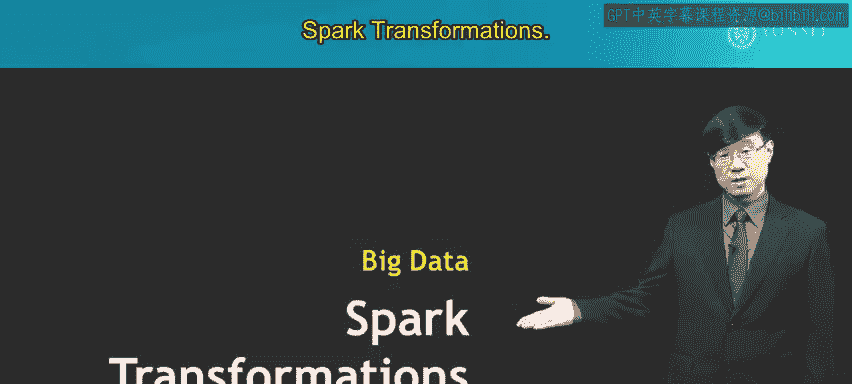
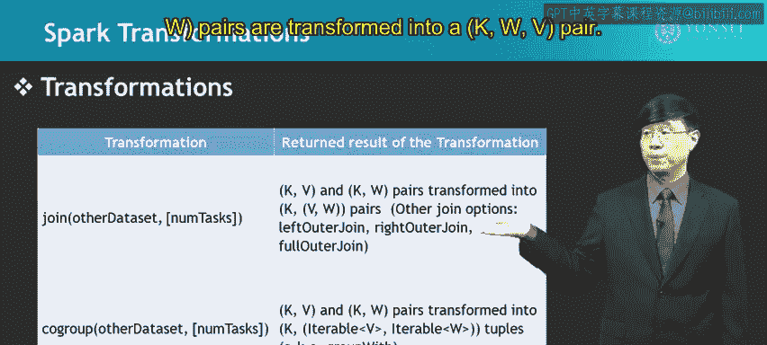
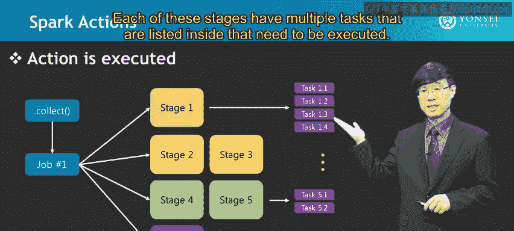
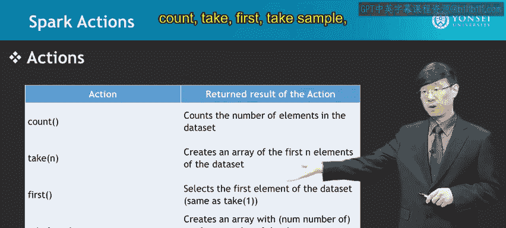
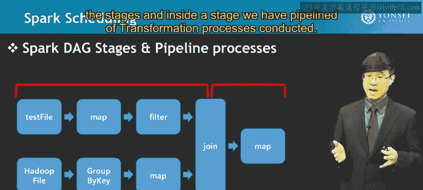
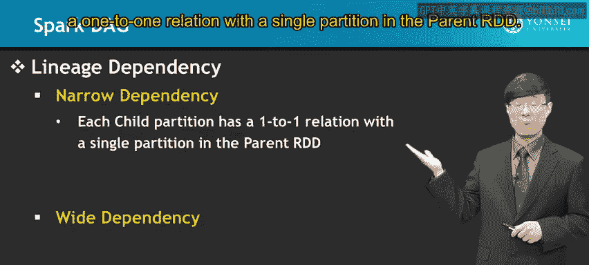
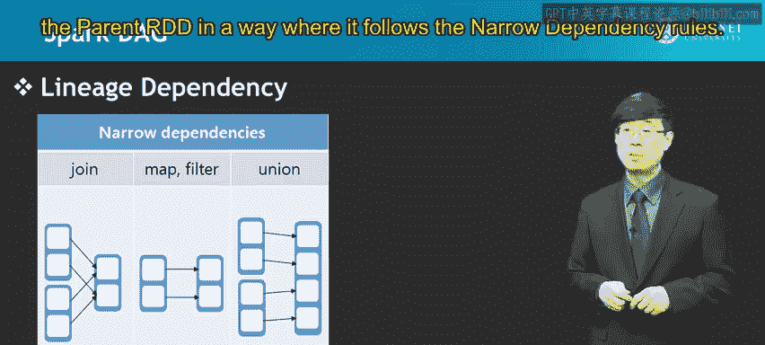
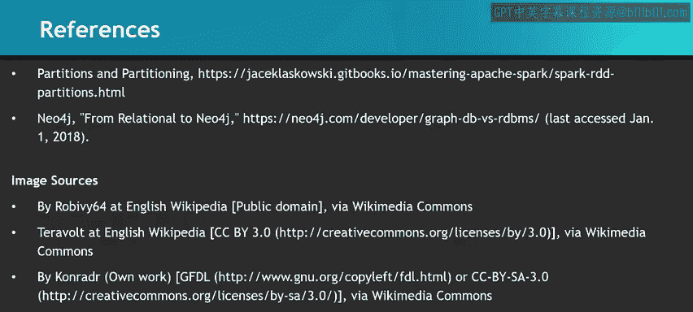

# 延世大学《新兴技术从智能手机到物联网再到大数据Emerging Technologies From Smartphone to IoT to Big Data》 - P19：18_3.6 Spark转换 3.7 Spark动作 3.8 Spark DAG.zh_en - GPT中英字幕课程资源 - BV18hpFewEcG

Yeah。🎼Yeah。Spark transformations。

Looking at it from the top of the table， we start with map。

The map transformation will pass each element of the source data through the function。

 The function is defined within the parentheesis of the map transformation。

 as you can see over there。😊，Then there's the filter。

Where this transformation will select elements which are true based on the function that is defined。

Then we have flat map， which maps each input item to zero or other output items。

 which results in a sequence as an output of the transformation。Map partitions。

Where map running functions separately on each RDD partition are executed。

This links into map Partitions with indexd。Where this will run map Partitions and provide the partition's index value。

Then we have the sample transformation in this transformation。

 sample data based on fraction using the generator seed with or without replacement is executed。

Union。In the union function， this will create a union of the source data and other data elements。

Then we have the intersection transformation， where the intersection of the source data and other data elements are given out as the output。

There is also the distinct transformation where distinct elements of the source data set are selected。

Then there's group by key， where the KV pairs are transformed into a different format。Reduced by key。

 KV pairs are transformed into KV pairs， with each key is aggregated with a reduced function。

Then there is the join where KV and KW pairs are transformed into a KWV pair。

Then there's the co group transformation， where KV and KW pairs are transformed into a K with a new type of Cupil format。

 as you can see below。Then there's also Cartesian transformation。

 where data set of type T and U are transformed into a data TU element pairs。There is also the pipe。

This transformation will， for each RDD partition is pipeline through a shell command。

Then there's the calles， where the number of RDD partitions are reduced to the number partitions listed in the transformation。

Repartition。Where the number of RDD partitions are changed to nu partitions and randomly reshuffle the RDD data to create a data balancing effect among the partitions in this transformation。

Then there is the repartition and sort with partitions， transformation。

 where the number of RDD partitions are changed to non partitions。

And sort records based on their key within each partition。Looking into Spk actions。

When an action is executed。A job will start to run with multiple stages， both serial and parallel。

Each stage will include multiple tasks in parallel on each partition of the RDD。For example。

 when a collect action is executed， then a job will be initiated to run that action。

Then the job will be divided to multiple stages where you can see that stage one， stage two，3。

 where two and three are in parallel， then you have stage four and five will run in parallel。

 and then there is stage6 down there。Each of these stages have multiple tasks that are listed inside that need to be executed。

Actions include reduce， collect。Count， take first， take sample。

Take ordered， save as text file， save as sequence file。Save as objectject file。

 count by key for reach。Spark dad。DAG stands for directed acyclic graphph。

 it is a sequence of serial and parallel computations to be conducted on an RDD。

Computation sequence of transformations。Resulting in a chain of parent RDD to child RDD relations are represented using a lineage graph。

The terminology of lazy transformation is used when we talk about a dag。In its process。

 what does this mean， Well， transformations and operators in Spark are executed lazy。

 What do you mean lazy， I thought Spark was very fast and efficient。 Well。

 this is what the terminology means。While the dag is being set up。

 none of the transformations are executed， and this is why we call it lazy。

Where all of these transformations and their serial and parallel processing sequences are set up in the program。

And you can see that some of these will be filter， map， join group。

 and various other transformations。Then。When the structure is done， we will call it a dag。Once again。

 it is called a directed acyclic graph because the transformations form a graph process listed right here In addition。

 there are no cycles， everything is directed to go out here and end right here。So therefore。

 having no loops， no cycles within， that's why it's called a directed acyclic graph。

Then when an action is executed， like the collect action itself。

Then the scheduler finds an optimal way to execute the DAG。

 this is when the operation will be executed and before this， before the action。

 everything was looked at and checked in the DAG structure。

 all transformations of the DAG lineage graph are executed in an optimal way where the action runs everything together。

And the result of the action are delivered to the output。

Howdu process example is provided here where it commonly does a read from HDFS。

 a map combined which includes a join and a shuffle。

 then partition to reduce and write back to HDFS This type of a process is repeated and repeated。

In a spark da and stage example， you will see that， for example。

 a group by key and join require a shuffle process。

 so they form a stage boundary where map and filter our pipeline together， for example。

Where we look at a DAg， stages and pipeline processes， look at this structure， for example， of a DAg。

In here you can see that up to this part right here where there is a join。

 this can be one stage where all the processes from the map and filter can be pipelined to reach the join process。

Another stage will be from Hadoop file to group by key。

 another stage will be passing through the map to reach the join。These stages within a。이 부분 다시 하겠습니다。

These functions within a stage can be pipelined together。

AndThen the final stage after the join that goes through the map can also be pipelined together。

 and therefore， the regions where these red lines are indicating separation are the stages and inside a stage we have pipeline of transformation processes conducted。

Avantages of lazy transformations that are used in Spar All optimized data processing methods are decided after the scheduler can check the entire DAG sequence of work that needs to be done so therefore it is optimal and extremely highly efficient。

Unnecessary operations are avoided and processing capability can be more effectively shared。

It also results in reduced memory consumption。A DAG computation example is an action is called on the RDD。

 Spark creates a DAg and submits it to the DAG scheduler。

DAG's Schr divides operators into stages of tasks。Each stage is comprised of tasks based on partitions of the RDD input data。

The DAG scheduler pipelines operators together。Multiple operators can be scheduled in a single stage。

The final result of a DAG scheduler is a set of stages to process。

And stages are passed on to the task scheduler。Then the task scheduler launches tasks through the cluster manager。

 which is Spark standalone， Mus or yarn。The task scheduler doesn't know about the dependencies of the stages。

And the worker executes the task on the slave。RDD resilience。

A read only collection of objects partitioned across a set of machines。

RDD data can be cached across multiple nodes and reused the data in multiple parallel operations。

Linage based fault tolerance is provided。RDD resilience is based on lineage based fault tolerance。

This is because if a partition is lost， RDD lineage is used to rebuild just the lost or erroneous partition part。

 and this is why it's called resilient。Transformation types include narrow transformation and Y transformation。

A narrow transformation is when data is only shuffled within the partition。

Narrow transformation examples include map， filter， union and others。In a wide transformation。

 data is shuffled across different partitions。Why transformation examples include group by key。

 reduced by key， and others。This results in a dependency， a lineage dependency， where， likewise。

 we can say narrow dependency and y dependency。For a narrow dependency。

 each child partition has a one to one relation with a single partition in the parent RDD。

The parent RDD partitions are each used by one or none of the child partitions。In a wide dependency。

 child。이 부분 다시 얘기하겠습니다。In a wide dependency， child partitions have a one to many relationship with multiple partitions of the parent RDD。

Parent RDD partitions are used in multiple child partitions。For example。

 a narrow dependency for a join， map， filter or union will look like this。

 and you can see why it's narrow。For the child RDD。

 you can see that there is a connection from the parent RDD in a way where it follows the narrow dependency rules。

When you go into a wide dependency， such as in group by key or join。

 you can see that the child RDD partitions are created from multiple partitions of the parent RDD。

 and you can see right here that the partition creation is based on a much broader scope of partitions from its parent RDD。

 that's why it's called wider dependency。These are the references that I use and I recommend them to you。

 thank you。

