# 延世大学《新兴技术从智能手机到物联网再到大数据Emerging Technologies From Smartphone to IoT to Big Data》 - P1：0_介绍.zh_en - GPT中英字幕课程资源 - BV18hpFewEcG

Welcome to my course Big Data Emging Techologies In this course we will look at various aspects of big data services。

 products and core technology we'll look at corporate ratings based upon who has the biggest share of the pie in addition we'll look at segments of hardware。

 professional services and software， their portions and who are the leaders in these areas。

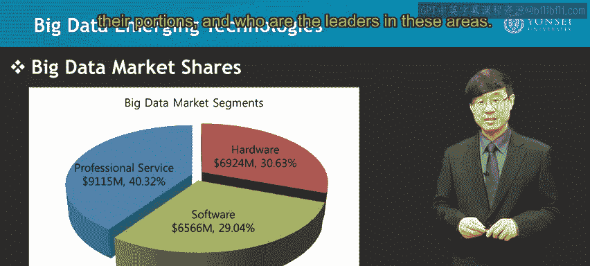

We will also look into potential growth in the future in terms of software， professional services。

 and hardware growth。Then we will take a look into the major products that are provided by these companies that are the leading companies in big data technology。

We will also look into the H1N1 flu virus that started in the United States。

 it was an event that brought alert to how important big data technology could be。

 we'll look at the problems that the United States CDC had and also we'll look into what Google did to help find how much and where vaccines could be provided。

We'll also take a look into how their analysis data was used to predict where things were going to happen。

Also taking a look into the 4V big data challenges， which include volume， variety。

 velocity and veracity， and we'll see how companies use this to their advantage。

Then we will go into the Apache open source applications， which are Hadoop， Spark and Stor。

 we will look at their characteristics as in terms of batch processing and real time streaming。

Then we'll take a closer look into Hado as well as Mareduce and HDFS technology In addition。

 we'll take a look at Mau。And Fme， as well as H basease and H and how these relate to support Hadop based operations。

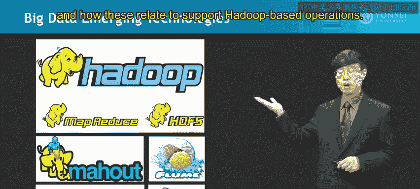

We'll also take a look into details of MapRduce and the Hadoop distributed file system in Hadoop。

 and we'll look at how these operations are processed。

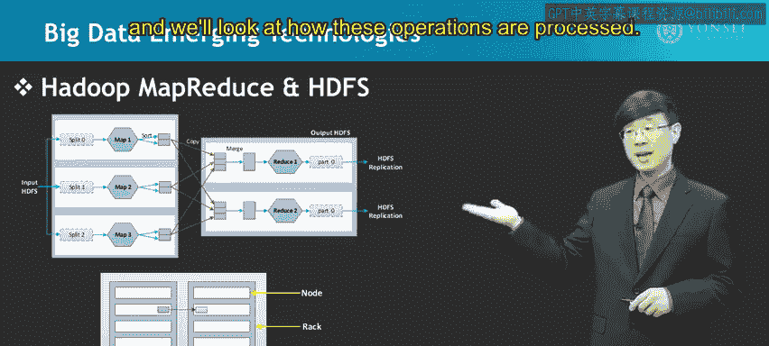

In addition， we'll take a look into cluster operations， how name nodes， data nodes。

 and how job and task trackers are used to process and schedule the overall big data analysis operations。

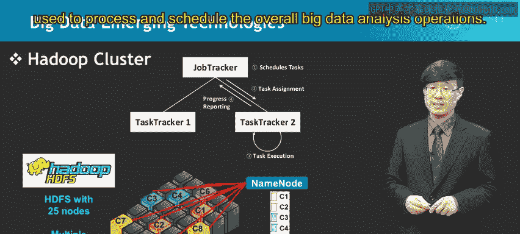

Then following， we will take a look into Hadjiop yarn and what are these blocks。

 how do they get set up， who's in charge of who and who sets up who in what order these things will be analyzed in detail。

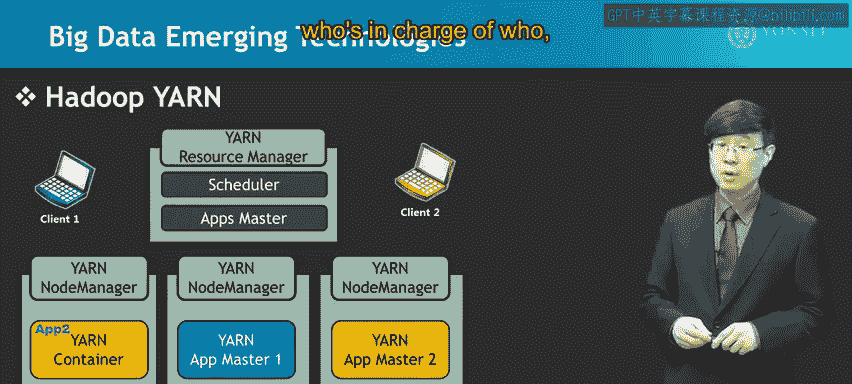

We will then look into Apache Spar。Focusing on the core as well as the memory devices in terms of in memorymory and SSD and HDD。

 and also the APIs that Spark is programmed in， which includes ScalA， Python， Java and R。In addition。

 we'll look into their major functional libraries， which includes Spark SQL， Spark streaming。

 RAs and the Ma learning library。We will also study about the cluster management technologies of Hadgyop yarn。

 standalone and Meos。

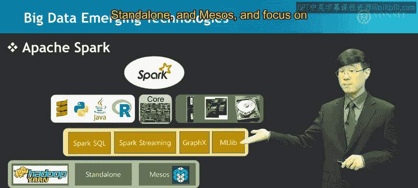

And focus on surrounding support technologies like Ton， Zookeeper。

 and we will also take a look into the database management systems， which include HDFS， Kafka。

 Cassandra and others。In the machine learning part of Spark。

 we will take a look into the machine learninging library。

 which include these functions and we will study these in detail。

We will also study about Spar and how speed， optimized big data processes are done based on the differences in various transfer and networking speeds。

We will take a closer look into the Spark job。That's divided into multiple stages。

 that's divided into multiple tasks， threads， and assigned to operational cores。

We will also take a look into the Spark standalone mode to look into how these blocks are created and what operations they do in addition we'll look into Mizos and how this cluster management scheme operates these Spark operations。

We will also look into Spark yarn cluster mode and the formation setup of these functional blocks and how they work together。

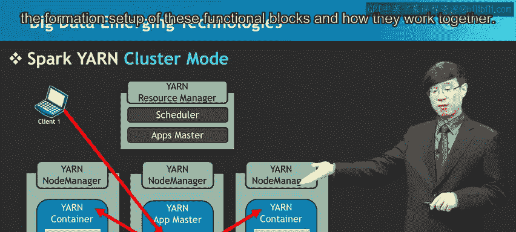

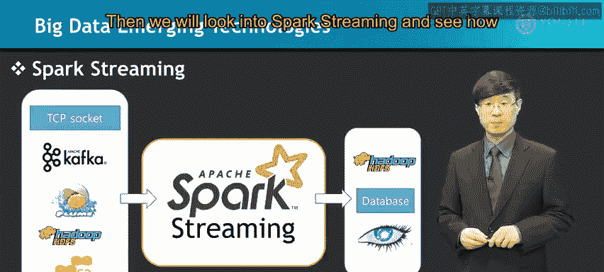

Then we will look into Spark streaming and see how input sources and the processing and the results are saved and operated and how a company like Netflix would use these。

In addition， for online sales， which are streamed in very fast mode。

 could be delivered through CAfC as well as actual department store sales and their records could be used and included into the Spark streaming through Fme。

 we will look into further details about this。

And then we'll look into the details of Storm， where Storm has a faster response to systems。

 and it uses architectures of spouts and bolts in a structure where supervisors are managed by zookeepers and the Nimbus node。

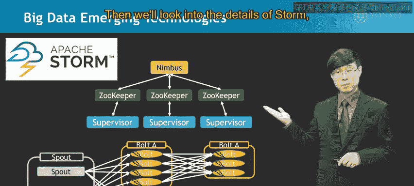

We'll also see how Twitter used to use Hadjiu to analyze their system and support user services。

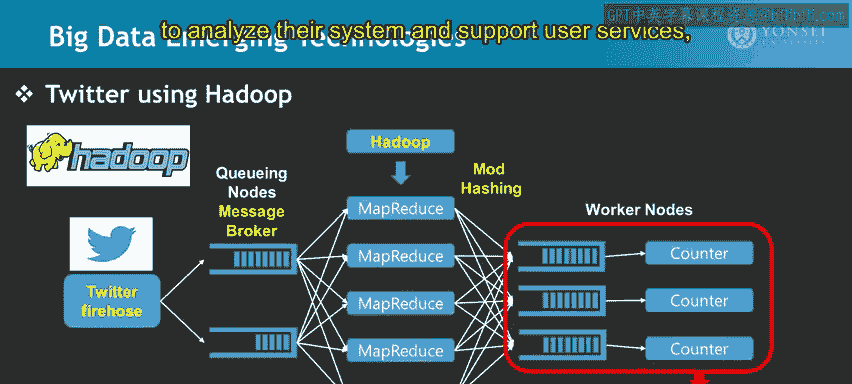

And we will also look into how Apache Storm is now what Twitter uses to support their Twitter services。

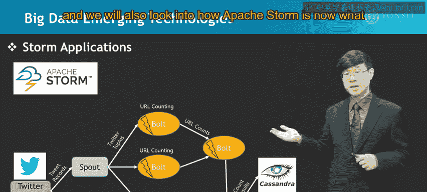

And then how stock market operations can use stormor to quickly adapt to new changes that are going on within stocks。

We will then have a project where we will focus on IBMS SPPSS statistics。

 and the reason we will be using IBM is because IBM has such great rankings in all areas of big data technology。

 so eventually you will be using IBM services at some point in your professional career if you're going to use big data technology。

Therefore， we might as well take a simple and easy glimpse into how to do a simple project in IBMSPSS statistics。

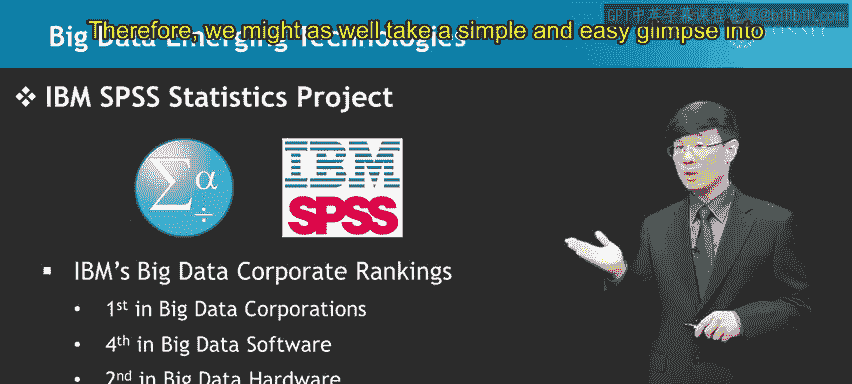

I really welcome you to join my course and study with me， thank you very much。

