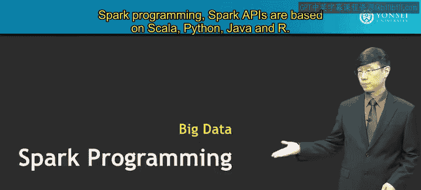
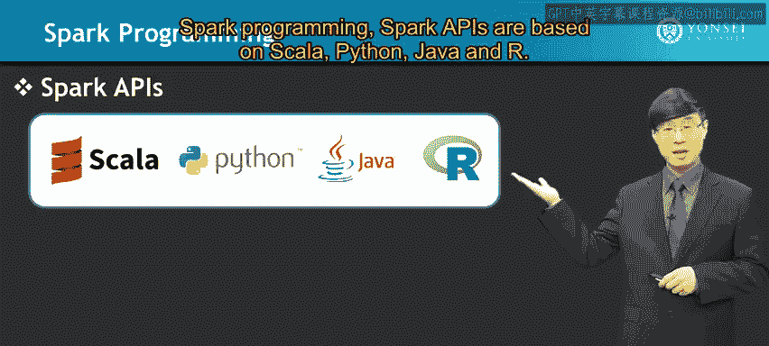
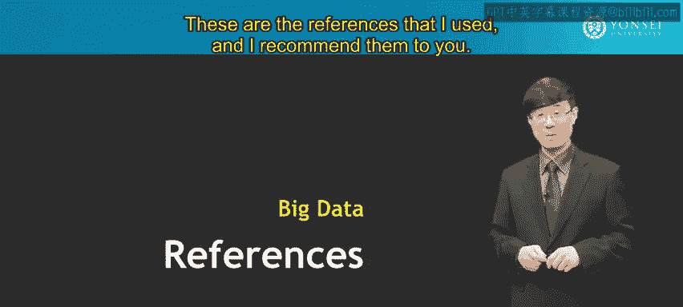

# 延世大学《新兴技术从智能手机到物联网再到大数据Emerging Technologies From Smartphone to IoT to Big Data》 - P20：19_3.9 Spark编程.zh_en - GPT中英字幕课程资源 - BV18hpFewEcG

嗯。

Yeah。Spark programming。

Spark APIs are based on Scala， Python， Java， and R。

APpiI includes functions， sub routineoutines， protocols。

 and tools to use for building and executing application software programs。A good API will include。

Easy and efficient software programming。Verseratile functionality。Easy management。

 control and adaptation。And excellent scaling for easy expansion and fast performance。

Looking into these APIs， Java first。This is a general purpose computer programming language。

One of the most popular programming languages used in the client server web applicationpplication development platform。

It supports object oriented structures。Imperative， generic， reflective。

 and concurrent multipar programming。It was first released in 1995 by Sun Microystems。

 which was later acquired by Oracle Corporation。On a proprietary license。

 Sun microcrosystems originally had released Java compilers， JVMs。

 which stands for Java Vitual Machines and Class librariesaries。

Then it was relicensed based on a GNU general public license in 2007。

It is written in CNC++ related syntax。And the file name extensions include dot Javava dot class and dot jar。

Scala and you will see that Scala is a multi paradigm API that is based on Java， JVM。

 Java virtual machines， and Java programming。It supports functional， object oriented， imperative。

 concurrent， multipar programming。It first appeared in 2004。

And the file name extensions include dot Scala and dot SC。Then there's Python。

Which is a general purpose high level programming language。

It was released in 1991 for the first time。And it has a design philosophy that is based on code readability。

Efficient programming， then C C++ or Java is enabled through Python， which makes it very attractive。

It is easier to understand。Based on its program code， which has a better readability。

So both small and large scale programs can be programmed very efficiently。

It includes a dynamic type system and automatic memory management features。

It supports object oriented， imperative， functional， and procedural multipar programming。

It's supported by a large standard library。And it has file extensions， dopyy。pyyc。pyyd。pyyo。

pyyw and dot pyz。Looking into R。This is a free programming language for statistical and data mining software development automatically you can see why it is attractive for big data analysis。

😊，Primarily written in C4tren and R。It supports arrays， object oriented， imperative。

 functional procedural， reflective， multipardise。It first appeared in August of 1993。

And it was developed by the R core team and supported by the R Foundation for Statistical Computing。

File name extensions include dot R， dotrdata， do RDS and dot RDA。

When programming a Spark program using the API's discussed， which includes ScalA， Python， Java。

 and R。You need to consider the RDD creation methods。You can paralyze a collection of RDD datasets。

Or red datata from a data file system， which could include HDFS， the Hadoop Dis file system。

Cassandra。Or Amazon Web Services， S3。When programming in Spk。

The driver program needs to consider the following issues。

The number of spark cores that will be used。And the number of nodes on the cluster that will be used。

Number of partitions of the RDD should be proportional to the number of nodes in the cluster to be used。

How to take advantage of the cluster's computation capability and achieve higher efficiency and fast processing speeds。

Where more partitions。Results in more parallelism。And the number of nodes on the cluster should be proportional to the number of partitions in the RDD。

For example， for a 1000 nodes in a cluster。That has 5，000 cores that could be supported。

 this processing， then 1，000 partitions in the RDD could be considered。

The driver program builds a deck based on sequence of transformations。

Executed Drive program assigns work to the worker machines。In a worker machine。

 multiple partitions can be processed by the executor， JVM。

Actions activate the DAG and the parallel computations。

Where multiple RDD objects build the operator deck。

Where a parent RDD will pass through a transformation or a stage of transformations to result in a child RDD。

Persisting operations in the DAG are identified， and the reusable parts are cached in intermediate RDDs。

Each RDD partition will have a task executed through a thread of computations。

Where a job is divided into multiple stages， which is divided each into multiple tasks。

The DAG scheduler splits the DAg graph into multiple stages and multiple tasks for execution。

And the task schedule executes individual tasks。The JVM Executor executes task using task threads and the block manager。

Then blocks are served and results are stored on a child RDD。These are the references that I use。

 and I recommend them to you。 Thank you。

