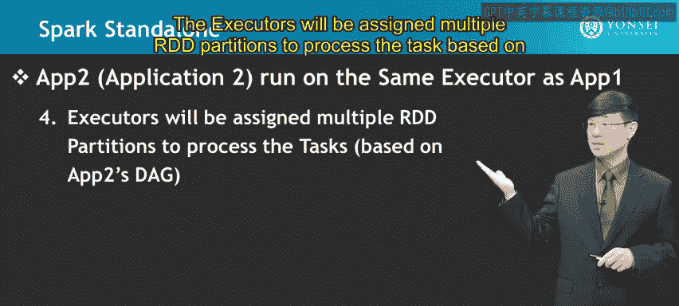
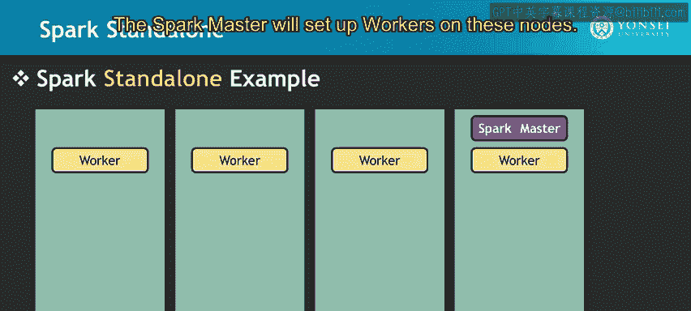
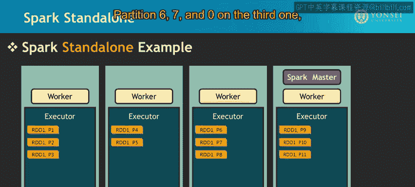
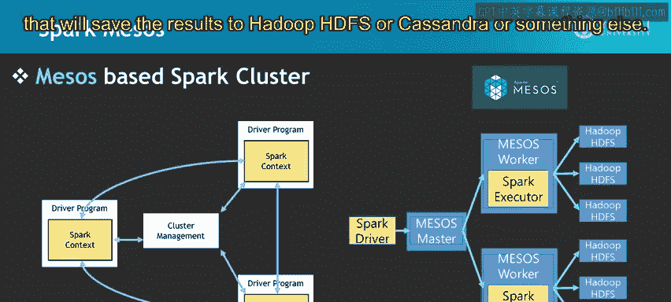
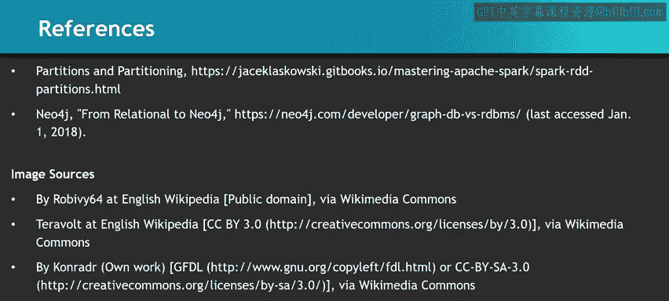

# 延世大学《新兴技术从智能手机到物联网再到大数据Emerging Technologies From Smartphone to IoT to Big Data》 - P22：21_3.12 Spark集群操作 3.13 Spark独立模式 3.14 Spark Mesos.zh_en - GPT中英字幕课程资源 - BV18hpFewEcG

嗯。

Yeah。Yeah。Spark cluster operations。Spark cluster management methods include a standalone。

 yarn and mazzs。And the features of the Spark Central master。

 the Executor's initiation and task execution are listed right here。

 and I will explain this in further detail。But before we go into cluster management。

 let's once again review this Spk operation。Here is the scheduling hierarchy。

Spark cluster schedulers are yarn missileus in the standalone。And once again。

 we have RDD and libraries。And also the DAG scheduler divides the DAg into stages。

 which is divided into multiple tasks that run in serial and parallel modes。

The task scheduler processes the task within each stage。

 and the executor processes the threads using the course。

Spark scheduling process example starts with multiple RDD objects to be processed through stages of transformations through the deck。

These transformations are lazy until an action is executed。The job will start to run multiple stages。

 both in serial and parallel， and in order to do this。

 it will look through the overall bag and prepare a scheduled plan。

Each stage will execute multiple tasks in parallel。

And a parent RDD will result in a child RDD after the D is operated。

Where each task will result in a new child partition to form the overall output RDD。Here。

 the operation now goes into action where the Sp driver JVM will use the DAG scheduler to divide the entire DAg into stages。

Each stage is assigned a task to the scheduler。The task scheduler will assign tasks to an executor to be processed。

Then the task scheduler will use multiple executors to process multiple tasks in parallel。

The executor will process tests using threads to its core that it has。

Executor B Manager will serve blocks of data and store process outputs。

When the task scheduler is done， processing the overall stage。

 the task scheduler informs the DA scheduler that it is done。If unprossed stages remain。

 the DAG scheduler will assign additional stages to the task scheduler for processing。

When all stages of the job are done， the child RDD will be stored。Based on that now， once again。

 let's look into the details of standalone， yarn missileles。

 which are the cluster management schemes and how they actually work。We will start with Spar。

 standone。The Spark master will set up on OneNot。Workers will be set up on multiple nodes in the cluster。

Then the Spark master and workers are JVMs， which have relatively light processing burdens。

App1 will initiate driver one to run on a selected node。Driver one will run job One。

 which is the job of app1 and will communicate with the Spark master。

 which is the scheduler that will schedule execution of job one。

The SMM will tell selected workers to process the task of job one on their executors， which are JVMs。

A job is made up of multiple stages， a stage is made up of multiple tasks。

The executors will be assigned multiple RDD partitions to process the tasks based upon app1's De。

Each executor identifies multiple cores on its node to be used in processing app1's threads。

Then the multiple threads are each assigned to a core or maybe using or sharing a core for simultaneous parallel processing。

What if application2 is now newly added and it runs on the same executor as app1。

 then app2 will initiate driver2 to run on a selected node。

Driver two will run job two and communicate with the Spark master that will schedule execution of job  two。

The SM will tell selected workers to process the task of Jo2 on their executorss JVM。

The executors will be assigned multiple RDD partitions to process the task based on app2's DAG。

And each executor identifies multiple cores on its note to be used in processing app2 threads。Now。

 here is an example which I animated of the explanation I just gave to you。

 so watch this in an animated structure number one。In the standalone example。

 selected nodes of the cluster have these nodes selected。Then a spark master is initiated。

The Spark master will set up workers on these nodes。

The workers will set up executors on these nodes。And the executor will need core to execute something。

 right？Then。For RDD1， there is Partition1， partition 2， partition3 on the leftmost worker executor。

Then we have partition four， five on the second one。Partition 6，7 and8 on the third one。

 and then we have partition 9， 10， 11 aside。

Then all of the tasks that need to be executed once again。

 there is a job divided into stages and the stages have multiple tasks that run in parallel and serial on the executor。

 and these are the tasks。Then threads will form from these tasks to enter the cores。

Now I know that the threads are not really threads that we use in thread and a needle to sew cloth。

 but anyway I drew them as threads to show them entering the course。

Then if you had another job that needs to be executed， then from RDD2， there is partition 1，2。

 partition 3， four， five， and6， and seven assigned to the executors on the multiple nodes。Now。

 these RDDs， of course， will have a job assigned which will be divided into individual stages and the stages will be divided into multiple tasks。

 and these tasks in serial and parallel will be executed through threads to be executed on the course。

Now。In comparison， what if app 1 and app two are running on different courses。

 then something like this would happen。Where app 2 will initiate Drive2 to run on selected nodes。

And driver2 will run job2 and will communicate with the SMM that will request for workers of selecting notess to set up new executors for job two。

Then the SM will tell the selected workers to process the tasks of Jo2 on their new JVM executors。

The new executors will assign multiple RDD partitions to process the test based on apps to DG。

Each new executor identifies multiple core on its node to be used in processing apps to thread。

For example， let's assume that we have executors already here and already our app one is using these executors then。

We have a new executor assigned to each one of these nodes， and each of these executors， of course。

 have course assigned to them。These course will be independent of the course that were assigned to the app one job。

These cores will be used for the app2 job。Then we have the RDDs。

 and then the stages are divided into tasks， and these tasks have threads that run in their courses。

Where？Each partition of the RDD1，2， partition 3， partition 4，5， and partition 6。

7 are assigned to the course。Resilience to failure for crashes that may happen。

Executor crash is recovered by the worker， which is the stage above。

The worker crash is recovered by the SM， the Spark master。If the Spk master crashes， well。

 that's where zookeeper， high availability， the backup engine will kick into action and will make us resilient from this crash failure。

The SM is replicated on another node in the cluster for backup。

And multiple SM backups can be made to make this more secure and reliable。

More SMs can be added during the job execution if needed。

 so you can add them in the middle of the process if you feel that you need more。Spark meos。

A meos spaced spa cluster。In standalone mode， the cluster manager is a Spark master。

When Messois used with Spark， the cluster manager is the Mezo master。

Mos was designed to support Spark。Advantages of using MezoOS include dynamic partitioning between Spark and other frameworks running in the cluster。

In addition， very efficient and scalable partitioning support between multiple jobs executed on the Spark cluster。

Comparing sparkark cluster operations to a messo space sparkk cluster operations。First。

 you can see the components of how Spark would do it and interact with cluster management in the middle。

Compared to this， in Mezoos， it has its own master and workers。

And inside the workers are where the Sp executors work。

Then the spark driver will interact with the MeOS master and that will activate interoping work with the workers that will save the results to Hadoop。

 HDFS， or Cassandra， or something else。

An operation example， a driver creates a job。The job issues multiple serial and parallel stages。

Each stage has multiple tasks。And each task is assigned to process partitions of the RDD within the Note executor。

MisOS Master schedules the task that the executor will run on the partition。

For a MOS master scheduling process， the schedule is determined based on these following factors。

The remaining resources on the node。The executor processing capability of the course on the executor。

The number of short lived tasks and long lived tasks。

The estimated processing duration of the short lived tasks and the long lived task。

What other frameworks coexist on the cluster that are being operated now？

And the potential schedule of dynamic partitioning of the resources。

Mizzo's clientient mode operates in the following way。

Where the driver's Shell program of Spark Meos is launched on the client's computer。

The driver can interactively monitor and control the process。

The final resulting RDD data is displayed on the client's driver and saved on the SSD or HDD。

 which could be like HDFS。In cluster mode of meles。

The driver is launched in the cluster on one of the nodes。The MCD。

 the Mazos cluster dispatcher shell driver， is started on a node in the cluster。

The final resulting RDD data set is displayed on the MiOS webUI。

Zookeeper can be used for failure recovery where the Meso supports writing recovery state into zookeeper。

MisOS run modes include a coarse grain mode。The executor size determines configuration variables where memory size of the executor and the executor's number of cores and core processing capability are considered。

The number of executors is based on statistics of the application。

The coarse grain mode has very little startup overhead。

Mzo's resource allocated to the application cannot be changed until the application is over in the Cose grain mode。

On the other hand， we have the dynamic allocation mode， and just from the name。

 you know that there is more dynamic adaptability。Meos supports dynamic allocation with the coarse grain mode。

Each job is dynamically configured based on required and available resources that the executor has。

These are the references that I use and I recommend them to you， thank you。

