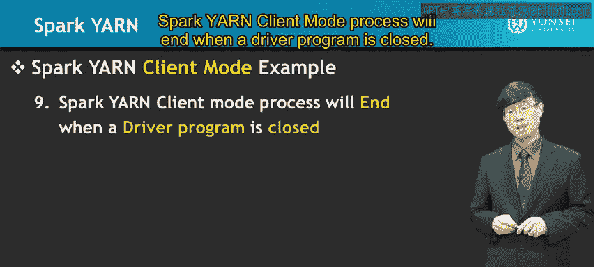
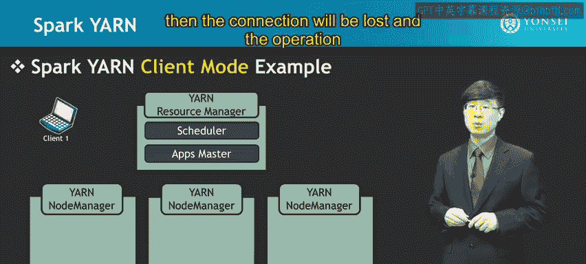
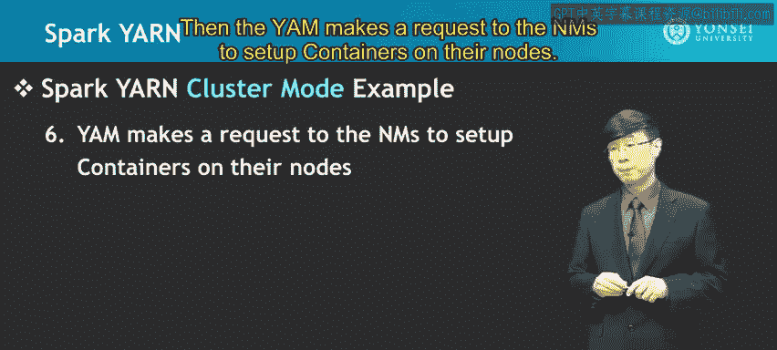
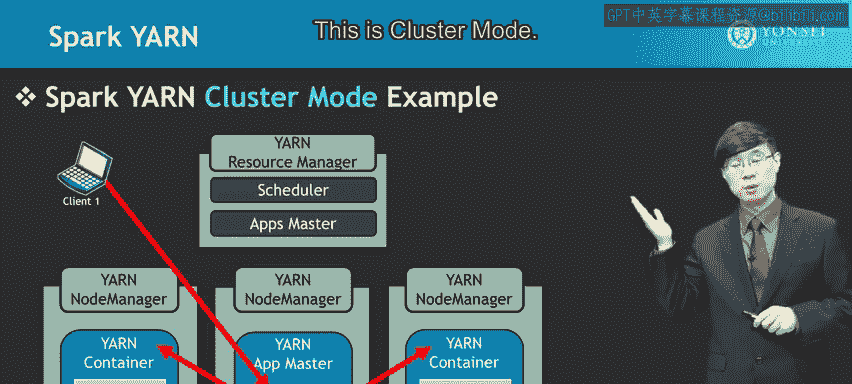
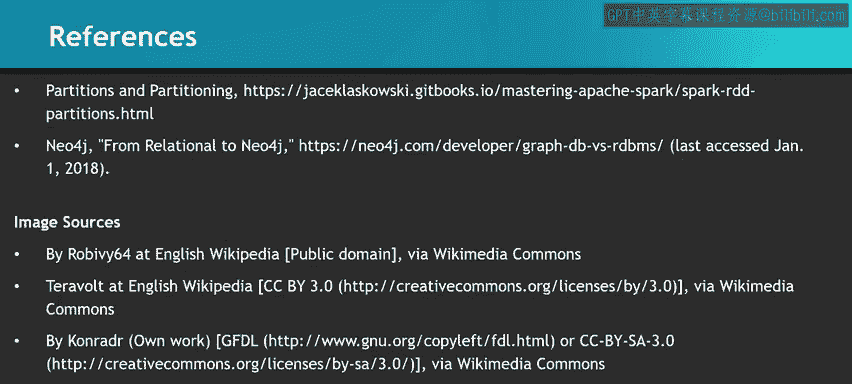

# 延世大学《新兴技术从智能手机到物联网再到大数据Emerging Technologies From Smartphone to IoT to Big Data》 - P23：22_3.15 Spark YARN.zh_en - GPT中英字幕课程资源 - BV18hpFewEcG

Yeah。Spark yarn。Spark yarn has the characteristics of。

It is compatible with Haddu by using yarn to run Haddu clusters。And once again。

 Hadjub is the original big data technology that was widespread。

 being one of the world's most famous and dominant technologies for its own period of time。

 and therefore it is so widely spread that a lot of HDFS databases still exist over many。

 many places and that's why using yarn to access the HDFS database such that data can be analyzed on Spark is so attractive。

 so this part is really important。Spark can process data on any Hadoop input format， so it's great。

Including HDFS， HBase， Cassandra， hive， and other things。There is a client mode of yarn。

The driver program of the application runs on the client computer。

 that's why it's called clientient mode。The yarn resource Manager， YRM。

 selects a node with sufficient resources and makes a request to the nodes yarn node manager to set up a yarn app master。

The yarn resource manager has a apps master which is in control of multiple app masters In other words。

 the apps master in the YRM is going to monitor and provide failure recovery when it happens。

Of multiple Y A Ms。The yaM makes a request to the YRM to have multiple yarn containers with executors to be set up in the cluster。

The YRM informs the YAM， which nodes have sufficient resources to set up the containers。

And send the required information to the YAM to enable the set of process。

The yam makes a request to the YNMs。To set up the containers， the yarn containers on the node。

Inside each yarn container， an executor is set up to process tasks on the RDD partitions。

The client can use the driver to be directly interactive with the executors in the yarn containers on the notes。

The client can check the results of the transformations and the actions in the executor in real time using the driver interface in client mode。

So once again。The driver is on the client's computer。

There are two level schedulers that are being controlled。

The YRM Schr decides which nodes have containers to run the executor JVMs。

The drive scheduler decides the actual task that will run on each executor。

The Drive scheduler attempts to optimize the task assignment based on the cached RDD data stored on each node。

Spark yarn client mode process will end when a driver program is closed。

When a client driver's shell is terminated， then it will close， or for other example。

 where the client actually just close its computer， ends its computer and takes it away。

 then the client mode will be terminated。Now let's check this process in animation through an illustration of procedures。

First， the driver on the client computer sends to the yarn resource manager。

The yarn resource manager， the YRM， sets up a yarn at master YAM on one of the nodes。

Then the apps master will monitor the yarn app master that was set up in case a failure occurs。

Then a yarn container request is sent from the YAM to the YRM， the resource manager。

 and the resource manager sends back the container setup information。Then the app master， the YAM。

 will contact the yarn node managers where the yarn containers are set up。Within the containers。

There is an executor which will execute the RDD。Using tasks to get the child RDD results。

The driver is in control of the executor programs that are running on the yarn containers。

So therefore， if the driver is turned off。Then the connection will be lost and the operation will be terminated that was running on the cluster。

Let's look at the cluster mode example。In a cluster mode。

 the client submits the app and the driver program to the cluster's resource manager。

And this is where the YRM is now in charge of the driver program itself。

 and the driver program is no longer being executed from the client computer。

That's why we call it cluster mode because the driver program is now in the cluster。The RM。

 the resource manager， the YRM， decides the location of where the yarn at master YAM will be located。

Then the Appma will monitor the YAM to make sure that it's running well。

 and in case a failure will occur， then the App master will provide a backup and failure recovery。

The yaM starts to execute the driver program internally on the cluster on one of the nodes。

The yaM makes a request to the RM， the YRM， to have multiple containers with executors set up to work in the cluster。

The RM informs the YM， which node will be sufficient to open new containers and execute your operation。

Then the yaM makes a request to the Ns to set up containers on their notes。

Inside each container， yarn container， an executor is set up to execute tasks on the RDD partitions。

The result is saved to HDFS or to Cassandra or to something else。

Then the client can come later and check the results that are saved on HDFS or in Cassandra or some other place。

Let's look at this operation of the cluster mode in animation。Here we go。

 the driver contacts the resource manager of yarn， the YRM。And the YRM will set up a Yrn app master。

Then the App master will start to monitor the YAM to provide its backup capability in case a failure occurs。

Then the driver that is on clientient1 will be moved into the yarn app master。

And the connection can be disconnected。Then client one can leave。

 it can close up its computer and come back and check later。

Then the yarn app master will send a yarn container request to the resource manager and it will get container setup info then the app master will contact the node managers。

To set up yarn containers。And in these containers， there will be an executor that runs the RDD tax。

Now， the driver will continuously monitor and communicate with the yarn containers。

When the client returns and wants to check the results。

 then it will contact the driver that's on the yarn app masterster， the YAM。

 and that will check the results on the yarn container。

It may also have saved the final result on HGFS or on Cassandra or some other place。

 where the driver will go and fetch that and report it to the client device。This is cluster mode。

These are the references that I use and I recommend them to you， thank you。

