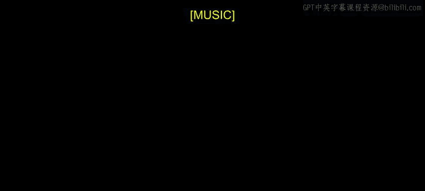
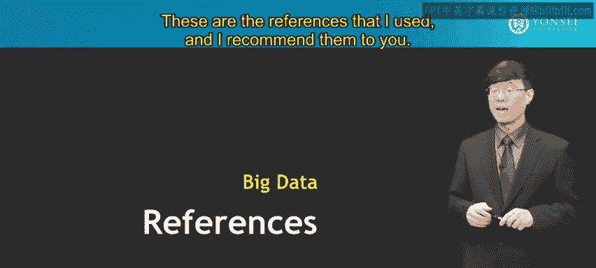
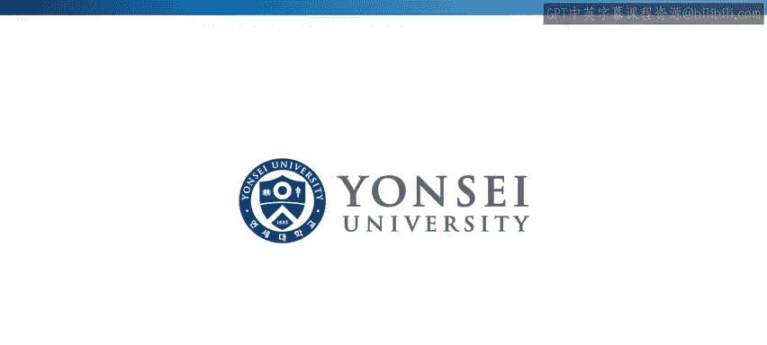

# 延世大学《新兴技术从智能手机到物联网再到大数据Emerging Technologies From Smartphone to IoT to Big Data》 - P24：23_3.16 Spark SQL 3.17 Spark GraphX.zh_en - GPT中英字幕课程资源 - BV18hpFewEcG

嗯。

Yeah。Yeah。Spark sequel。This supports SQL operations based on the Spark core。

It can easily include SQL queries into Spark programs， and it's programmed in Java， Scala， Python。

 NR。Programmers can connect to any data source， which is so convenient。

 the same way and easily join datas across these different data source types， which is wonderful。

Schema RDD based data abstraction is used。And it provides data extraction based on data frames。

It provides support for structure and semistructure data， which is so important。It provides DSL。

 domain specific language in Scala， Java， or Python to manipulate data frames。

Business intelligent tools can be easily used as a server mode provides industry standard。

 JDBC and ODBC connectivity。 What does that mean Just wait， I'll explain it to you soon。

Programmers can connect to any data source。The same way and easily join data sets across different data source types。

In order to understand Sp SQL operations， we need to look into some additional terminology。

 A data set is a distributed collection of data。It is an interface of Spk that provides RDD and Sp SQL functionality。

It's constructed from JVM objects and processed using transformations。

A data frame is a data set organized into named columns。

It's similar to a R or Python based data frame or RDB relational database table。

 I will explain more on relational databases soon。Data frames are created from structure data files。

Tables in Hve， external databases， and existing RDDs。

Data abstraction is a reducing process to obtain a simplified representation of the whole data set。

ODBC is open database connectivity。 It is a standard API to access database management systems。

APpiI is designed to be independent of the database system and the operating system。

JDBC stands for Java Dataase Connectivity， It is a Java API used for client access to databases。

It is a Java standard Ed platform based API。And it enables database query and update functionality。

Spark graphics。Graphs is a distributed graph processing framework。

It was originally developed by UC Berkeley's， and PLav and Databricks。

It was later donated to the Apache Software Foundation and the Spark project。

It examines the entire graph of a batch process to derive the optimal solution and answer。

Graph computation API is provided through Gph X。And optimized runtime processing of user defined graphs are enabled through Gra X in Spark。

Spark's distributed graph processing framework is based on， of course， its RDDs。

Since RDDs are immutable， graph x graphs are immutable also。

Graphics is unsuitable for database graphs that need to be updated。 this is because it is immutable。

 this is because the RDD is immutable。So if changes are made to graph x values or structure。

 a new graph will be created。Some programmers use graph database technology with Spark Gs。

And I will explain more on relational databases and graph databases soon。

Sparks distributed graph processing framework is based on the RDDs， as I mentioned before。

 where the entire graph of the RDD is transformed into a combination of vertex RDDs and edge RDDs。

Vertex RDDs and E RDDs are suitable for graph computation and easy to apply graph optimization algorithms。

Spark's distributed graph processing framework is based on the RDDs where the APIs enable implementation of massively parallel algorithms。

And mapR style APIs。And pre APIs。Presual API enables message sending computation based on vertex attributes and constraint messages on the graph structure。

It enables more efficient， distributed execution and flexibility in graph based computations。

And provides database abstraction in graph form。These are the references that I use。

 and I recommend them to you。 Thank you。

