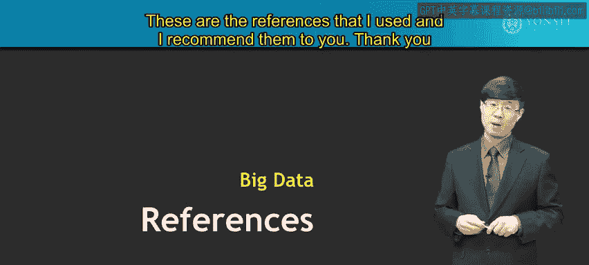

# 延世大学《新兴技术从智能手机到物联网再到大数据Emerging Technologies From Smartphone to IoT to Big Data》 - P25：24_3.18 关系型数据库与图数据库.zh_en - GPT中英字幕课程资源 - BV18hpFewEcG

We just studied about Spark graphics。And I receive questions from my students about relational database and graph database。

 and also is G X a graph database。And the answer is no。

 but there are relations that you need to understand between relational database and graph database which interacts with graph X。

 and in order to explain that， I will explain this chapter I do want you to study this part because once again this course is about big data and big data is based on databases and the database structures that we have been using and is used in all corporates are relational databases and the new graph database concepts。

 so here we go。Relational database。A representative database used in all software applications since the 1980s。

 so therefore， this is what's out there。Structure data is stored in tables。 Once again。

 these are based on structure data。Columns define data types and rows are collections of the same data types from different data sets。

Relationational information is the key。Relations between one data set table to another data table are indicated through table primary key attributes。

 which are referred through foreign key columns。So therefore we have primary key and foreign keys。

 and these are from table to table listed in rows and columns。Then let's look into Graph database。

This is a database that uses graph structure。Database graphs that use vertexes and edges。

 so automatically you can see the relation between a graph database and graph X， however。

 they' are not the same， highly related with multiple functionalities that can interact very efficiently。

 but they are not exactly the same， they have differences。And you will see that。

 as I continuously explain， vertexes are based on data sets and metadata。

 and edges are based on relationship。What is metadata。

 I will explain that in further details very soon。Graph databases support semantic queries on nodes and edges and properties to represent and store data。

Vertexes represent an entity or attribute of metadata。

Edges represent the relationship of the vertexes。Relationship records are organized based on type。

 features， direction， correlation， statistics， and other attributes。Metadata， what is this。

 this is data that provides information about other data。

Metaadata types include descriptive metadata， structural metadata and administrative metadata。

 Let's look into these。Descriptive met datata is data and information on data resources and purposes。

Method of data discovery， identification and verification are some of those categories。

Examples include title， abstraction， programmers， authors， source， keywords， and other features。

Then structural metadata， This is data information on data containers。It specifies on categories。

 types， versions， relationships， statistics， and characteristics。

Where method of data container collection or creation is considered。

 and data set compounding basis objects are considered。Then we have administrative met data。

 where data and information on resource management and administration is the focus。

This includes method of data， set， collection and creation。

 data set type and file technical information， user access permission and administration。

 resource management methods and policies。For example of a relational database to a graph database。

 this is just a simplified one example， it's not complete， but anyway。

 if this right here is a relational database structure where we are looking at person。

 department members and technical department functions， then，😊，We have Chung。

 which is me related to the Department of Electical and Electronic Engineering。

 Computer Science and Engineering， management of Information systems， where smart device design。

 Spk big data， HCI design， related technical aspects are what I may cover。

Extracting these components out and representing their relationship based on attributes will look different。

 and this is basically one aspect， this is not a full graph database。

 but you can look at the relation of what was in a relational database table extracted out into vertex and edges that you see right here。

And this can be further developed into a graph database。

Looking into the reason why Gra databasease is more attractive in some cases than relational databases is what we will focus on。

Right here you look into relational database analysis， when a query is received。

 data joins are computed by matching primary keys and foreign keys on the tables。

This join process is the major task that we're looking at。

Joint tables are made to record the many to many relationships of the data。

Join processes require a lot of shuffling and sorting operations once again。

 if you remember that the shuffling and sorting operations were the complex operations and that's why when we had a join。

 that's where we divided the stages。Of a job， a job was divided into stages。

 and in a stage there were pipeline operations of transformations。

And each stage was divided into multiple serial and parallel process tasks。

 which were turned into threads executed on the course， right？Now， once again。

 these joint operations are time consuming and computational burdens。

This is why RDB technology was desired to be turned into GB graph database technology。

 looking further into it。The process of a join is combining related to data sets based on common fields。

Essential process in database and data merging and data analysis。

 it is so important you have to do this once in a while in your process。

The types of join include nested loop joint and hash join。Looking into its mechanism。

 nested lu joint is the simplest joint method。It uses nested loops to join two tables。

 so it's something like this， the basic operation if I had two tables and I wanted to get their attributes combined。

 then I will look at one attribute and go through the table the next one and go through the other table the other one and go through the other table and do this over and over and over in a nested loop operation sequence This will take a lot of time and it's very slow。

The joining process based on nested loops are for each row in the inner table。

 all rows of the outer table are read in order in the join process。

Time complexity increases significantly when the tables become larger。

Multiple tables joining is process two tables at a time， so if I have two tables。

 then I'll just do that operation， but if I have five tables I will have to do two。

 then do the other one， the other one， the other one sequentially so it's not a parallel process it is a serial process and that serial process takes time In addition。

 when we go to a large databases， when we go to huge databases， which is the focus of big data。

 this will take an exponentially increasing amount of time。That's why we use hash joint。

HaashJoin uses hash tables of the smaller table we create a hash table。

 which is like a lookup small abbreviated compact table。

 and this will be used to go through the larger table to process it out and do a faster joining process because the hash table is smaller we can also put it on in memoryory RA。

 such that it operates much faster。Then the small and quickly accessible hash table is used in the lookA process of traversing the larger table in the join process where once again the hash table is saved on RAM for very fast processing。

It is much faster than the nested loop joint。Hash table， which is a hash map。

 this is a data structure that builds an associative array of abstract data from the larger data set。

It is more efficient than search trees and lookup tables。Hash tables are used to map keys to values。

And hash functions are used to compute indexes into values， an array of buckets or slots。

 which are placed in the hash table。In graphra database Data analysis for a joint operation。

 the database just uses the list of vertexes and edges it already has。

And it has direct access to the connected nodes eliminating the need for a complex and time consuming search and match operation。

Pre materializing relationships into database structures is what Graph databasease does。

Faster response to queries， which is exactly the focus。More expressive of data relations。

Much simpler to understand the relational database structures。

And it is easier to use in analysis and modeling and simulation。

Why GB is better than RDB for connected data？Connected data requires a lot of joint processes to analyze its numerous interconnected relationships。

So Gra database is not placed into a relational table。

 which uses predefined types of data structures。That's the advantage of graph database。

 Gph database data attributes can be added and removed as needed。

When semistructure data is placed into a relational database relational table。It cannot accept it。😡。

Therefore， much data will be filtered out because only structured data can be entered into a relational database。

 relational table， so when you have semistructured data where not all data is full structured format。

 then basically graph databases are much more powerful。If you put that into a relational database。

 relational table， then the parts that were filtered out will be null values because they cannot be stored because they are not structured data that can be put into a relational table。

Since Graph databasease has no predefined structure， data modeling is much easier。

In relational databases for highly connected data， SQL query programming syntax is complex and difficult as the number of joins has to increase。

Then can we get a changing mechanism so that we can change our RDVs relational databases into graph databases。

 Yes， there are functions that do that。For one example， I recommend Neo4j as that example。

These are the references that I use， and I recommend them to you， Thank you。

