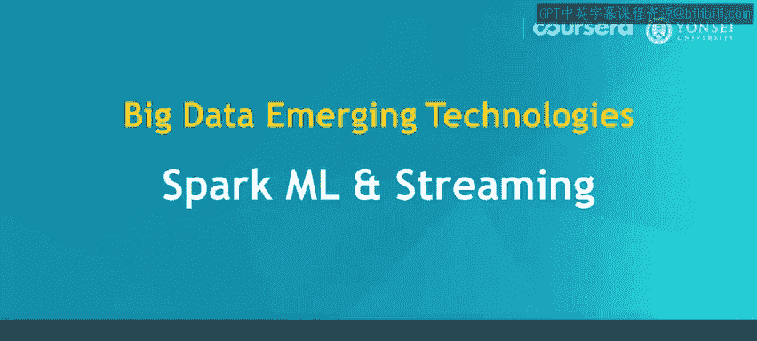
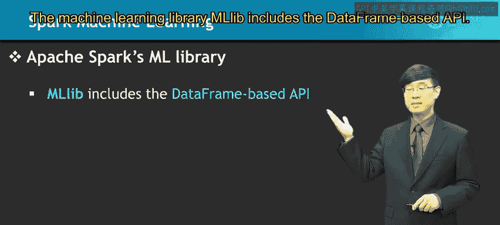
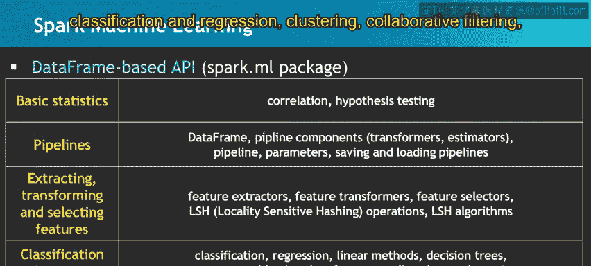
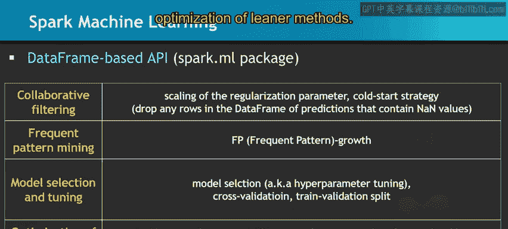
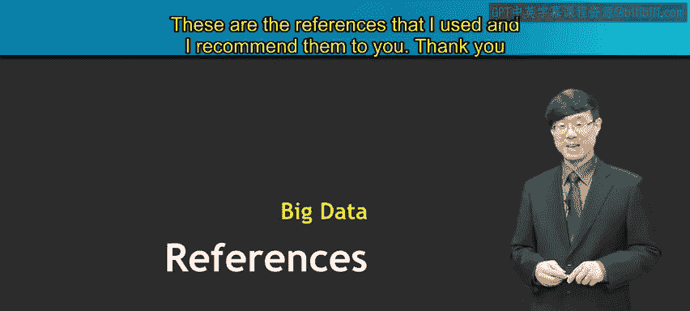

# 延世大学《新兴技术从智能手机到物联网再到大数据Emerging Technologies From Smartphone to IoT to Big Data》 - P26：25_4.1 Spark ML机器学习.zh_en - GPT中英字幕课程资源 - BV18hpFewEcG

Spark Maine learninging Library。Is easy to learn and use， provides very practical functions。

 scalable performance， very high level machine learning functionality。

 which include machine learning algorithms， featturization， pipelines， persistence， utilities。

 and so much more。😊，Looking a little bit deeper into it， the machine learning algorithms。

 there are tools for constructing， evaluating， and tuning machine learning pipelines。

Under feturization， feature extraction， transformation， dimensionality reduction and selection。

Under pipelines， learning algorithms for classification， regression， clustering。

 collaborative filtering， and more in persistence， there is saving and load algorithms， models。

 pipelines。And under utilities， linear algebra， statistics， data handling， and much more。

The Maine learninging library ML LibB， includes the data frame based API。

The data frame based API in the Spk。ml package is Spark's primary machine learning API。

The RDD based API can be found in other documents， and this is in the Sp。

mllibB Maine learning library package， which is in maintenance since Spk 2。0。

 so we'll focus on the data frame based API in this lecture。Looking over here。

 the data frame based API。There are basic statistics， pipelines， extracting。

 transforming and selecting features， classification and regression， clustering。

Collaborative filtering， frequent pattern mining， model selection and tuning。

 optimization of linear methods。

These are the references that I used， and I recommend them to you。 Thank you。

