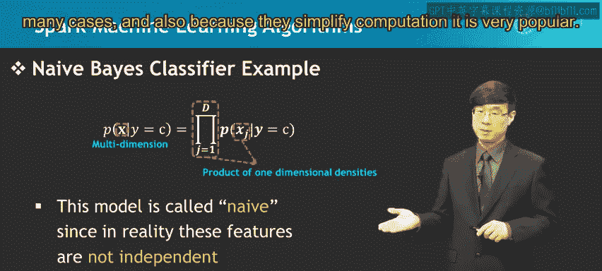

# 延世大学《新兴技术从智能手机到物联网再到大数据Emerging Technologies From Smartphone to IoT to Big Data》 - P27：26_4.2 Spark ML算法（第1部分）.zh_en - GPT中英字幕课程资源 - BV18hpFewEcG

🎼Yeah。Spark machine learning algorithms。There are basic statistics and classification and regression types where under basic statistics。

 correlation， hypothesistheesis testing， under classification and regression。

 there's linear models which include support vector machine， linear regression， logistic regression。

 naive base， decision tree。And some others are collaborative filtering， clustering。

One of the most famous ones is Cans。Dimenssality reduction and others。

Let's look into that list first we'll start with correlation。

Variables can have a relation of being independent， weakly correlated， strongly correlated。

Correlation indicates the extent to which variables have an influence on each other to increase or decrease each other。

For example， in the case of the blue dots over there， for the x and y axis that you see。

 the blue dots they are strongly correlated， how do we know well they are on a diagonal structure。

 which means that when x increases the y value will most likely be a large value as well。

Compared to these red dots。The red dots show a weaker correlation between x and Y。

 and you can see this because just because x is large does not mean that the y value will be large as well。

 That's why the data values are spread out much more。In addition。

 if these dots are spread out even more， then the correlation between the x and y will be even lesser。

 and therefore the dots will have a weaker correlation all the way until they are maybe even uncorrelated。

Then you will see them even spread out more。Hypothesis testing method is based on the following case where we define a statistic that obeys a certain distribution if the hypothesisthesis is correct。

And then we try to go and check。Collect samples and then calculate the statistics probability。

If the sample statistics show a probability lower than the threshold of being drawn from this distribution。

 then the hypothesis is rejected。For example， if the probability is lower than the threshold pi。

 which is shown right there， if it's lower than that， in order to be like that， for the case of T。

 if t is larger than omega， which is shown right down there， then the hypothesisesis is rejected。

 like you see down there。Lineer models。Frequently are used in regression。

They include the support vector machine， logistic regression， linear regression， and others。

What is regression， regression is a method to predict the value of one or more continuous target variable y。

 given a D dimension vector input x。So it's used in prediction and you know that theres so many places that you can use prediction。

 so therefore it is very powerful and frequently used。Looking into first linear regression。

 which is the simplest regression model。The output of linear regression is continuous。

And to obtain output y from a linear combination of input variables X and weights W。

 you can see it right down there。Here， an example of linear regression is like this。

 where the red dots over here are the input values。

And the blue curve is the linear regression output model。Logistic regression is different。

 It is used in classification problems that need to make a decision。

Where we decide among two options or multiple options。For example。

 to decide among0 and1 using a sigmoid curve is something that would be a typical logistic regression example。

Decide among multiple options， of course， is possible。For example， a siggamoid S curve。

 which is right here， you see it right here。With a decision boundary it' frequently used to make a decision。

Where we have a decision boundary right here in the middle， this yellow line， and based on this。

 if it's left， it's classified to zero， if it's on the right， it's classified to one。

Small changes on this curve right here near the threshold will either go up or go down based on it。

 and therefore it is sensitive in that area and you can use it to make a decision。

Then we look at support vector machine， SVM。 This technique is frequently used in solving problems in classification。

 regression and novelty detection。SVM algorithms create a decision boundary that maximizes the margin between the groups that are being classified。

So， for example， H1 represents another algorithm， let's say like maximum likelihood。

 where it is dividing， classifying the red dots and the white dots。In its own criteria。

H2 represents the SVM mechanism。Where you can see that it attempts to separate data sets with the largest margin。

 The margin could be these areas right here， so therefore。

 the classification result of SVM will be different from other algorithms。

We will now look into naive B Classifier。Conditional independence is assumed to simplify the classification decision in naive based classifying algorithms。

What do you mean， well， base theory is based on conditional probability。

Let's look at a conditional probability of x。Given Y and Z， that's written over there。

This is a conditional probability that x occurs based on the condition。

 the given condition that Y and z occurred earlier。If x is independent of Z。

 then it doesn't need to be in the conditional area， it can be removed like you see right here。

So removing a variable can be based on its independence。

Everything is dependent to everything else in a real world when you analyze data。

 marketing sales and various parameters， then in reality everything is connected to everything。

 everything has some level of correlation and dependence， nothing is truly independent of each other。

 but the relations are too complex to analyze， and then put them into a formula。

 maybe even much more difficult。So in order to simplify our computation。

 the naive based model naively assumes that events， some events are independent。

It provides fast and easy to compute results， which is the pros。But on the other hand， the cons。

 the accuracy and reliability is sacrificed。You use it when the resulting accuracy is sufficient to be applied to its purpose。

An example of naive based classifier。Where conditioned on Class C。If it is assumed。

That the probability distributions of the input variables， x1 through Xd are independent。

 which they actually are not， then class conditional probability density equation can be written as a simplified multiplication。

 a product of one dimensional probability density functions。

Let's find the probability of occurrence of data set X through Class C。

Looking at that conditional probability。Nively assume conditional independence between the features。

 then we can get a form like this。Looking into this。D is the number of features。

Looking further into the formula， a multidimensional probability is easily obtained from multiplication of a product of many one dimensional densities under the assumption。

Where originally x is a multidimensional variable。And the product of one dimensional densities are used to get the overall multidisional value。

This model is called naive， since in reality， these features are not independent。

 although they were assumed to be。Nive Base classifier technology actually works very well in many。

 many cases， and also because of its simplified computation， it is very popular。

