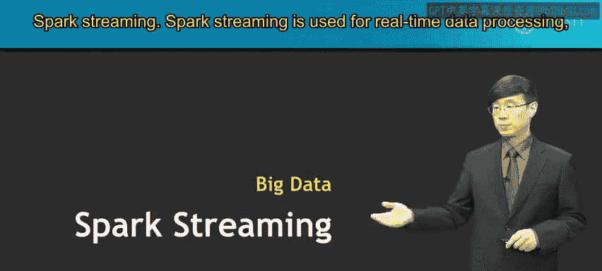
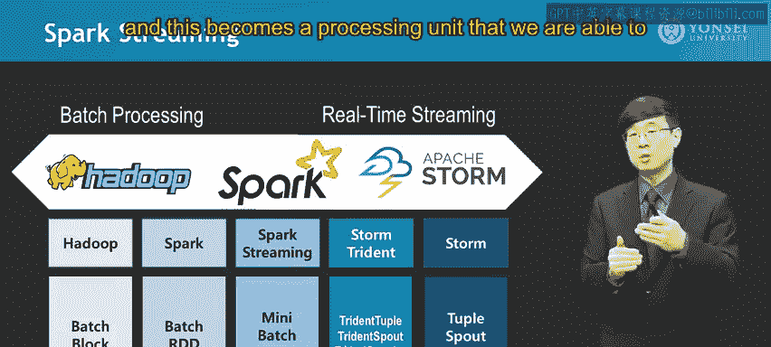
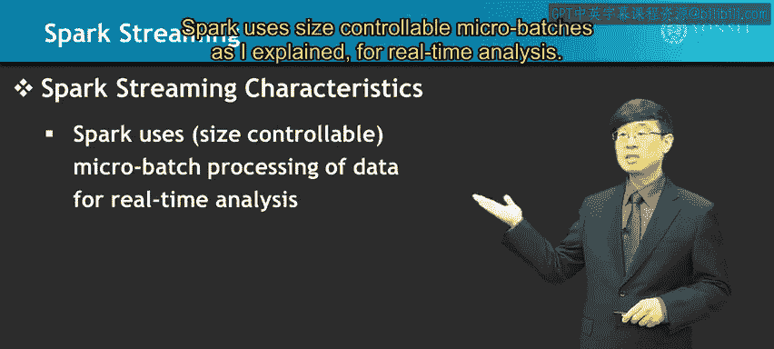
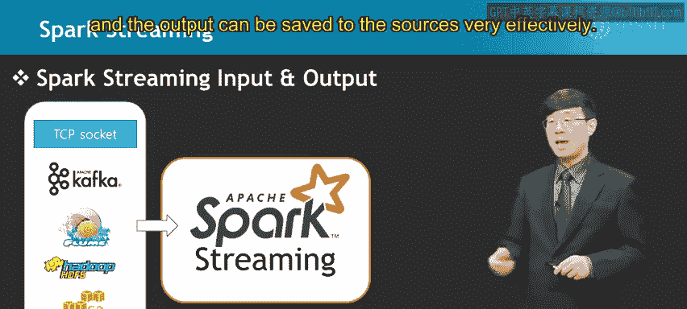
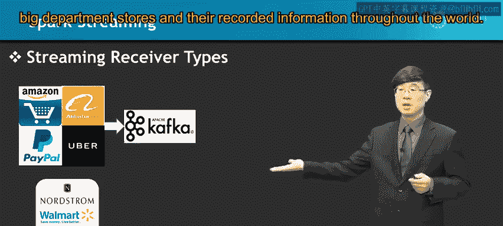
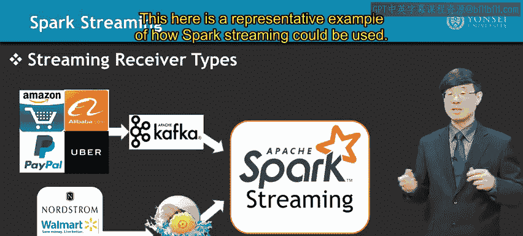
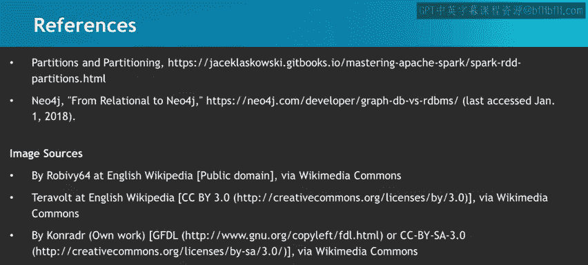

# 延世大学《新兴技术从智能手机到物联网再到大数据Emerging Technologies From Smartphone to IoT to Big Data》 - P29：28_4.3 Spark流处理.zh_en - GPT中英字幕课程资源 - BV18hpFewEcG

🎼Yeah。Spark streaming。

Spark streaming is used for real time data processing， where Spark streaming uses mini batches。

Mini batches are small batches where Hadop uses large batches and so does Sp。

 When you we go into spark streaming， the batch size can be reduced to as small as half a second。

And this becomes a processing unit that we are able to obtain results based on data that is the size of a mini batch。

There are also other techniques such as storm Trident and storm。

 which we will talk about later that can process at faster rates， but in a slightly different way。

 Overall， batch processing from Haddu and batch processing with spark down to。

Real time streaming with Spark streaming is what we will focus in in this lecture。

Spark streaming is an extension to the Spark corere API。

 Some of the characteristics include that it supports live data streams。 In addition。

 it is fault tolerant and scalable。It provides high throughput and realtime data support Now I put near realtime because some applications may need a faster processing result to come out that is less than 0。

5 seconds period then in that case we will need to use storm however a lot a majority of the applications over 90% will be sufficient to use mini batch sizes of 0。

5 seconds and of course we can use larger batch sizes for that but the smallest unit that we can go to is 0。

5 seconds。Streaming data from HDFS， Kafka， Fme， TCP sockets are all possible。

Spark streaming supports processing with high level functions for map， reduce， join， window。

 and others。It processes outputs saved on file systems， databases， and live dashboards。

Spark machine learning functions and Gs graph processing algorithms are fully applicable to streaming data。

Spark uses size controllable microbe batches， as I explained， for real time analysis。

Hayop uses batch processing of data， which is time consuming to obtain results。

 the larger the batch size， then the longer it will take to get an output from that batch that is being processed。

Sparark uses RDD to arrange data and recover from failures。Looking at spark streaming structure。

 the input can come from these sources and the output can be saved to these sources very effectively。

Streaming receiver types include basics。Which have file systems， socket connectors， AA actors。

 sources directly available in streamaming Contacttex API。Other receiver types include custom。

 where it requires implementing a user defineded receiver and also advanced。

 which requires linking with systems that have extra dependencies such as Kafka， Fme， Twitter。

 and others。Spark streaming process is now described where we start with live input data stream is received。

Then input data stream is divided into mini batches called Dstream， discretized stream。

Which is saved as a small RDD every mini batch period。

Spark Stam engine generates final output stream of batches。DSt， a discretized stream。

 is a continuous stream of data with high level of abstraction。

Dstreamam are created from input data stream sources such as Kafka and Fme。

 or high level processing operations on other Dstreams。

These streams are represented as a sequence of small RDDs。Mini batch size is 0。5 seconds or larger。

This means that the smallest mini batch size is half a second。RDD is processed through the DAG。

And processing latency through the dag has to be smaller than the batch period。

 What this means is that if the mini batch size， for example， is half a second。

 then within that half a second， the data that is received needs to be processed。

 then it needs to be sent out， and the preparation for the next mini batch input data to be received。

 has to be all conducted within that mini batch period of 05 seconds in this example。 So therefore。

 processing latency has to be a fraction of the mini batch size。So， for example。

 if the mini batch size was half a second within that half a second period， then the receiving。

 the processing and the sending out has to all be conducted。 and that's what this means。

Windows operations is something that you need to consider。

The window length is a number of blocks to conduct a RDD DAg process together。

The sliding interval is a number of blocks， the partitions to slide the window after a RDD process is conducted。

For example， if these are the blocks that need to be processed。

 then that will be a window and there will be a sliding interval。

Looking into the transformations that are used for Windows， for example。

 we have window count by window， reduced by window， reduced by key and window。

 count by value and window。In here， you see the parentheses。

 and that's where you can put in the arguments。For example。

 some of the key parameters for windows will be the window length and slide interval。

 which are the major things that we are looking at right now。Now。

 if the window length is larger than the sliding interval。

 then the window length subtracted by the sliding interval will result in overlap blocks。

 these overlapping blocks will exist for the RDD process。For example。

 on the blocks that are shown here， if the window size is4 and the sliding interval is2。

 then you will have an overlap where the next window will exist compared to where the former window existed。

 which is in yellow。There will be an overlap of two blocks， as you can see。

The overlap blocks help to analyze correlation， the dependency of sequential blocks in the stream data。

For an example， where IPTV or webp page live statistics need to be monitored。 In other words。

 let's see how many people are watching Watch channel。

 and we want immediate information of that of what is going on。😊，For example。

 a channel or page view clicks need to be monitored in real time。

 so we know where the audience is interested in。Use Kafka for buffering because Kafka is very effective for streaming data support。

Spark streaming is used for processing。And we will draw a heat map of the current channel or page view clicks so that we can use that heatat map to immediately know how many users are where。

 and if you think about it， well a company like Netflix could easily use this very effectively。

And that is why Spk streaming is used by Netflix。Sales product type monitoring example， online sales。

 well， you could read through Kafka because the online sales are done globally and the numbers that are accumulated increase at a very fast speed。

But on the other hand， department store sales， well they're done in a lesser rapid speed because people put them in their cart。

 they take them up and they compute them at the same time。

 and for a batch their computation is done at the checking counter。And we can collect all their data。

 which is more recorded data through Fme。And use an example of Spark streaming to join two live data streams。

And process them together。For example， well， we have Amazon。com， we have Alibaba， PayPal。

 and also Uber users， and their online reservation and payment information is coming in。

We use Kafka to stream that in in real time。On the other hand。

 for big department stores and their recorded information throughout the world。

 well we collect their information in big logs and we move them into the system through flu。

We combine them into spark streaming。 This here is a representative example of how spark streaming could be used。

Here from the stream of input using CAfka， one task slot in the executor will serve as a receiver。

 a thread to receive the live streaming data into a block， a partition of the RDD on the node。

The receiver will also make a copy of this partition to another node here for this example。

 I'm talking about a replication factor of two， and this is to make the system resilient and having a backup for reliable computation。

The DAAC transformers are executed on the new RDD。Another stream is added， for example， from Fme。

 on a different node， assign one test slot in the executor to serve as a receiver to receive the live stream into a block a petition of the RDD on the node。

Receivever will also make a copy of this partition to another note。

The DAG transformations are executed on the new RDD。

And a union can be used to unify the two RDDs into one。

And an example of this being processed internally。These are the references that I used。

 and I recommend them to you。 Thank you。

