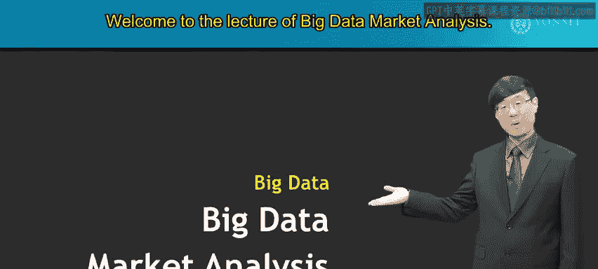
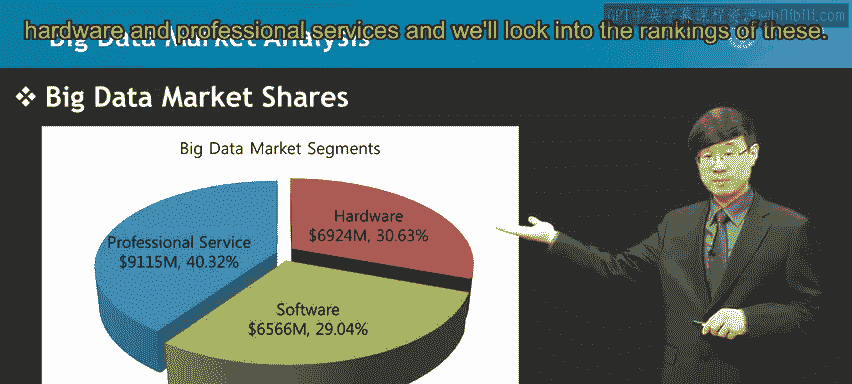
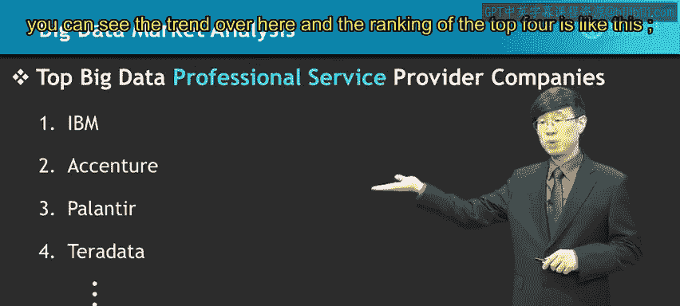
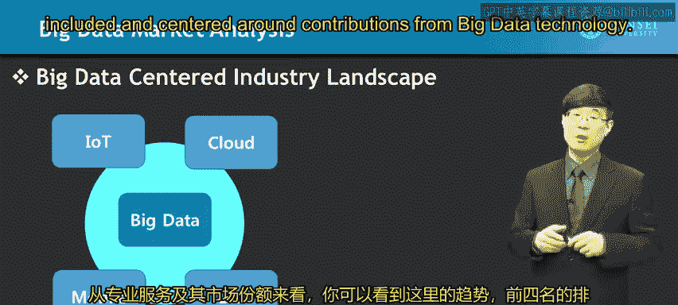
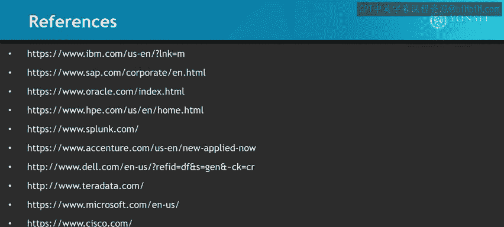

# 延世大学《新兴技术从智能手机到物联网再到大数据Emerging Technologies From Smartphone to IoT to Big Data》 - P2：1_1.1 大数据市场分析.zh_en - GPT中英字幕课程资源 - BV18hpFewEcG

🎼Yeah。🎼Welcome to the lecture Big Data market Analysis。

 Let's first start looking at the world ranking of big data market shares。 And as you can see here。

 there are leading companies that overall dominate a large portion of the market。😊。

The big data market shares are based on market segments of software。

 hardware and professional services， and we'll look into the rankings of these。

In terms of big data software market share， you can see the portion of the top ranked companies。

And some of them are like this， SAP， Splunk， Oracle， IBM， Microsoft， and on。

Then looking at professional services and their market share， you can see the trend over here。

And the ranking of the top four is like this。

The overall big data centered industry landscape looks like this where big data could be at the center and IoT cloud services。

 various mobile services， which include mobile communication services as well as transportation services。

 as well as various biotechnology aspects， are all included and centered around contributions from big data technology。

These are the references that I used， and I recommend them to you。 Thank you。

