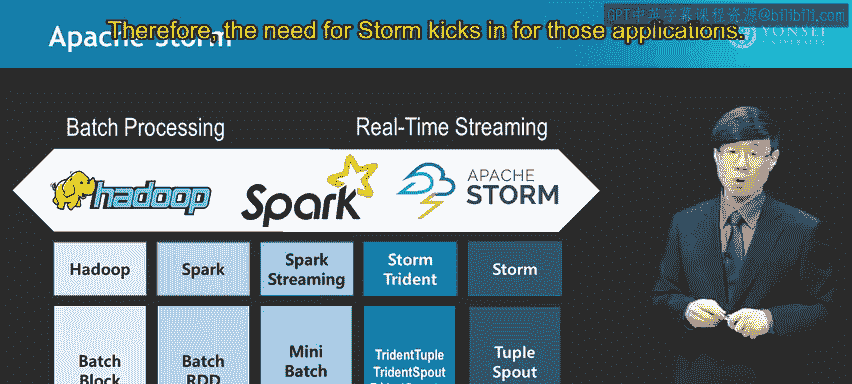
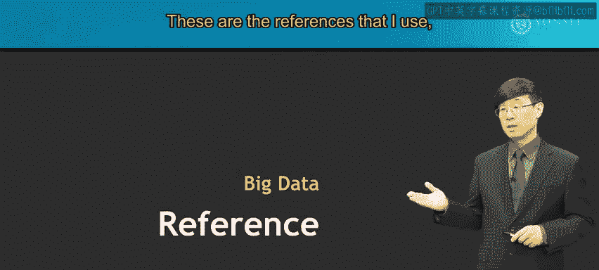
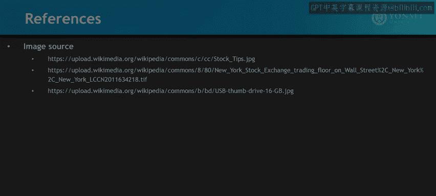

# 延世大学《新兴技术从智能手机到物联网再到大数据Emerging Technologies From Smartphone to IoT to Big Data》 - P30：29_5.1 Apache Storm.zh_en - GPT中英字幕课程资源 - BV18hpFewEcG

Yeah。Apache storm。Apache storm is used for real time streaming at levels that can go down to as lowest as microseconds。

 so therefore microseconds and above base processing is possible through storm。

And you can find applications， a lot of applications that could be sufficiently analyzed just using Spark streamre Spark streaming once again uses a mini batch that can be as small as 0。

5 seconds， half a second or larger。A lot of applications can be supported by that。 However。

 some applications like the stock market and other things controlling on autonomous systems and things like that will need faster services。

 Then half a second。 That is where spark。Will not be sufficient and spark streaming will not be fast enough。

 therefore the need for storm kicks in for those applications。

 and therefore we will study about storm and storm Trident storm Trident uses mini batches as well just like spark streaming and their characteristics are a little bit different because Sp is based on batches and mini batches when we go into spark streaming。

 Now storm is based on pils， which can be very small。

 and then a group of cupupils together to form a mini batch is what is used in storm Trident。

 So in other words， you see that batch and mini batch are used in spark where pils and a group of pupils into a mini batch can be formed using storm and storm Trident and we will get into the details of this。

Looking into Apache Storm， Apache Storm is a distributed fault tolerant。

 real time data stream processing， big data framework。It was originally developed by BlackTpe。

 which was acquired by Twitter， Why would Twitter acquire Storm？That reason will be soon revealed。

But first， let's have some fun looking into some storm terminology。First。

 over here you see a magnificent view of a storm， a huge storm coming up Think of this as seawater。

 this is live big data consistently changing， moving around never the same。😊，Then we call a nimbus。

 a nimbus is a dark cloud in Latin。And we have a nimbus over there。Then we have a spout。

 think of a spout coming down from the dark cloud， the Nimbas， it is a tornado。

 it is sucking up whatever is going down below and it hits the surface of the seawater。

 the seawater gets sucked up and that becomes a spout that you see right there and this is a case where water as well as fish come down from the sky when something like that would happen。

In this picture you can see from a nimbus， a dark cloud， we have bolts， bolts of lightning。

 lightning have massive energy， they can change， they can create transformations。

 they can charge something up as well as burn something down so bolts are the ones that create actual changes。

 transformations and activity。Because that we will use this terminology in big data storm technology。

 a nimbus， dark cloud and Latin is the original core of the system。

 then we have zookeeper to do management of the cluster systems。Also。

 we have supervisors below now storm components are now what we will study， NIs。

 this distributes program codes throughout the cluster。It schedules topology processes。

 assign science tasks to worker node， it monitors worker notes and monitors for node failures。

Zookeeper Apache Zookeeper provides highly reliable distributed coordination of clusters。

High availability， fault tolerance provided through replicated master and agents and non disruptive upgrades are supported through Zookeeper。

Supervisor waits for task assignments from the Master node。For each worker process。

 it executes a subset of a topology process。Tapology process involves many worker processes distributed across multiple worker nodes in the cluster。

Tology is an overall computation process represented in a graph form based on spouts and bolts connected together to form a directed acyclic graph。

 a dag of operations。Storm topology dag with single components are shown here。

 and you can see the spout and the bolt structures are simple。For multiple component units。

 you can see that the spout and the bolts have multiple units inside。

 and therefore parallel processing， as well as faster data processing of the units are provided together through these more complex units。

A spout is a source of the Tal stream。It is input to the storm Network technology。

An example could be like a Twitter API。Tupple is a sequence of data values。

 It's a finite number of data values。And we will represent it something like this。

 an N tuupple is a sequence of n elements。A five tuupL example will be five numbers。

A tuple stream is a continuous stream of tus。A bolt is a processing unit of the TL stream。

It receives input Cupil streams。And it will process and emit a CupL stream output。However。

 if the bolt is at the end of the da， then in some cases it may not emit an output。

Process types include functions， filter， aggregate， join， talk to database， and there's so much more。

For Stor， storm programs are written in Java En closuresure。And initially， it was released in 2011。

In 2011 September， the first major release was 0。5。0。

Originally developed by Nathan Mars and the team at Blackt。

Twitter acquired Storm and made it an open source Apache storm project。In 2014 February。

 Apache Storm's first major release was provided， which was 0。9。1。And in the same year September。

 Apache Storm became an Apache top level project。Here you get to wonder how would Twitter use stormor and we will get into the details of that。

Features of storm include it can process millions of tus per second。 That means that。

Per tual could go down as low as。Microsecond units or maybe even lower。

Highly fault tolerant and fast recoveries are possible。

 efficient and fast cluster control is supported， and is simple to program and supports multiple programming languages。

 it supports various cross platform operating systems。

The features of a storm include a topology based spouts and bolts used to form a dag。

A topologies stackg， edges are streams that direct data from one node to another。

The topology forms data stream transformation pipelines。These are the references that I use。

 and I recommend them to you。

