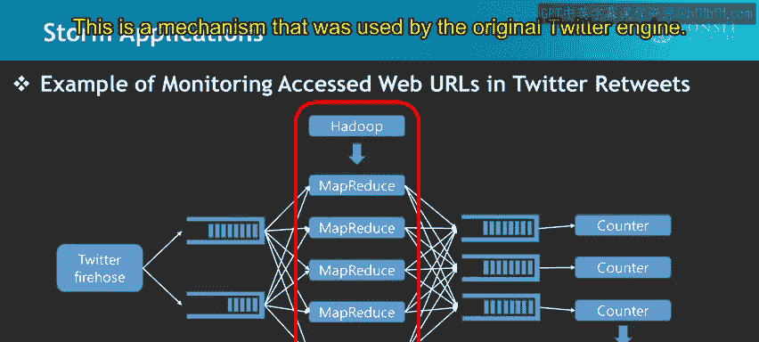
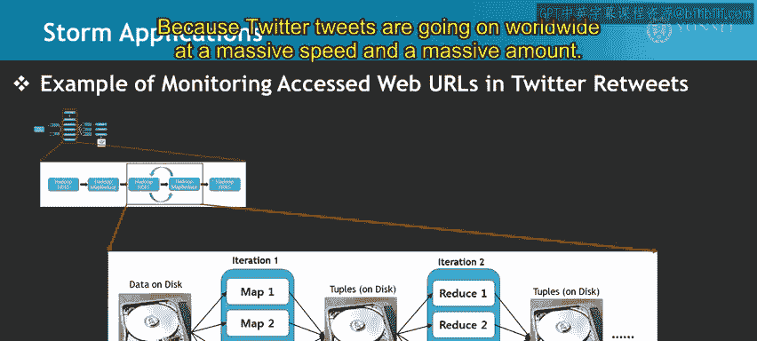
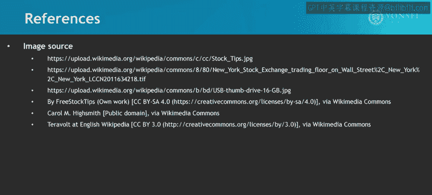

# 延世大学《新兴技术从智能手机到物联网再到大数据Emerging Technologies From Smartphone to IoT to Big Data》 - P31：30_5.2 Storm应用.zh_en - GPT中英字幕课程资源 - BV18hpFewEcG

Storm applications。Storm use case includes stream processing。

 which is direct stream processing without any intermediate cues。

And also distributed remote procedure call DRPC。Computation load is efficiently distributed over parallel processing CPUs for real time reliable results。

Continuous computation。Continuous real time updates to a computation as the input streams are continuously analyzed and you get continuous outputs of what that computation results in these are some of the major use cases of storm。

Real time analytics， online machine learning， continuous computation。Also。

 we just talked about distributed remote procedure call。

 we will talk about more on this and then extract transform and load operations we'll talk more about this also。

These are the main applications of storm， looking into further details。The DRPC。

R PCC Re Pro call this is a program that can execute its process on a remote computer that is based on a different IP address。

Distributed RPC， executed in a distributed parallel form over a cluster of nodes is what the DRPC will do for storm。

Then we have extract transform load， ETL， These are the three essential database functions combined into one。

ETL functions extract data from a database， transforms it， and then loads it to a data warehouse。

Where you can find the words of ETL in here in its definition。

Financial services are some of the major storm applications。Which includes security fraud detection。

 policy violation detection， stock monitoring， alert notification， pricing control and adaptation。

Then retail services， where logistics scheduling， sales monitoring。Discount rate control。

 coupon distribution， shrinkage and stockouts， pricing and offers， all of these， as you can see。

 they need very fast updates and can change very rapidly because retail services are happening over the world in real time in so many different places to monitor and include all the changes that have been done。

 all the new transactions and sales that are going on， Well， stormor can support that very well。

Web services。Web server and system support。Security breach monitoring， Of course。

 you want immediate response detection on this security breaches。

 That's why storm is most appropriate。Application failure recovery。User problem solving。

 personalized content protection。In the ICT and telecom services， social network services。

 once again， this is exactly why Twitter uses storm。Mobile apps and cloud services， custom services。

 security breach monitoring as well。And network。Outage such as from gateways。

 routers and switches being malfunctioned， being hacked， being attacked by dos and Ddos attacks。

 typically how and how to recover from that we can use storm very effectively and of course bandwidth allocation。

 giving the right amount of bandwidth to the throughput to the right locations。

 all of this can be controlled very effectively using storm。

And then there's mobility support and radio access network connectivity these support mobile users that are moving around and the network needs to adapt and change to support the mobile users and also on other devices。

 they need to reconfigure， send information， reroute the data so that their user can effectively get his data connectivity All of this is needed to be supported by mobile devices。

 smartphones， as well as transportation systems。Understanding Stor using a comparison with Hadu。

First， cluster operations， let's start big and then focus in down。Haop cluster。

 this runs map reduced jobs on the Hadoop Dis file system， HDFS。

Storm cluster will run topology processes based on the DAG。

Comparing process ending in Hadop mapp reduce jobs end when the assigned data set is completely processed。

 However， in storm， this is an ongoing process。 There is no definite end。Tapology processes。

 streaming messages continuously until the stream is intentionally terminated by the user。

No types in Hadji， we had name nodes and data nodes， the name node was a master node。

 and the data node was a worker。And the name node runs the job tracker Damon。

 and the data node runs the task tracker Damon。In StorM we have a master node and a worker node。

 a master node runs the Nmba Damon， where the worker node runs the supervisor， Damon。

Now we will look at a Hadoop URL retweet counting example。

 this here is where the Twitter fire hose provides streams of Twitter messages that need to be cud in an intermediate message broker node that serves as an intermediate queuee。

The worker collects and stores data in HDFS。MabRuce reads from HDs to find web URLs is used mode hashing。

 which is modular hashing operation， and this will be such that you can select the right node worker node to give the right。

Key and value information that is based on counting a certain URL， so therefore。

 the same worker node needs to do the same counting so that an update count can be provided by that specific worker node。

 and that is where the mode hashing is used in this system。

Updated URL counts and statistics can be collected and sent to Casandra。For example。

 you look at this system and we're going to go over the details of what we just explained by the procedures。

First， Twitter starts to give in its Twitter information through the Twitter fire hose。

This information needs to be cute because we don't know how fast it will come in and if the mapreuce engine is overloaded。

 then we may lose something， there may be an overflow， so we need good size buffers。

 cues to stack them up at the input size。So these queuing notess are the message brokers。

 and they are there such that we don't have any missing information because of an overflow into the map reduce engine。

Then we have Had， where we have map reduce process。

And then we have mode hashing such that we assign the counts。

 the key and the values that are processed through MaRduce to the right devices， the counters。

 and also the counters may get overflowed， so just for that we'll have in the beginning part of the worker nodes there will be queues and then there will be counters and then the result could be sent to Cassandra for savings。

This is a mechanism that was used by the original Twitter engine。

It uses Hadoop in the middle where in this middle part， taking a look into it， it is HDFS Mareduce。

 HDFS Mareduce， HDFS repeatedly processed， and in some parts there are iterated processes that will go around in a loop structure looking into the details of how this worked in terms of topology and speed well。

You can see that iterative part where you will have data on disk that will be brought into it and a map function will be processed and then it will be saved back onto that hard drive disk and it will be taken back up again。

 read again and then the reduced process will be done and then we will put it back to disk now as in the former lectures as I have explained this read and write from hard disk drives are slow and you're also doing this for a large amount of information and also above you see in the red box this is an iterative process I need to do this over and over again。

For this case， this will slow down the analysis and making it maybe too slow for Twitter because Twitter tweets are going on worldwide at a massive speed and a massive amount。

That is why we face some issues with Hadu。Intermediate message broker functioning key nodes are needed。

Because we don't want to overflow the mapreuce engine。Read and writeite with HDFS is slow。

 so multiple HDFS readWrites will even be more slower。Needing to compute the mode hashing operation。

 this is cumbersome and to send the same URL message to the same counting worker。

 this is also inconvenient。Then again， adding an additional worker node。

 if you want to expand your system， if you want to grow， then you will need to add a new worker node。

 a new data node in parallel to the existing system。

 then you will have to do a lot of additional programming。

 let's say in the Java Vi machinech program， JVM programming of the worker nodes， the data nodes。

 and then you will have to put them into the system of the cluster。

Significant time is required to conduct programming replacements throughout the cluster。In addition。

 Hadoop program for this job is complicated， it is difficult to program。

 in addition it difficult to debu。So let's see how Twitter changed the storm and to do this process in a more effective way。

Here， Storm will receive Twitter messages in TuppleSt form。

And multiple bolts in parallel are assigned to the task of finding the URLels and counting。

The following stages of bolts aggregate the URL counts to find the summed overall final numbers。

The final Sage boltols will have the Twitter URL statistics saved to Cassandra。Looking at this ina。

 well， Twitter has their tweets and their records fitted into the system through the Twitter fire hose。

 we have spouts that are the receiving parts of it。

And then we have the bolts that are actually doing the transformations and count。Look right here。

 there is no Q before the spouts， why， why is this possible。

 why do we not need cues before we have those spouseouts is there a reason for that just wait one second。

 I will explain that to you the transformations， the counting operation is done in the bolts and they are collected。

 collected。Where the final result is saved to Cassandra。Advantages when using Storm， here we go。

 Spout controls the message input stream from Twitter。

There is it is using a pullbased scheme and this is different in other words。

 when you are passively receiving something that is being sent to you， your queue。

 you may be overloaded， you may be full so that whatever comes after you' full。

 then you will just lose， it will be an overflow loss。Here。The spout。

 that is the input data component that controls the flow into this network of storm is based on a pull mechanism。

 it will bring it in。What does that mean， I'll give you more details on this。 Just wait。

Guarante data processing of all tweet messages。Now there is reliable and unreliable spouts in bolts。

 and we will need to talk more about that if it's reliable。

 then the operations are even more guaranteed。Where unreliable spouts and bolts。

 there could be some misses， not much， but there occasionally could be。

 We'll talk about more on this。Built in self healing fault tolerance capability is also included in storm。

 as well as no intermediate queuing no are needed。No， mo hash operations are needed either。

Great horizontal scalability of spouts and multistage balls are provided through storm。

Fast RA based in memory， read and write speeds are processed in the bolt。 So in other words。

 instead of using hard disk drives。We're using as much as possible in memoryory RAM and once again。

 RAM is about 100 times faster per process compared to HDs and we've already studied that in former lectures of this course please check that out again。

Simple and easy program debug and upgrades are possible。

 and instantaneous processing topology updates with the rebalance feature are possible as well。

This is great because once again， one of the problems when we were using Hado was that if you wanted to add in an additional worker node to help and grow the overall system。

 then you would need a lot of complicated processing， a lot of additional programming。

 and then interfacing with all the other nodes， change their programs as well。That was complicated。

 but here we have the rebalance feature that which can instantaneously give us a swap in programming capability。

 we'll look into more on that。These are the references that I use， and I recommend them to you。

