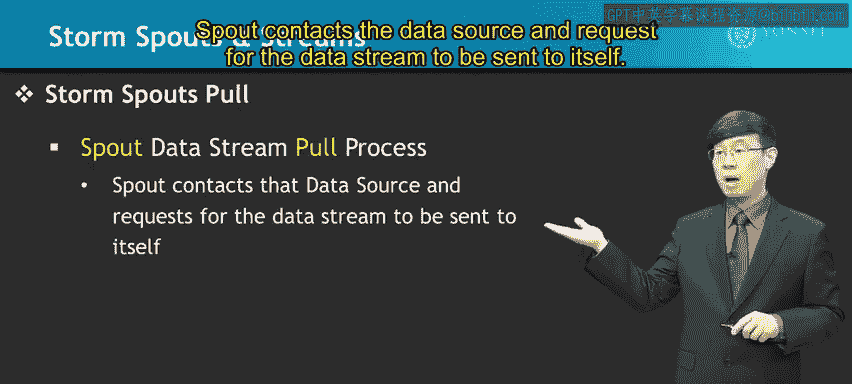
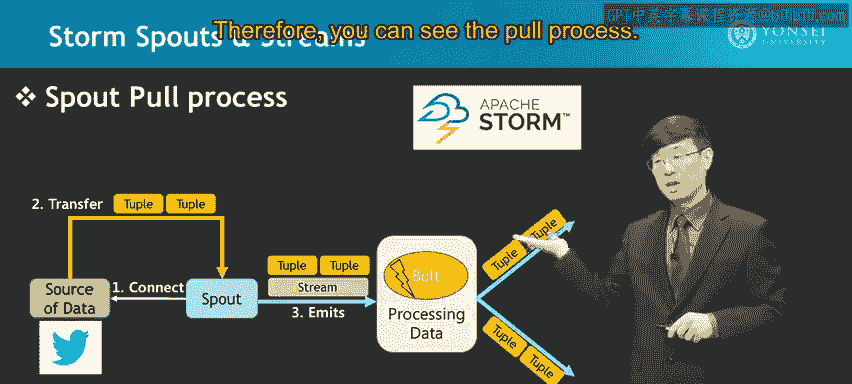
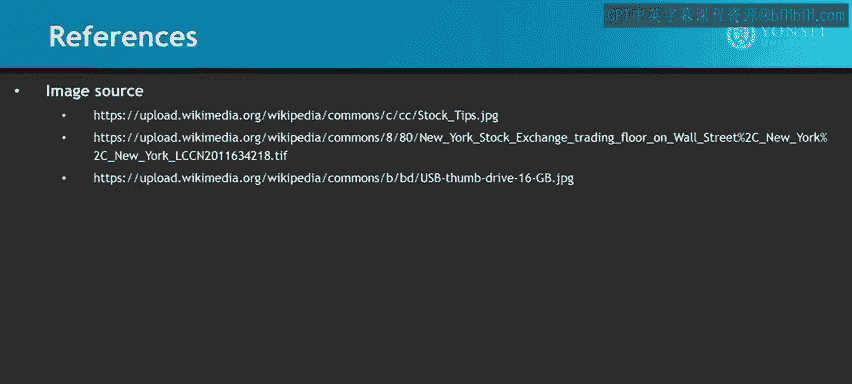

# 延世大学《新兴技术从智能手机到物联网再到大数据Emerging Technologies From Smartphone to IoT to Big Data》 - P32：31_5.3 Storm喷口和流.zh_en - GPT中英字幕课程资源 - BV18hpFewEcG

Yeah。Storms， spouts and streams。Sout data stream pull process。

Sll contexts the data source and request for the data stream to be sent to itself。

The pull mechanism of the spout enables spout to be the active controller of the source stream of data to the overall topology。

Therefore， no queuing note is needed。Take a look at this。

The spout will first connect to the data source。And then the data source will send over the tus。

 a stream of tus。Then the spout will send these tus to the bolt。

 and the bolt will process them and then send out additional tus out the system as needed。Therefore。

 you can see the pull process。

First， the spout will ask for it， and then it will be brought in。Overall。

 the Spout pull operation enables the spout to control the start， the stream termination。

 the flow speed， manage the topology process， and control the changes that need to be made to the topology of the stream data processing。

The Spout pull process frequently uses the next TL command。

 This is a message that Spout uses to receive Cupils from the data source。

Which is based on the form of one time or on user request method。

Reliable and unreliable spouts and bolts。A reliable spout and bolt。

A reliable spell will use acknowledgements like you see in this message right here and failures。

 which you see right here， they have the object and TL ID included to monitor the TL processing status of the bolts。

When reliable spouts are used， reliable balls should also be used。

Unreliable spouseouts and unreliable bolts will not conduct the acknowledgement and failure monitoring process。

 so there could be something that is missed。The act and fail monitoring and messaging of reliable spouts and bolts require more overhead in processing the overall messages。

 so therefore in some cases you don't want this additional overhead and additional message exchange。

 then in some cases they will use unreliable spouts and bolts。And an example would be like this。

Reliable spouts and bolts， of course， should be used for the stock market。 You don't。

 you cannot afford to miss anything。So therefore， everything must be processed， monitored。

 and protected， and then obviously a reliable storm topology is preferred。On the other hand。

You can use unreliable spots and bolts for monitoring and analyzing。

 let's say something like a social network。Where it doesn't really matter that much if you miss one。

 the speed is much more important because overall the statistics are going to be so large。

 missing one or two is not going to have a big influence based upon your overall combined statistics in that case you can go reduce the overhead。

 reduce the additional exchange of messages for the reliable operations and just go ahead with unreliable and then collect statistics through this way。

Storm Data stream Q management。You can process over1 million messages per second using stormorM。

Storm can control the maximum number of Cils that can be pending and not processed yet。

So there is a way such that you have a little bit of extra time to do something based on this mechanism。

 which uses topology Max spout pending this is the command that you use for that。

Storm streaming APIs include Tple and Trident。A TupL is a set of a finite number of data values。

 as mentioned before。An N tual is a sequence of n elements。A trident。

 this is a process of the incoming stream of micro batchches one at a time。

A micro batchch is a collection of pupils。It is more efficient and it provides higher throughput performance。

The Trident mode is similar to the Spark streaming mode which also used mini batches。

The stream groupy。For a given topology， stream grouping informs how to send pupils in parallel across the interface of the spoutable connection and the boltable connections。

The spout tubal and the boltable connections are used to process multiple tus in a parallel way over the distributed topology in the cluster。

Some steam grouping types include shuffle grouping， this is the simplest type。

 and it sends tuupils to a random task。This has the effect of distributing the TUL process workload evenly across bolts。

Field grouping， this conducts selection of pupils to assign to a common b for further processing。

Therefore， it needs to use mod hashing in the selection process。

 and therefore it requires an additional processing time to do this properly。

Field grouping is used in streaming joints， streaming aggregations， and other places。

It is used in word count B to have the same word go to the same task to receive the same processing。

 and that's where field grouping could be so effective。These are the references that I use。

 and I recommend them to you。

