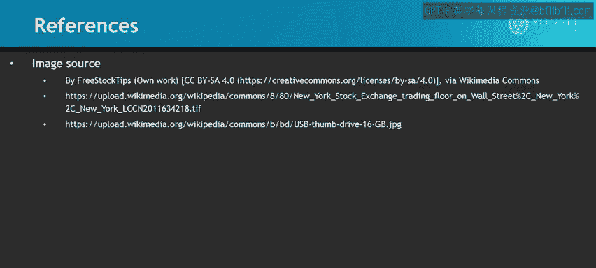

# 延世大学《新兴技术从智能手机到物联网再到大数据Emerging Technologies From Smartphone to IoT to Big Data》 - P33：32_5.4 Storm拓扑管理.zh_en - GPT中英字幕课程资源 - BV18hpFewEcG

Storm topology and management。Storm transactional phases include a commit phase where any number of bolts can participate in the commit phase。

 and these are called committers。There is a strong ordering where commits are ordered based on how the batches were omted。

Processing phase includes storm default， tripleple tree completion time is set to 30 seconds。

Therefore， if 30 seconds expires and the Tuple tree computation is not done， well。

 the spout will reexecute the overall process again。At least once guaranteed processing is enabled。

 and that's where we get the word exactly one semantics that's used in storm。If a failure occurs。

 then that cupil， that batch is reprocessed again。If it succeeds。

 then you move on to the next tuple or batchge this way it is guaranteed that each of these are processed at least once。

 and that's exactly one semantics， what that means。

 which is used to explain the characteristics of storm。

Storm with meles meles can be used to manage the cluster topology distribution of tasks and processing core assignments。

BizzoOS can enable different storm topologies to execute independently without interfering with other topologies running in the same cluster。

This is very， very powerful， so therefore if you have a cluster。

 you have multiple operations that need to be operated in the same cluster。

 and in some notes the resources need to be very accurately managed such that there is no interference with each other。

 that's where Meos is so powerful at。JaR Ja is used to submit a topology to the cluster Ja process execution order starts with topology jar file will be uploaded to the Nimbus。

And this is an example of a programming code to conduct this。

NIims will distribute to college tests to the supervisors through the help of zookeeper。

Then the jar will run the main function based on the topology class and arguments that are specified。

 the arguments are specified in the parentheses of the main。

Storm activates thepology and starts the processing within the cluster。

Some management commands include activateivate and deactivate， we'll start with deactivate。

You can stop streaming of tus from the spouts。Storm UI can be used to deactivate a topology。

You can activate or resume stream tuupple processing of the spouts using Actate。

 and the storm UI can also be used to activate this。Looking into deactivate， activate and close。

Sout can be deactivated using the command deactivate。

Serilization will be conducted to save the processing state information and pupils。

To resume processing， activate will be used。And spout clothing will use clothes。

 and this will first deactivate it and then it will close it。Then there's the kill command。

Kill is used to terminate a topology in process。The kill process first。

 serialization of the spout and bolt status and results will be conducted and the serialized files will be saved。

 so before the kill operation activates and kills everything。

 first the structure of the data and the processing units are all serialized and then they are saved as a file。

Souts of the topology will be deactivated， and then the bolts will be stopped and saved。

 states will be cleaned up。Rebalance， this is used to reconfigure a topology。

Rebalance will change the process conducted in the spouts and bolts。

Rebalance will redistribute the task among the spouts and the bolts in the cluster。

An example will be when an additional supervisor node needs to be added to the cluster and you can use rebalance and once again。

 this is much better than what need to be done before in your cluster using JVMs when you are using Hado because it is much faster。

 almost instantaneous response in addition， the overall programming and debugging is much more convenient and it is easier and robust。

 so therefore overall much easier to use and work with。

Rebalance enables a nearly seamless swap of the topology。

Having to kill and then resubmit a new topology would take at least tens of seconds or to a few minutes to do so。

Changes can be made to the number of workers using the n option and the number of executors using the E option。

 for example， in a program code， you can see that where the N and the ER and this is an example right down here that actually uses the rebalance to make the changes。

Open internal initialization activities are open using the open command。Open operations， a collector。

 a collector is used when sending data into the cluster to be processed by the bolts。Configuration。

 task information。Connecting to a data source and others。These are the references that I used。

 and I recommend them to you。 Thank you。

