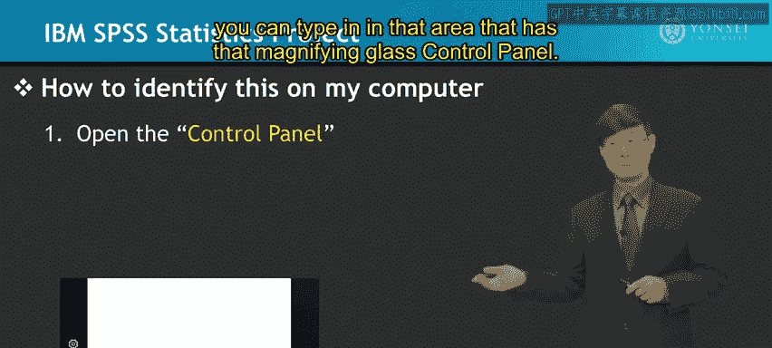
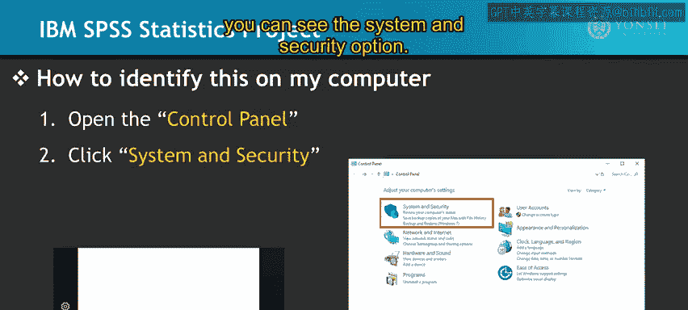
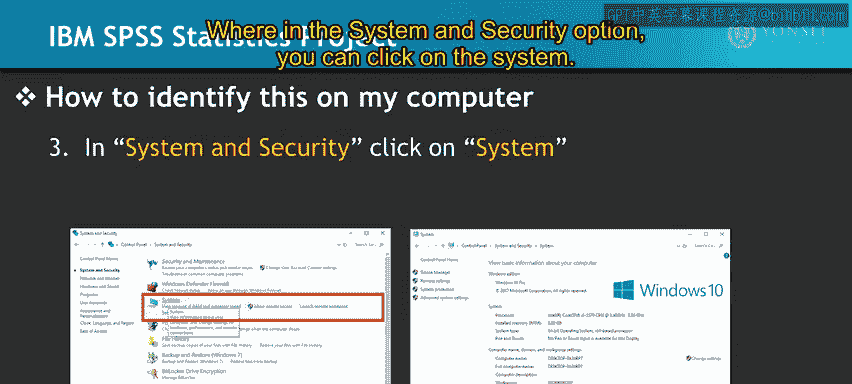
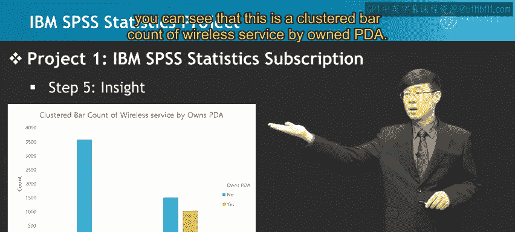
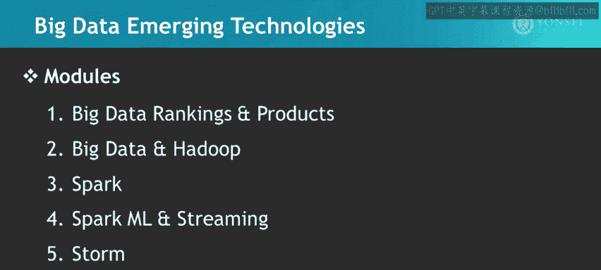

# 延世大学《新兴技术从智能手机到物联网再到大数据Emerging Technologies From Smartphone to IoT to Big Data》 - P35：34_6.1 IBM SPSS Statistics项目.zh_en - GPT中英字幕课程资源 - BV18hpFewEcG

🎼Yeah。Welcome to the last module of this lecture。IBM SPPSS Stas Project。

Corporate data analysis experience is needed， and many corporations provide a free trial period of two weeks to one month to experience their data analysis system。

IBM SPPSS Staistic， SAP S4 Hannah and others provide this as well。

Now let's sign up to create an account and get some experience using IBM's advanced corporate data analysis technology。

We will focus this project on IBM SPPSS statistics， and these are the logos。Why。

 because IBM is ranked number one in data corporations， number four in software。

 number two in hardware and number one in professional services for big data That's why eventually if you are working in this field of big data as a professional eventually at some point you will have to use IBM SPSS statistics so therefore while you're taking this course with me。

 you might as well get some basic a glimpse of experience of it and that's what we're going to try to do。

IBM SPPSS was initially released in 1968 by SPPSS Incorporated。It was later acquired by IBM in 2009。

 which became IBM SPPSS。IBM SPPSS Staistics provides statistical analysis of logical batch and non batch data based on descriptive statistics。

 regression， advanced statistics， and others。Various solutions are provided for Spark， SQL。

 text Ana for product， service integration， and big data analysis。

SPSS syntax enhancements using R and Python is possible。For Project1。

 the project objective is to gain insight of advanced data analysis using IBM SPPSS。

The IBM SPSS functions， they provide comprehensive set of statistical tools。

 integration with open source software， easy to use statistical analysis。

The overall trial system can be obtained from this website right here。

And you can make an IBM account and start your free trial。

You can click on that button over there in red， and then you will get a place where you can start to write your information。

Then using this will lead you into this and you can include more information about yourself to have an official account。

And then you can download the installation file。Using that button right there。

 this will lead you to this page and here you have these options where you can see that either 32 bit or 64 bit windows。

 you need to know your system setting or you can select something for an iOS operating system。

How can you find your 64 or 32 bit？Mechanism， well， go and open the control panel。

 you can go to that corner way over there where you have the window sign。

 then you open it up and you can type in in that area that has that magnifying glass control panel When you type that in you will be able to get this window and in this window if you look at the control panel options。

 you can see the system and security option you click on this that will lead you to this page。

Where in the system and security option here， you can click on the system when you click on the system。

 you can find the system type。

And that will lead you to this part right here。Then you will see like Windows 10。

 and under there you will see either Windows 32 bit or 64 bit information。

A lot of the software that you install onto your computer， laptop， tablet， or other device。

 knowing this is good。 so go ahead and try this out and then install the right version onto your system。

Then we can download and install the file。And we can do our assign in。

The operating IBM SPPSS statistics is now what we're going to look into。The interface is right here。

And looking into this system， you can see that the sample files are located over there。And also。

 we have a tutorial over here。 I recommend that you read the tutorial and gain more information about this。

 In addition， we will use discussion prompts to help each other out。

 And that's what I want you to do。 I'll explain more on that very soon。😊，Then open data sample files。

 demo。savV。Which you can find over here way over there。

And then you can get this part where the Windows， data editor and output viewer are provided。

The data set window allows you to edit the data variable using the variableable View tab。

Where you can change the measurement option using that over there。In addition。

 you can run the analysis。What you see right here， that window will bring up here and then you can do this based on the options over there。

 which you have these options below， and this gives you a variety of ways that you can display your results and look at the data。

From a different point of view。Then you can choose variable information and click OK where you see this right there。

 and you can see the options that are provided as well as the menu over there。For the graphs。

 you can see that you have this optional window。And you can control the settings to your desire I ask you to try different options。

 read the tutorial， try different options to see what type of additional insight you can get when you use a different graph type or different statistical analysis result mechanism。

Then for the graphs， you can see that， you can do a right click。

Using the menu and then a double click to select what option you like for like a histogram or a block diagram pie chart。

 you have many options， and then you will get the desired result structure that you have。

Then you can do a drag drop。And then you can obtain the results that you see right here。

And in the graph options， you can see that you can select click right， then use a drag and drop。

And then you can access this to obtain the graphs that you need。Looking into this。

 the results that we just obtained， you can see that this is a clustered bar count of wireless service by owned PDA。

And that is what you obtained over here what does this information provide well the chart shows that people with wireless phone services are far more likely to have PDs which are personal digital or data assistance than people without wireless services and there shows you a correlation between this。

In Project two， I want you to try and analyze these。

Analyze and draw a chart of the relationship between the number of people in household and the primary vehicle price category。

Also， I want you to analyze and draw a chart of the relationship between the household income in thousands。

And the primary vehicle price category。As you can see， the CAcat， the CAcat。

 this is a common denominator， which is used in this as well as this。

 the thing that is changing is the number of people in household and the household income in thousands。

I want you to compare the results of these two right here。So overall。

 I want you to go and try out Project one， try to see if you can get the same results that I did by selecting the same options that I did。

 and then go ahead and do Project two， and also do more。

 share your results with your peers and try to learn from each other as much as possible。

Thank you so much for taking my course Big Data emergingging Technologies This wraps up the sixth and last module I hope you learned a lot。

 I hope that this will help you in your professional career as well as your academic studies and I wish you the best and a most successful life as you pursue in big data technology and other evens。

 thank you so much。😊。

