# 延世大学《新兴技术从智能手机到物联网再到大数据Emerging Technologies From Smartphone to IoT to Big Data》 - P36：0_介绍.zh_en - GPT中英字幕课程资源 - BV18hpFewEcG

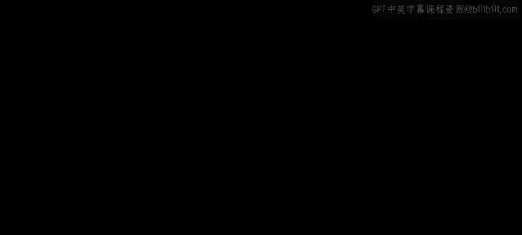

Yeah。🎼Yeah。Welcome to the course， Smart Dev and mobile emergingerging technologiesnologies This is a course in the specialization emergingging technologiesnologies from smartphones to IoT to big data。

🎼I am Professor Zhong Munchk from Ys University， and I welcome you。🎼In this course。

 the following modules are included。 We will start with mobile business ranking and analysis。

Then we'll go into smart devices focusing on smartphones， smartwatches， and components。

 as in terms of SOC chips， CPUs， GPUs， and various other components。

Then we will go into mobile communication technology。

And we will focus more on 4G and 5G mobile communication technology as in terms of 4G we're talking about LTE and LTA。

Then we will go into smartphone operating systems as in terms of Android and iOS。

And we will wrap it up with a project， smartphone and mobile network project。

Looking into the details， we will start with mobile services and market analysis。

Which will lead us into the global smartphone market share by country and much more details。

And we will look into global mobile operating systems， their market share， and the trend。

 how it changed。Smartphones and smartwatches， we will focus on the Galaxy Note 8 from Samsung and the G S3 from Samsung。

 as well as the iPhone X and the Apple Watch series 3， which are from Apple。

When we look into these devices， we will also take a closer look into the IP67 IP68。

 which are the codes that are used to identify dust type and waterproof。

Then we will look into SOC processor technologies that are used in smartphones。

 typically the Samsung ExonOS， the Qualcomm Snap Dragon， as well as the Apple A11 bionic。

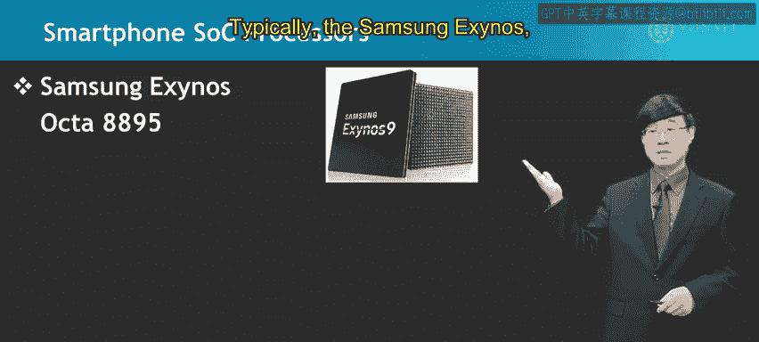

In further semiconductor technology， we will see about how semiconductor size evolution is in progress。

 especially this red area right here in which we are now in。

We will also look into the most recent architecture used in the major SOC chips。

 which is the big little architecture。

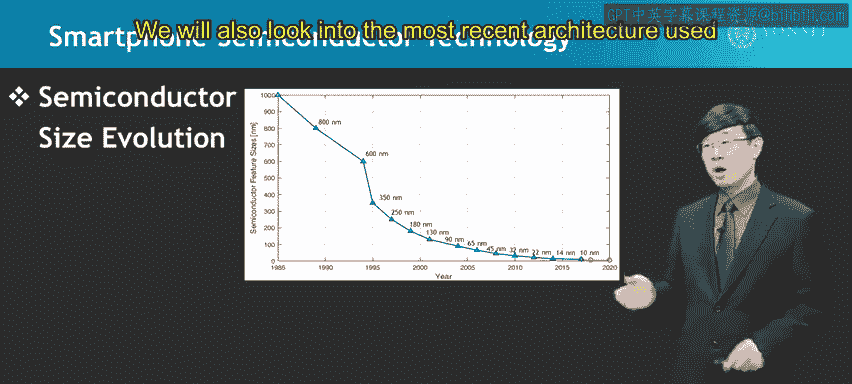

Then the lecture goes into smart device based on GPS this GPS technology is very important because it enables us to do locationbased services。

 precision accurate services based on where we are that is why we will study about GPS systems in addition A GPS assisted GPS because we're not always outdoors when we're indoors or in places that we cannot get good GPS reception。

 then we will need some help from the mobile communication network to get our precision location information。

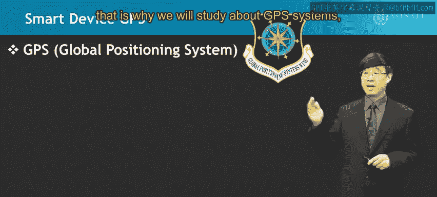

We will also take a look into wireless charging techniques。

 these are becoming extremely popular and focus on these standards， as well as the details。

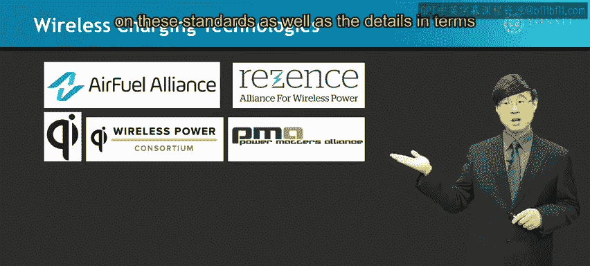

In terms of inductive and resonance technology and how the standards merged into the further standards and their relation。

Then we will look into mobile communication， focusing on stage by stage evolution from the first generation 1G to the second generation 2G to the third generation techniques evolving into the fourth generation techniques。

 LT and LT advanced。And also 5G mobile communication technologies， we will focus a lot on these。

In addition， we'll talk about the relation of when SIimM。

 these subscriber identity modules became and what their roles are。

Looking into the LTE network architecture of how LT services is provided and the core technologies in terms of packet forwarding and handover。

 as well as Mimo technology and OFDM， the physical layer that is used across the antennas to actually send this broadband high throughput high speed data communication services。

Leading into LT events， a step up from LTE， the core technologies that enable it。

 which include ICIC and FFR， as well as dynamic subcarrior assignment。

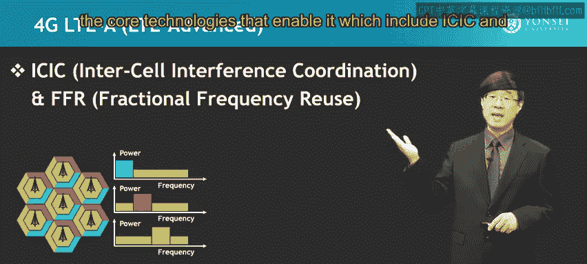

We will also look into coordinated multipoint technologies comp。

 as well as carrier aggregation techniques and the details in heterogeneous networks and self organizing networks。

Ne and SAD。

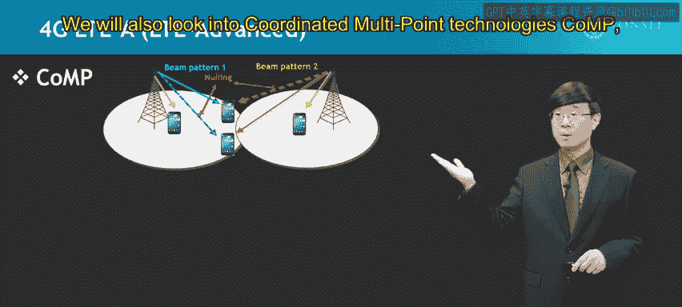

We will move into 5G mobile communication technology and see what the overall focus is。

 what are we trying to accomplish In addition， we will compare 3G。

 4G and 5G in detailed specifications on how they are different and what they can achieve。

Focusing more on 5G there are specific modes， they are divided into three big technical groups of technology specifications。

 focusing on the EMBB， as well as the MMTC， as well as the U LLC， what are these technologies。

 what type of service applications are they targeted for and what basis were they're designed。

5G deployment scenarios will be the next subject， looking into how 5G will be deployed。

 either in its SA standalone mode or working with 4G mobile communications in its non- standalone NSA mode。

In addition， we will look into network slicing how the overall network infrastructure is virtually divided to support various core technology and services。

The talk will also lead into 5G wave technology， this is because millimeter waves and high frequency signals are used in 5G mobile communication systems。

 unlike the former 4G or 3G or 2G systems。And in order to use the overall network。

 we will need to learn how to use multira， multi radio sex technologies。

 and how they inter network together。

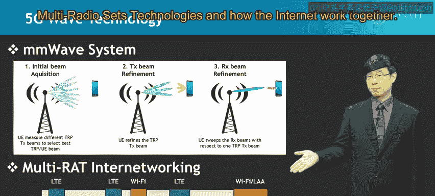

Then the lecture leads into operating systems。 we will start with the iOS evolution。

 These are the standards that were used to support the iPhone evolution。

From the beginning of i 1 to what we have now in ios 11 and beyond。

 what are the differences among these different。Virgs of the Ios operating system。

The major characteristics and what was removed and what was added。That's what we will focus on。

 In addition， we will focus on the iOS architecture， these five layers。

 what are they doing and how do they work together and what are their major characteristics。

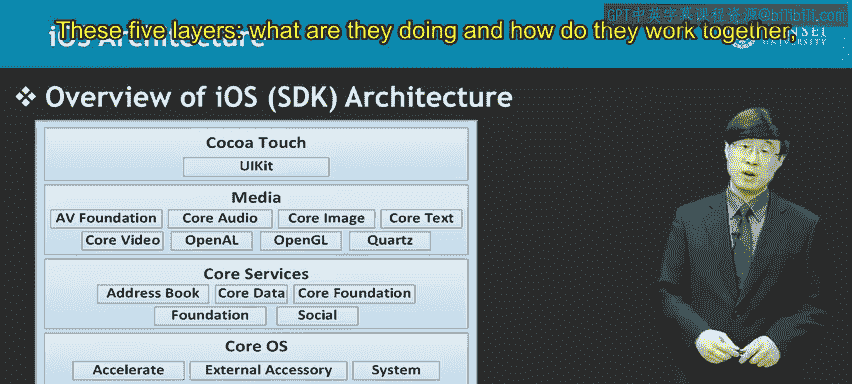

Then we will go into the Android evolution starting from the alphapha beta and then going into cupcake all the way to Oreo and beyond in this lecture we will focus on the major characteristics of these different versions of Android and what technologies were included and what was removed and terms of its evolution then we will go and look into these six unit blocks that form the Android operating system architecture what are they。

 how do they work together， what are their functionalities， we will focus on that。

Then we will go into a smartphone project where we will use the IAA 64 in Google Android as well as Apple devices。

 and we will look into the details of your smartphone。In addition。

 we will use the mobile network project components to look into various aspects of the network that we are connected to as in terms of the mobile communication network。

 we will see the data rate support and how much has been used。

As well as the actual signals that are connecting us to the base stations。In addition。

 we'll take a look at the modes of what is active and inactive， as well as the latency， the delay。

We will also take a look into the iOS field test mode。

 which is a specific mode that iPhone users can go into。

 it has serving sale measurement information as well as other information that is very interesting and we will go and look into this。

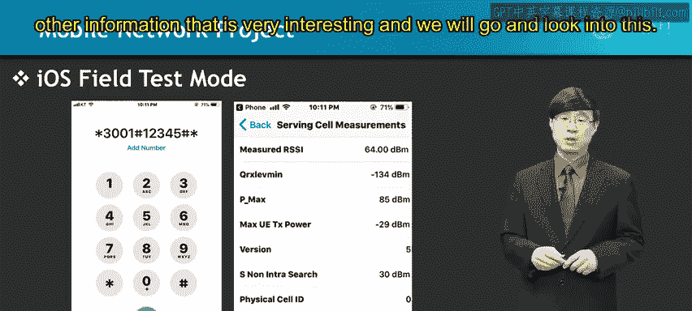

🎼Overall， this is what is covered in the course smart Dev and mobile emergingging technologiesnologies I welcome you to this course and look forward to seeing you in the lectures Thank you。

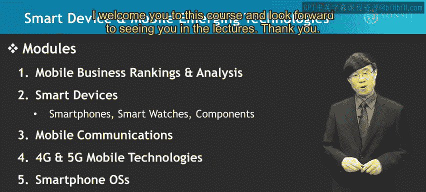

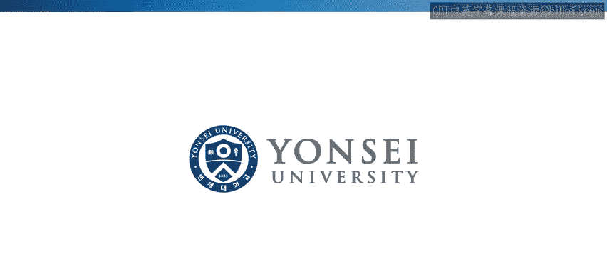