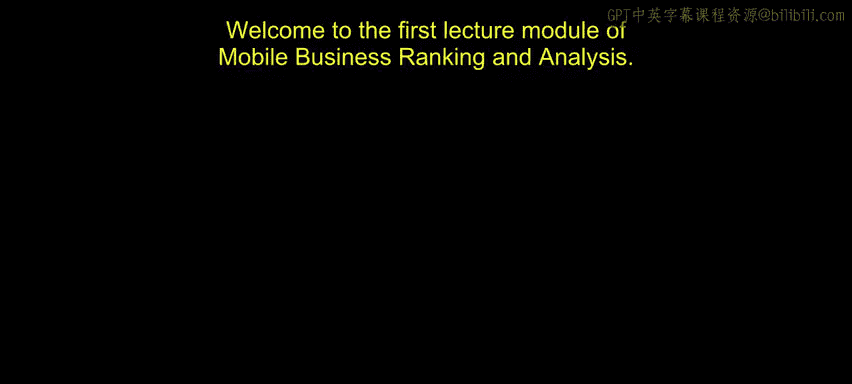
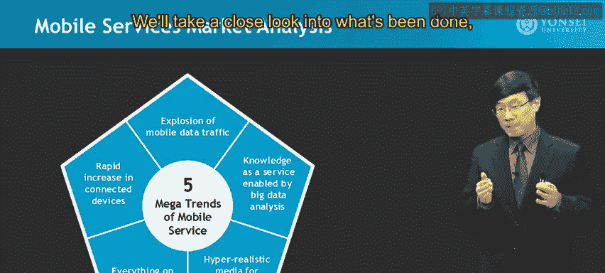
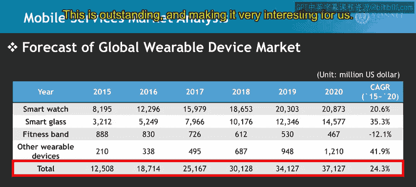
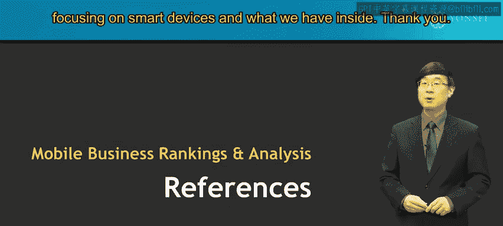

# 延世大学《新兴技术从智能手机到物联网再到大数据Emerging Technologies From Smartphone to IoT to Big Data》 - P37：1_1.1 移动服务市场分析.zh_en - GPT中英字幕课程资源 - BV18hpFewEcG

Welcome to the first lecture module of mobile business ranking and analysis。

 I will start with the first lecture， mobile Services Market Analysis。😊。

The five megatrends of mobile service are listed here in this structure where you can see on the top explosion of mobile data traffic。

 then knowledge as a service enabled by big data analysis， In addition。

 hyper realisticistic media for convergence services。

Everything on cloud and rapid increase in connected devices。

 these five major trends will lead the future in technology development， services。

 and we need hardware and software， as well as a network infar to support all of this。😊。

We'll take a close look into what's been done and what is most likely going to happen。

We will start with forecast of Global Telecom Termin Market。Looking over here for the years of 2015。

 16， 2017， 18， 19， and leading on to 2020。But first。

The overall performance is evaluated based on CAGR， where from the years of 2015 to the year of 2020。

 you can see the percentage numbers provided in order to understand what this percentage number means first we need to study what the CAGR is。

This is the compound annual growth rate。 It is a geometric progression ratio that provides a constant rate of return over the time period。

 This is frequently used in business and investment analysis so it is very useful to know the way you compute the CHGR is based on these four variables where we have year A as YA and year B as year B where Y B should be larger than YA for the table above 2015 will be our year A YA and 2020 will be our year B YB。

Then for Y A and Yb， the corresponding values at those years are VA will be the value based on year A。

 and Vb will be the value based on year B。In addition。

 what you can see is the equation that is in the red box。

 which we have the CA GR is obtained for year B to year A， where the equation has Vb over V。

 and in the superscript， we have the power of1 over yb minus YA and overall subtracted by one。

This is how you calculate the compound annual growth rate。

 and the result is represented in percentage。Based on this， let's look into the details。

 we will now look into mobile devices and we can see that the growth rate is at 6。4%。

 which is truly significant。The numbers that you see in the table， for example， under 2020。

 we have 602 comma 814。 These numbers are in units of millions of US dollars。 so therefore。

 602 comma 814 stands for 602 billion。$814 million， that's a truly significant amount of size。

And the growth rate is truly significant，6。4%。 When you look at base stations。

 base stations are even larger。 One thing that you may think of is why would the base station market be even larger than the mobile device market growth rate。

 Well， this is because once we approach 2018，19 and 20。

 we are moving closer in the higher data rates being supported worldwide through 4G LTEA。

 LTE and also 5G technologies。And one characteristic about the technology services is that in order to provide broadband services at a more reliable level。

 you need more base stations more base stations means that the cells are becoming smaller。

So therefore you see the increased rate where compared to mobile devices that have a growth rate of 6。

4%， base stations are even larger at 8。2%。Then。In telecom Services， you see a 2。5% growth rate。

And the overall size of the market is at the level of over 1 trillion dollars in reference to 2018。

 you see that as1 trillion。And 42 billion908 million in its overall scale。

 which is truly significant because the market， because the telecom services market is so large already。

 a 2。5% growth， rate， seems a little bit small but it's not because the original number is so large。

 this is truly a significant value。Overall， it combines to a 3。9% growth rate， CAGR。

 which is very significant。Then we look into reference of 2018， where we compare mobile devices。

 base stations， telecom services， and the overall total， looking at the numbers here。

 you can see that for mobile devices， it's at an overall nearly about $500 billion。For Bay stations。

 it's around about $52 billion and for telecom services， the reference is around about 1 trillion。

Looking at what will happen up to 2020， 2020， you can see that for mobile devices will grow all the way to 600 billion and it will exceed $600 billion level。

 then for base stations it will go up to the $60 billion level and exceed it and for telecom services it will nearly approach $1。

1 trillion in 2020。So you can see that this is a tremendous market and there is great potential for various technologies to join。

 we'll see further details about that。And the device market data that we have right here。

 This is the wearable device market。 So there are other device markets that will take advantage of mobile services like internet of things。

 but first， let's look at wearable devices here。 The first category is smartwatch。

 you can see that the overall CGR is at 20。6%。 This is outstanding。

 this is a significant growth rate。 but this comes at a slight reduction in the fitness band area。

 This is because smartwatches are getting so capable。

 so versatile that the fitness band market is being reduced。

 So naturally smartwatches include fitness band capabilities。

 So naturally the fitness band market will reduce。 However。

 the smartwatch will absorb it and grow consistently。😊，Now looking into smart glasses。

 you can see that the CAGR is at 35。3%， which is even larger than smartwatches。

 what is triggering this Well， applications such as augmented reality。

 which is expected to be a significant market product in various forms。

 especially in smart glass forms will trigger this growth。😊。

You can see the way that the numbers are growing all the way to 2020。

 and some even estimate that this number that you see right here as a CAAGR is a little bit conservative。

 we'll need to see as we progress into the future。Then for other wearable devices， look at this。

 the growth rate is at 41。9%。This what are the other wearable devices Well think about this where you have a necktie。

 a necktie pin， you have your belt， you have your shoes， you have your pants。

 you have your underwear， various things will all be effectively included with smart device technology and this is where and this is why we need to invest our effort into。

 so we become the leaders in this area。Overall。For wearable， device， market， for smart wearables。

 Well， the overall combined reaches an expected 24。3% growth rate。

 This is outstanding and making it very interesting for us。😊。

Then let's now look into network equipment for mobile communications。First。

 looking at the base station technology of2ji。And you can see that the percentage of minus32。

7 is the percentage， which means that 2G technology will have less and less investments such that the market will grow smaller。

 This is because data communication based on 2G is limited。Also for 3G technology。

 as the major focus will be more on 4G and the upcoming 5G mobile communication technologies。

 you will see a lesser。Scale of the 3G technologies being deployed and invested。

 That's why the CGR is at a minus23。7%。Then 4G，4G is at an interesting growth rate of 17。9%。

 This is significant reaching levels where 4G will absorb a significant part of the 2G and 3G market。

 However，4G in places where 4G technology， such as LTE and LT A cannot be。😊。

Deployed in a way such that it provides complete coverage of the area。

 it will fall back on 3G technologies and 3G plus 3G advanced technologies。

 which we will soon see about that in the following slides。

The overall subtotal is a compound growth of 6。3%。Then look at small cells。The 27。0% growth rate。

This is probably the most significant growth rate on this table。 And then you're thinking。

 why are we having such a large growth rate on small cells， This is because once again。

 as we go into LTA technology。4G technology and deploy 5G technology。

 The cells will become smaller and much more base stations that are smaller。

 such as femto cells will be deployed in various locations。In addition， once we go into 5G。

 this market will grow even more because 5G uses millimeter waves and frequencies that are higher in the above 6 gigz range。

 such as 28 gigerz and beyond， because of these higher frequencies， cells have to become smaller。

 although when you get connected to them， you will get a significantly broadband data service。

And to take advantage of this， small cell technology is expected to grow even more after 2020 with the introduction of 5G mobile communication technology。

Then we need a core network， and that's why the core network is consistently growing。

 It's already large， so that is why these numbers are the way that they seem with a 4。1%。

Because the overall core network will take advantage of the existing infrar。

 it will take advantage of what has already been deployed and use that to grow and add onto it。

So as you can see here， there is a consistent growth rate， in addition。

 all of the small cells and all of the 4G and all of the 5G future technology will need to be connected to a core network。

So the core network growth rate is shown here and it is definitely expected to grow。

 then combining everything together in a total results in an 8。2% growth rate CHGR。

These are the references that I used， and I recommend them to you。

 There's more that we will study on this topic in further details。

 focusing on smart devices and what we have inside。 Thank you。😊。

