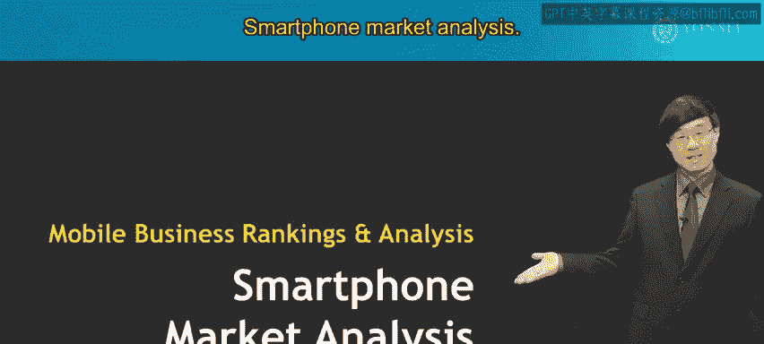
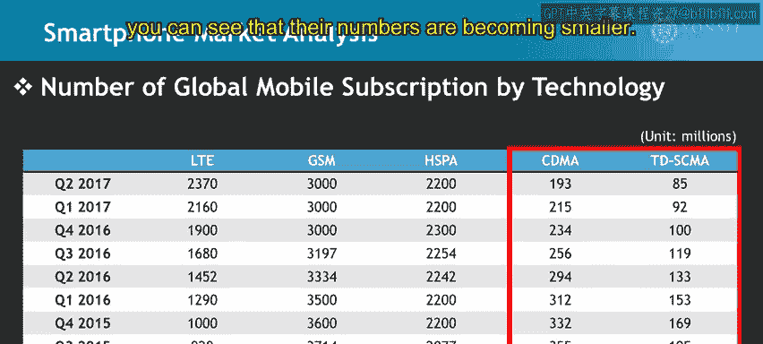
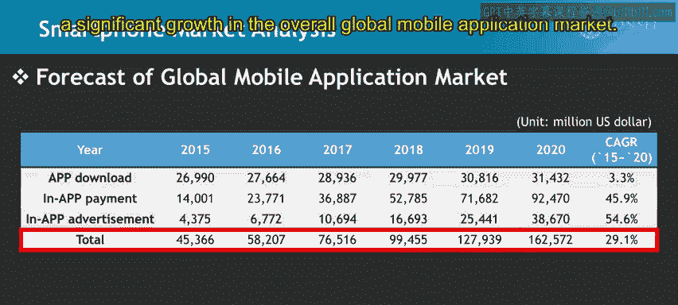
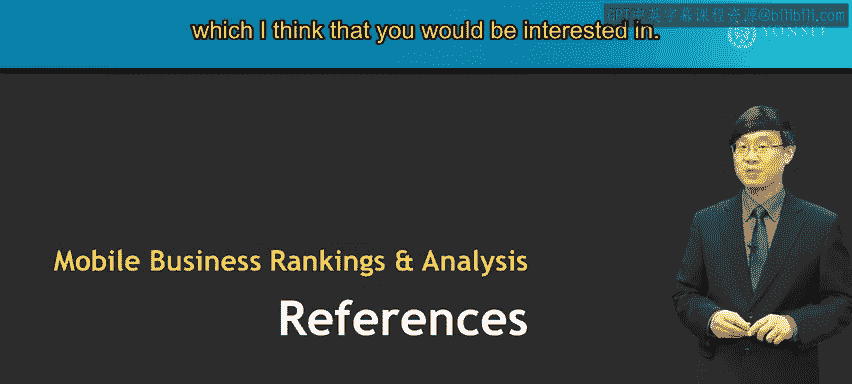
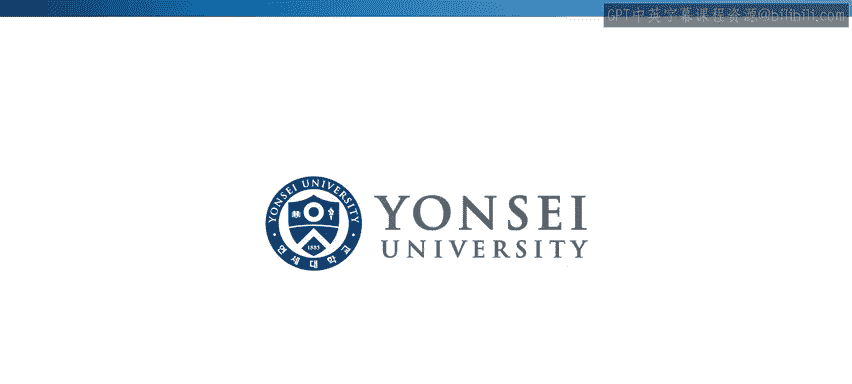

# 延世大学《新兴技术从智能手机到物联网再到大数据Emerging Technologies From Smartphone to IoT to Big Data》 - P38：2_1.2 智能手机市场分析.zh_en - GPT中英字幕课程资源 - BV18hpFewEcG

哦。Smartphone， market analysis。

We will start with the global smartphone market share by country。

I want you to note that this is in units of percentage。

 so if you see a number that is being reduced that may not necessarily mean that the overall market investments and the overall sales that they've accomplished is becoming smaller this could be because some other country has significantly grown and if that's the case you may see an overall percentage reduction。

 although the overall market sales and income and profits may be growing。

 so keep that in mind as you see these percentage numbers change， however。

 on a global basis these percentage numbers do have quite a significant meaning and everybody is sharing a whole big 100% pie so therefore you have crosscorrelation in influencing each other and we'll look into those key facts first we'll start with the United States which is represented in orange in this histogram。

You see that from 2011 to 2013， there is a slight reduction in percentage from 21。3% to 15%。

Then this trend continues on until 2017， where the percentage goes down to 12。1%。

What is triggering this overall percentage reduction？You have to see what's happening in China。

Look at the China increase rate， which is from 18。2% to 32。8%。From 2011 to 2013。

 because the population of China is so large。And this overall performance increase is significant。

 This is what is influencing the overall percentage reduction based on the United States。😊。

So then you see the significant numbers in 2013， and as we go on to 2017。

 you see that these numbers that China has recorded in 2013 are slightly tailing off what is triggering this？

One factor is the significant increase during this period in India。In India。

 you can see in the yellow histogram bar that it goes from 3% to 10。3%。

 which is triggering this reduction overall， but once again。

 keep in mind that we're looking at percentage。Because of this。

 you know that China and India have such a large population。

This is why they're change in the way that they see a need for smartphones。

Can influence the market significantly， and we are expecting to see more changes in the future。

In addition， I want you to notice changes in the UK and Brazil， where you see over there in 2013。

 the UK was larger at 3。9% compared to Brazil at 3。1%， however， once we go into 2017。

 you can see that there was a flipover where the UK market has gone down to 3。1%。

 and Brazil has increased to 4。4%。As you can see， big countries with a lot of people。

 this can change the overall percentage as year goes by and knowing what country and what needs they have。

 what will be a popular device feature， as well as an application structure， application service。

 these are very important in determining what's going to happen in the future in the overall global smartphone market sale。

Going into a closer look at the vendors and how they're doing the top ranked vendors here that you can see is Samsung is at number one for the 2016 and 2017 period。

Apple is number two。Huawee is at number three。And Oppo is at number four。

These four companies combine to an approximate 54% and more。

This is truly significant what these four vendors are doing。

Because the overall others are at around about 45% and more。

 So you can see what the overall big four vendors are doing and how their market share is influencing the overall global market。

😊，Looking into further details about how the quarterly performance over the past two years has been first。

 Samsung has been the number one in performance when it comes down to the first three quarters。

 quarter one， quarter2， quarter 3 of 2016。So you can tell from January all the way to September of 2016。

 Samsung was the number one in overall performance。Then， looking at the market share percentage。

 you can see that Apple leads in the fourth quarter of 2016， where at 18。

3% it is larger than Samsung's 18。1%。But then again， in year 2017。

 the same pattern repeats where in 2017， from quarter1 to quarter3。

 which is from January to September， you can see that Samsung leads off strongly at a 22 percentage above。

But then once we go into quarter four of 2017， Apple exceeds Samsung at 19。2%。

What is triggering this type of a difference Well product release periods， In other words。

 how and when you are releasing your products throughout the year will determine these type of changes and keeping an overall idea of this type of a trend in market share is very important to determine when and how you're going to invest and also this will influence。

 of course， the stock market significantly。Then again。

 we're going to now look into the overall global mobile operating system market share。

And as you can see right here， I want you to take a look over there in 2009。Then in 2009。

 you can see that Sbiian is at number one， then the yellow line at RIM。Like the Blackberry devices。

 that is ranked at number two。 N three over there in 2009 is the red line， which is iOS， Apple。

 which will be the overall iPhone and iPad devices。Using i。

And then you see the orange line over there， which is Microsoft。And then below that is the blue line。

 which is Android。By Google。So that trend will rapidly change between 2009。

 going all the way to 2012， where a significant flipover happens， where you will see Apple。

 iOS has a consistent growth， but then maintains its level very well going on into the future。

Over there you can see that the companies such as with operating systems supporting Sia。

 as well as RIM， Microsoft， tailor off significantly， and now at the point where we go beyond 2011。

 we see that we have two major operating systems that are dominating the smartphone and smartphone device market。

 this is here the Android at number one significantly and then Apple iOS at number two。

These two dominate and the rest have somewhat lost in the competition。Now。

 as new future devices come about for augmented reality and new IoT technology and things like that。

 of course there is always range and a possibility for something to change however。

 currently you see the overall Android and iOS going very strong and this is why in the following modules of this course。

 I will focus on the specifics of the evolution of iOS and Android as well as the Android and iOS architecture。

 of the operating systems。And looking back at this table。

 let's see some of the numbers which are important。 Overall。

 you see that the numbers here for the Android is most significant， exceeding 80%。😊。

Then for overall iOS， you see that it's converging， it had a peak around about 23。8%。

 but then again it is coming down here to the 17 to about 12% range in recent years。So this trend。

 how will this change？We'll have to see in the future。 However。

 we will focus on operating systems based on Android and iOS more than the others。Looking at。

Number of global mobile subscription based on mobile communication technology。

 we will see the data that is listed here for the period of 2015。

 second quarter going up to the second quarter of 2017。We'll start with 4G。

Mobile communication technology， LTE and LTA。 And you can see that there has been a consistent。

 significant growth。On the other hand， when you look at 3G communication。

 the advanced mode of 3G mobile communication， HSPA from the second quarter of 2015 to the second quarter of 2017。

 there has been a growth。 However， in the middle， around about the third and fourth quarter of 2016。

 That was when it peaked the most。 And in 2017， it maintained a steady level。

 still larger than what was in 2015。😊，What is going on Well。

 LTE market has been growing significantly and LT communications is providing broadband data communication。

 however， for ranges where LT communication cannot be provided you will do an automatic fallback onto 3G plus technologies like HSPA This is why HSPA the need for it is still there because mobile communication。

 third generation technologies have good cell coverage and that is why for less populated areas where LT coverage is not a good investment then HSPA and related techniques will support the overall services。

😊，On the other hand， for GSM technology， which is a second generation mobile communication technology。

 mostly focused on voice communication but does support some data communication at low rates。

 you can see that overall it is tailoring off。In addition for CDMA and TD as CMA。

 you can see that their numbers are becoming smaller。

Mobile technologies market share subscriptions worldwide forecasts。

 So now we're going to take a glimpse into the future。

And what is forecast is looking at the histogram here， the blue bars are LTE。

 then you see HSPA in orange， and in gray， you see GSM。

 second generation mobile communication technology， and then overall in yellow， which is just in。

2021 and 2022， you see a little bit of the yellow， which is 5G。

This is because the standards for 5G mobile communication will be completed in 2020。

 so their product sales and how the market will use them is still a little bit hard to estimate because the standards are not completed yet and that is why these numbers here at 0。

1 and 0。4 in 2021 and 2022， these numbers are small and significant changes and there may be a large difference in 5G investments。

 so we'll have to wait and see what really what will happen for 5G telecommunication services。

 but let's focus on what we see right here。First， the blue light。

 LTE is expected to grow consistently in the future。 and as you can see。

 that's what is shown right here。Then HSPA， which is 3G advanced techniques with higher data rates。

 You can see that this is maintaining a very large level of。32% reaching down to 2022。

But on the other hand， the GSM market will be reduced in the future and 5G technology will be growing。

Once again， 5G technology， although shown here very small， based on this reference。

 it could be much more than this based upon how it's accepted and used based on various service modes。

So we'll have to see in the future on exactly what will really happen。 however。

 this is a very good estimation。😊，Then we go on into the overall mobile application market。

 we'll start with app download， which is the first line。

Looking into a little bit of the past and the future， you can see that for app download。

 the CAGR is at 3。3%。This is significant why， because overall the app download market is already very large。

 it is at the range of 26 billion and larger where it goes on to become 31。432 billion in 2020。

 as in terms of forecasting。This is already a large market and mobile apps have been around for quite a while。

 this is why this growth rate， which is at 3。3% seems a little bit small， but in fact。

 it is truly significant。But when it comes to inapp payment。

 this market that was relatively small is going to grow significantly。

 that is why the CGR is at a 45。9%。Looking into inApp advertisement。

 you can see that the CHGR percentage growth is significant at 54。6%。Overall， the total is at 29。1%。

 a significant growth in the overall global mobile application market。

These are the references that I used， and I recommend them to you。 Thank you。

 There's more on smart devices and the overall market share。

 which I think that you would be interested in。 So hang in there and I'll see in the next lecture。

 Thank you。😊。

