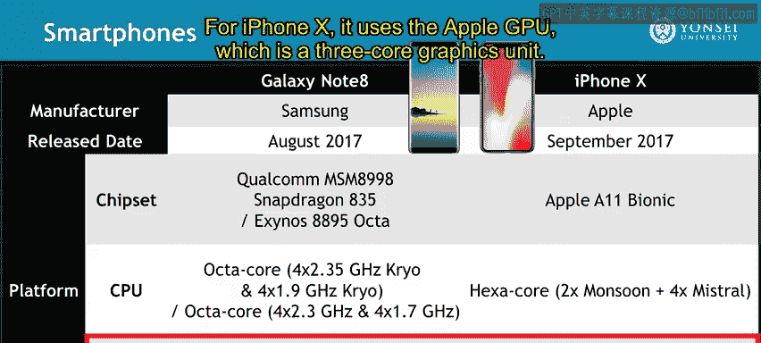
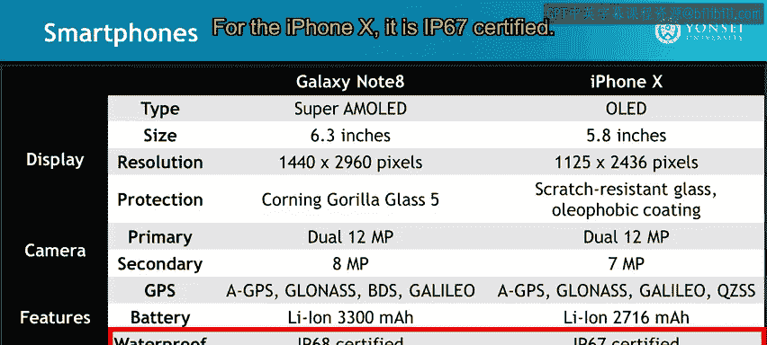
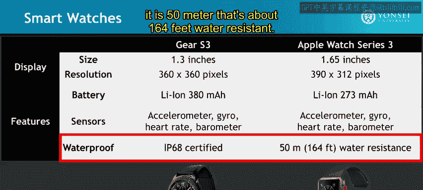
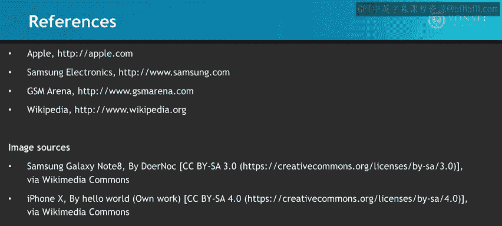

# 延世大学《新兴技术从智能手机到物联网再到大数据Emerging Technologies From Smartphone to IoT to Big Data》 - P39：3_2.1 智能设备规格.zh_en - GPT中英字幕课程资源 - BV18hpFewEcG

Yeah。🎼Yeah。Smart devices in this module， we will focus on smart device specifications first and then go over all the details of smart devices。

 which we will focus on， smartphones and smartwatches。😊。

Beginning with smartphones， we will focus on two device types。 One is the Samsung Galaxy Note 8。

 and the other one is the iPhone X。In these devices。

 we will focus on all the specific modules that are included inside that make them perform so outstandingly。

First， when this was released and their manufacturer， the manufacturer for Galaxy Note 8 is Samsung。

 and it was released on August 2017 for the iPhone X。 the manufacturer is Apple。

 and this was released on September 2017。 So a mere one monthth difference is all that distinguishes these two。

Looking into the platform units that are used in smartphones。

 we will first begin with the most important module， which is the chippsset。

 The chippsset contains the majority of the functions that the smart device has to use。

 In other words， it controls the mobile communication， as well as the wfi。

 Bluetooth networking interfaces。 In addition， it does a majority of the processing that makes that enables the smartphone to operate。

So therefore， the chipets play a significant role of the smartphones。For a Samsung Galaxy Note 8。

 it uses a Quallcomm MSM 89，98， Snapdragon，835 chippset。In addition， there's a Samsung Xos  88。

95 octa chipset that could be used as well for an iPhone X， it uses the Apple A 11 bionic。

I know that you're thinking you need to know much more about these modules。

 and of course in this lecture I will include further details。

The second most important module on a smartphone is the CPU。

 it interfaces with all device components on the smartphone。

 of course it will interface with a chipet to receive operations and ask it to do things and also it will work with the graphics processing unit。

 which is the row below， and it will work together to get all the functionality coordinated for the smartphone itself。

The CPU for Galaxy Note 8 is anoctacore device， this means that it has eight cores。

 it has four cores which run at 2。35 gigahHz cryO， and also it has four cores which run at 1。

9 gigHz cryo。Or you can use anoctaCre which has four 2。3 gigahHtz and also four 1。7 gigahHtz cores。

 either way you have eight coreds that you will be using further details about theoctaorre and the components will be explained pretty soon in following lectures。

For iPhone X， you have Hexa cord that means that it has six cores，2 R monsoon， and 4 R Mistral。

What does this mean， of course， I will explain this later。

The GPU is the next module we need to focus on for Galaxy Note 8。

 it's an adreno 540 or amalli G71 MP20。For iPhone X， it uses the Apple GPU。

 which is a three core graphics unit。

We now look into display， camera， and additional features。

The types of the display are super amalled for Galaxy Note 8， and for iPhone X， it's Oled。

 The meaning of this， of course， I will explain in detail later。The display size is 6。

3 inches for Galaxy Note8 and 5。8 inches for iPhone X。

The resolution for Galaxy Note 8 is 1440 by 2960 pixels for Galaxy Note 8 and 1125 by 2436 pixels for the iPhone X。

Protection wise of the display for Galaxy Note 8， it uses a Coring gorilla G glass5。And for iPhone X。

 it uses scratchch resistance glass， and it has the feature of alaopphobic coating。

What does corning gorilla glass， gorilla glassss mean， Also， what does alaopphobic coating mean。

 Of course， I will talk about the details of this in the following lecture。Then for the camera。

 it has a dual 12 megapixixel for the Galaxy Note8。 and for iPhone X。

 it'll use a dual 12 megapixel as well。 So the primary camera。

 This is a camera on the backside of your smartphone。😊，The one that you use for selfies。

 taking pictures of yourself is a secondary one， and you can see the resolution right here for the Galaxy Note8。

 it's an8 megapixel1 for iPhone X， it's a 7 megapixel1。Additional features include GPS。

 GPS is your positioning system that tells you your longitude and latitude where you are。

 and this is critical because a lot of the applications that are conducted on a smartphone are location based services LBS。

For the Galaxy Note 8， it uses AGPS。Glow us。B，D， S， Callilo， and for iPhone X， it uses A GPSPS， Gs。

 Callaleo and Q Z， S S。What are the details of these， What do these GPS modules mean。

 Of course I will explain this later。Looking into the battery of the two devices。

 the units are both in milli and hour MAH， as listed in your left side bottom corner。

The battery types are both lithium ion and lithium ion batteries with different capacities are used in these smartphones for the Galaxy Note8。

 it's a 3，300 millimre hour one for the iPhone X， it is a 2，716 millimre hour battery。

In addition in the following lectures， I will talk about the details of wireless charging。

 which is a critical feature for smartphones nowadays。

 and therefore I will talk about the standards and what's going on in there。

The next thing of the feature that we need to focus on is waterproof。 Also， really。

 it is dust proof and waterproof。You will see that it has。The identification of IP2 numbers and C。

 What does that mean， I will， of course， explain the details of this very soon。For the Galaxy Note 8。

 it has an IP 68，68 certified for the iPhone X， it is IP 67 certified。

Now let's talk about smartwatches。I'm going to compare the gear S3。

 as well as the Apple Watch series 3。The G S3 is from Samsung and was released over a year ago in August of 2016。

 the Apple Watch series S3 was released in September of 2017。The platform。

 first we look into the operating system， gearar S3 is a Tson based wearable OS， 2。3。2。

 and for the Apple Watch series 3， it's a watch OS 4。0 from Apple。

The chipet for gear 3 is an ExonOS 7270， and for the Apple Watch series 3， it's an Apple S3。

For the CPU for Gar S3， it is a dual corere 1。0 gigahertz module， and for the Apple Watch series 3。

 it is a dual corere CPU as well。Looking into the display and other features。For the gear S3。

 the size of the display is 1。3 inches。 for the Apple Watch series 3， it is 1。65 inches。

The resolution of the display is a 360 by 360 Pixel1 for gear S3， and for the Apple Watch series 3。

 it is a 390 by 312 pixel。For gear S3， the battery is a lithium ion 380 millim hour1。

 and also for the Apple Watch series 3， it is a lithium ion， 273 millim hour battery。In addition。

 I will talk about the wireless charging， which will be a major feature for smartwatches as well。

Additional features include sensors for the gear S3， it includes a accelerometer， as well as Shiro。

 heart rate and barmeter。For the Apple Watch Series3， it includes the same sensor types。

What does this mean， Well， of course， I will talk about the details of these very soon。

 So please hang in there。😊，Then waterproof， like I said before。

 I will talk about the details of IP certified standards very soon。

 but as we go into the details of here for the gear S3。

 it is IP 68 certified for the Apple Watch series 3。

 it is 50 meter that's about 164 feet water resistant。

In the following lectures， I will talk about the details of what you saw in the tables of the specifications for smartphones and smartwatches。

 These are the references that I use， and I recommend them to you。 Thank you。😊。

