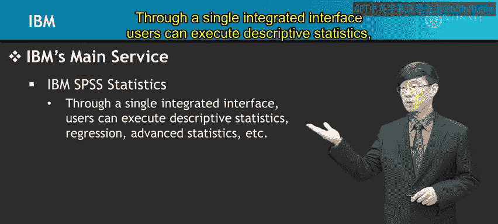
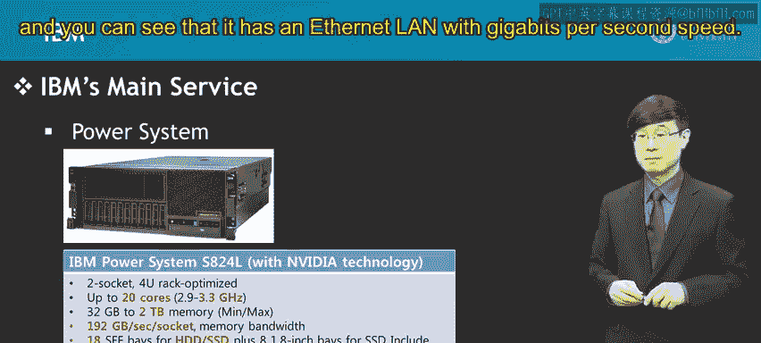
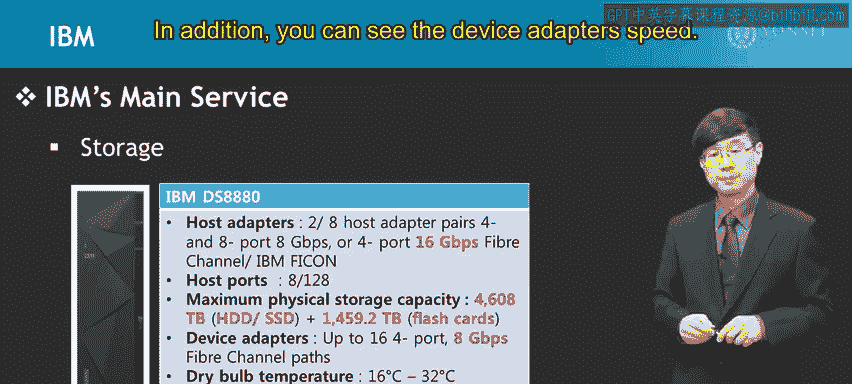
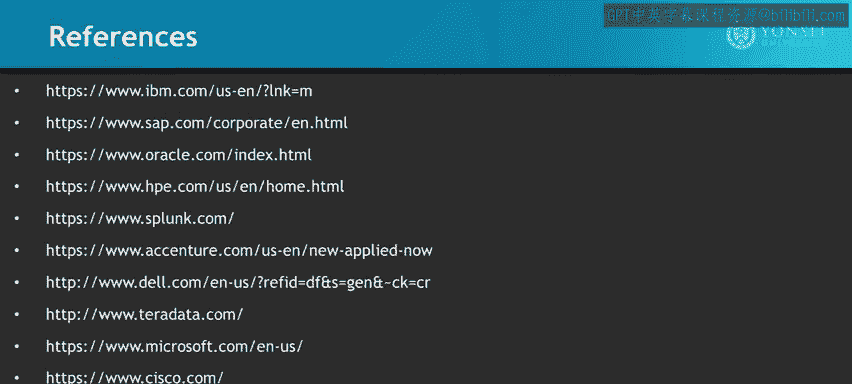

# 延世大学《新兴技术从智能手机到物联网再到大数据Emerging Technologies From Smartphone to IoT to Big Data》 - P3：2_1.2 IBM 1.3 SAP.zh_en - GPT中英字幕课程资源 - BV18hpFewEcG

Yeah。We will now look into some of the leading corporates and their products。

Which we will start with IBM IBM was founded in 1911 in the United States。

 and it has these rankings right here， which you can see that it's number one in big data corporations。

 number four in big data software， number two in big data hardware and it's number one in professional services。

 so IBM is truly a leader in this area。Taking a look into IBM Big Inights。

 you can see their interface， which includes a lot of information。

Which are focused on the keywords such as HDFS， data node。

 name node and yaR What do these mean I will soon explain this in the following lectures very soon。

IBM Big Insights is IBM's enterprise platform that combines Hadoop and Spark。

 which are two open source data technologies that are now driving the world。

It enables fast and accurate big data analysis。And also， solutions are provided for Spark， SQL。

 text analysis， and others。IBM SPSS statisticsistic has a interface like this。

 and we will look into the details of this in a project at the end of this course。

Through a single integrated interface， users can execute descriptive statistics， regression。

 advanced statistics， and other things。

Specialized extensions enable users to enhance the SPPSS syntax with R and Python APIs。For product。

 service， integration， and big data analysis， solutions are provided for SparR， SQL， text analytics。

 and other things。Taking a look into IBM's products， we can first look at IBM power system。Now。

 when you look into the details of these specifications。

 I want you to take a special notice on a couple of numbers， first， for example， like the 20 cores。

 and they run at 3。3 gigahHtz。We will later study about the Spark core and how the threads go into the core to be processed What speed will the core be able to work at。

 This is listed right here， we have 20 cores and they can operate at a maximum speed of 3。

3 gigahHtz so that will be used later on when we study about the further details of the big data processing architectures。

😡，In addition， one terabyte of memory and you see 230 gigabytes per second。

 this is like the data exchange rate within internal modules and you can look at the speed of this and later as I will explain the spark as well as storm will take advantage of these faster transfer rates to overall optimize their processing capability。

Also at the bottom you see 2 x SFF， which stands for small form factor。

 and then you see HD and SSD with two terabytes of storage memory。Now。

 the SFF stands for small form factor， and in a couple of pages later， you will also see LFF。

 which stands for a large form factor。Here the reference is something like this where a small form factor is like a 2。

5"ch disk drive size and also a large form factor is like a 3。

5"ch disk drive size Now I do need to mention that in some other technologies when they use small form factor or large form factor。

 they're actually talking about a different dimensional size， however。

 in reference to hear this about works。😊，In addition， HD stands for a hard disk drive and SSD。

 which is solid state drive， these do not have disks inside。

 however their small form factor will be of course this size if it's indicated as SFF down there and as you can see you get to choose between HD and SSD。

Now， I do need to mention that in later lectures of this course。

 we will talk about their speeds of data transfer and how this affects the overall operation。

 as in terms of Hadjuop Sp and storm。 so keep in mind that you have this option and of course。

 SSD is more expensive than HD drives。 So when you have multiple drives inside your device。

 they will determine the cost of the device， however， because their speeds are different。

 later on you will see that maybe even though they're more expensive。

 you may want to have them in your system。And you will see in the following products that。

Other devices have multiple units of these。Then you will need to determine on your budget。

 as well as performance， what you want to do。 Let's take further look into more devices and products。

For this power system from IBM， you can see that it has 20 cores also and their speed in addition you see that it has 192 gigabytes per second per socket。

 as well as 18 small form factor base for HD or SSD drives and you can see that it has an ethernet land with gigabits per second speed。

In addition， here's another device for storage where it has an overall speed of 16 gigabits per second of transfer rate。

 as well as you have。A large size drives for H TD and SSD。 In addition。

 you can see the device adapter's speed。

Looking into IBM spectrumrum storage suit， you can see the interface here where this provides unlimited access to licensing a family of software that has an easy to use user interface。

 In addition， costs are flat and costs per terabyte are the basis of the pricing。

Which is very easy to understand。 In addition， it has predictable costs for expansion。

 which makes it easier to predict how much more money you need to support a larger system。

Then IBM also has Watson Anatic。Which provides smart data analysis solutions and helps to visualize data analyzed in the cloud。

In addition， it has automated data prep， predictive modeling， and data visualization services。

Searcher for insights， instant answering， as well as no training is needed。

 and anyone can start to use it for free。Now， a lot more on deep learning technologies and machine learning technologies that are used in various systems as well as big data systems。

 well more details can be found in deep learning for Business， which is another one of my courses。

Sap。SAP was founded in 1972 in Germany。And it ranks as number two in big data corporations。

 as well as number one in software。Looking into their software platform， which is S4 Hannah。

This has the largest market share in business application software。For big data services。

 it provides SAP cash apps， fraud management， service， ticketing， and other functions。

Hanna is an advanced relational database management system， where it combines functionality of OLAP。

 which is online analytical processing and OLTP online transaction processing in a single in memoryory database。

It supports immediate， intelligent and integrated enterprise resource planning。

The characteristics of S4 Hannahna include ACID compliant。

 as well as in memoryory database functionality， stores compressed data。

 offers parallel processing across multiprocesor core， and supports SIMD commands。

These are the references that I use， and I recommend them to you。 Thank you。

